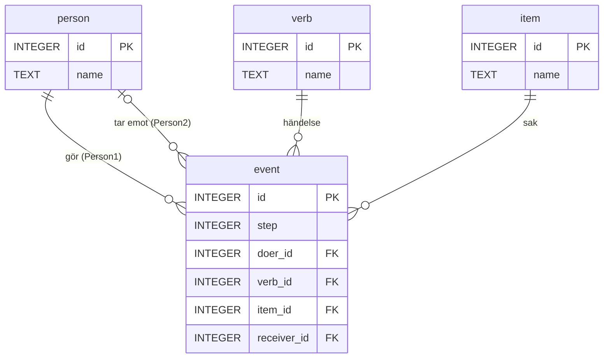

# En liten saga om en databas

🟢

Det här är en liten saga om en databas, öar, broar och en massa personer och saker.

## Sagan

Det var en gång en grupp människor. De hade olika namn, de gjorde olika saker och de tyckte om olika saker. Dessa människor hade helt vanliga namn som Anna, Omar, Camila, Dariush, Shirin, Mateo och Leila.

- En dag hade Anna ett par VR-glasögon. Hon hade precis fått ett nytt par, så hon gav de gamla till Camila.
- Camila tyckte om VR-glasögonen. Hon hade en spännande deckare som hon redan hade läst, så hon gav den till Shirin.
- Shirin hade nyss köpt två biobiljetter. Men hon tyckte att den spännande deckaren verkade roligare, så hon läste den och gav biobiljetterna till Omar.
- Camila testade VR-glasögonen.
- Omar lade undan biobiljetterna i en låda (filmen gick först på fredag).
- Mateo lekte med en liten hamster.
- Dariush sprang i skogen och hittade en gammal karta.
- Anna lämnade över att göra-listan till Dariush.
- Dariush hade inte tid, så Mateo fick ta hand om att göra-listan.
- På fredagen använde Omar biobiljetterna.
- Till sist köpte Anna två biobiljetter till Leila, så att hon också kunde gå på bio.

Det hände alltså en massa saker. Det var flera människor inblandade, och flera saker som användes på ett eller annat sätt.

I själva berättelsen upprepas en hel del information, och det gör att sagan blir lång och samtidigt en smula tråkig. En människa kan förstå texten, men en dator skulle bli förvirrad av händelseförloppet.

## Allt i en tabell

För att göra berättelsen enklare skulle man kunna dela upp den i tre listor, eller kolumner:

| Person | Händelse | Sak |
|---|---|---|
| Anna | ger | ett par VR-glasögon |
| Camila | tycker om | ett par VR-glasögon |
| Camila | ger | en spännande deckare |
| Shirin | köper | två biobiljetter |
| Shirin | läser | en spännande deckare |
| Shirin | ger | två biobiljetter |
| Camila | testar | ett par VR-glasögon |
| Omar | lägger undan | två biobiljetter |
| Mateo | leker med | en liten hamster |
| Dariush | springer i | skogen |
| Dariush | hittar | en gammal karta |
| Anna | lämnar | att göra-listan |
| Mateo | tar hand om | att göra-listan |
| Omar | använder | två biobiljetter |
| Anna | köper | två biobiljetter |

Titta på tabellen en stund. Två saker sticker ut:

- **Samma text upprepas om och om igen.** "Två biobiljetter" står fem gånger. Ska vi ändra det måste vi ändra på fem ställen, och glömmer vi ett blir sagan fel.
- **Vi har tappat information.** Vem fick VR-glasögonen? Det står inte någonstans. Och Leila är helt borta! Tre kolumner räcker inte.

Vi löser båda problemen, ett i taget. Men först måste vi städa.

## Först: städa (sanering)

Tabellen ovan är lite för snäll. I verkligheten har en sådan lista skrivits av olika människor, vid olika tillfällen och med olika fingrar på tangentbordet. Den ser snarare ut så här:

| Person | Händelse | Sak |
|---|---|---|
| Anna | ger | ett par VR-glasögon |
| Camila␣ | tycker om | VR-glasögon |
| Camila | ger | en spännande deckare |
| Shirin | köper | 2 biobiljetter |
| shirin | läser | En spännande deckare |
| Shirin | ger | två biobiljetter␣ |
| camila | testar | ett par vr-glasögon |
| Omar | lägger undan | Två biobiljetter |

(`␣` är ett mellanslag som har smugit sig in på slutet. Det syns inte, men det finns där.)

För oss är det uppenbart att "Camila", "camila" och "Camila␣" är samma person. För databasen är det **tre olika** personer. Ger vi dem varsitt id har vi plötsligt tre Camilor i sagan, och ingen av dem har gjort allt hon har gjort.

Att städa bort sådant innan man bygger vidare kallas **datasanering** (eller datatvätt, på engelska *data cleansing*). Man gör det alltid **före** normaliseringen. Annars bygger man broar till öar som egentligen är samma ö.

### Hitta smutsen

Lägg in den stökiga listan i en tabell:

> 🗄️ **Kör skripten mot SQLite**, t.ex. i DB Browser for SQLite eller på [sqliteonline.com](https://sqliteonline.com/). De är skrivna för SQLite och fungerar inte rakt av i andra databaser. I SQL Server sätter man till exempel ihop text med `+` eller `CONCAT` i stället för `||`, och `LOWER`, `TRIM` och `DROP TABLE IF EXISTS` kan fungera lite annorlunda.

```sql
CREATE TABLE story_raw (
    person TEXT,
    verb   TEXT,
    item   TEXT
);

INSERT INTO story_raw (person, verb, item) VALUES
    ('Anna',    'ger',          'ett par VR-glasögon'),
    ('Camila ', 'tycker om',    'VR-glasögon'),
    ('Camila',  'ger',          'en spännande deckare'),
    ('Shirin',  'köper',        '2 biobiljetter'),
    ('shirin',  'läser',        'En spännande deckare'),
    ('Shirin',  'ger',          'två biobiljetter '),
    ('camila',  'testar',       'ett par vr-glasögon'),
    ('Omar',    'lägger undan', 'Två biobiljetter');
```

`DISTINCT` är ditt förstoringsglas. Det visar varje variant exakt en gång:

```sql
SELECT DISTINCT person FROM story_raw ORDER BY person;
```

Sju "olika" personer: `Anna`, `Camila`, `Camila␣`, `Omar`, `Shirin`, `camila` och `shirin`. Men det är bara fyra människor.

```sql
SELECT DISTINCT item FROM story_raw ORDER BY item;
```

Åtta "olika" saker. Men det är bara tre.

### Städa bort den

Ta bort mellanslag i början och slutet med `TRIM`:

```sql
UPDATE story_raw SET person = TRIM(person), item = TRIM(item);
```

Bestäm sedan **en** stavning för varje sak, och skriv om alla varianter till den. `LOWER` gör om till gemener, så att du kan jämföra utan att bry dig om stora och små bokstäver:

```sql
UPDATE story_raw SET person = 'Camila' WHERE LOWER(person) = 'camila';
UPDATE story_raw SET person = 'Shirin' WHERE LOWER(person) = 'shirin';

UPDATE story_raw
SET item = 'ett par VR-glasögon'
WHERE LOWER(item) IN ('vr-glasögon', 'ett par vr-glasögon');

UPDATE story_raw
SET item = 'två biobiljetter'
WHERE LOWER(item) IN ('2 biobiljetter', 'två biobiljetter');

UPDATE story_raw
SET item = 'en spännande deckare'
WHERE LOWER(item) = 'en spännande deckare';
```

Kör `SELECT DISTINCT` igen. Nu är det fyra personer och tre saker, precis som det ska vara.

Först nu kan vi låta databasen bygga ön åt oss. Varje unik sak blir en rad med ett eget id:

```sql
CREATE TABLE item (
    id   INTEGER PRIMARY KEY,
    name TEXT NOT NULL
);

INSERT INTO item (name)
SELECT DISTINCT item FROM story_raw ORDER BY item;
```

> 💡 **Se upp med å, ä och ö.** SQLites `LOWER` och `UPPER` hanterar bara a–z. `LOWER('ÅÄÖ')` blir fortfarande `'ÅÄÖ'`. Här gick det bra, eftersom inga stora Å, Ä eller Ö fanns med, men med svensk text är det värt att kontrollera resultatet med `DISTINCT` en extra gång.

Sanering är sällan roligt, men det är ofta det som tar längst tid i riktiga projekt. Det säger sig självt: skräp in, skräp ut.

## Varje sak på sin egen ö

För att databasen ska kunna förstå informationen skriver vi in den som data. Snyggt uppdelat i tabeller, där varje rad får ett nummer som börjar på 1 och räknar uppåt. Numret kallas för ett **id**.

**Personer**

| id | Namn |
|---|---|
| 1 | Anna |
| 2 | Omar |
| 3 | Camila |
| 4 | Dariush |
| 5 | Shirin |
| 6 | Mateo |
| 7 | Leila |

**Händelser**

| id | Händelse |
|---|---|
| 1 | ger |
| 2 | tycker om |
| 3 | köper |
| 4 | läser |
| 5 | testar |
| 6 | lägger undan |
| 7 | leker med |
| 8 | springer i |
| 9 | hittar |
| 10 | lämnar |
| 11 | tar hand om |
| 12 | använder |

**Saker**

| id | Sak |
|---|---|
| 1 | ett par VR-glasögon |
| 2 | en spännande deckare |
| 3 | två biobiljetter |
| 4 | en liten hamster |
| 5 | skogen |
| 6 | en gammal karta |
| 7 | att göra-listan |

Nu har vi tre tabeller. Varje tabell har ett id, och det id:t är unikt för varje rad i tabellen. Camila har nummer 3, och det innebär att ingen annan person har samma id. Ungefär som ett personnummer, fast här är det en mindre siffra.

Varje händelse har sitt eget id, och likaså varje sak. Även om Camila och biobiljetterna båda har id 3 har de egentligen ingen koppling alls.

Man kan poetiskt uttrycka det som att varje tabell är **en ö i databasens hav**. För att kunna föra över information mellan tabellerna måste vi skapa en **relation** (koppling, samband). Det innebär med andra ord att om öarna ska mötas måste vi **bygga broar**.

## De fyra frågorna

Om vi nu tittar på första meningen i sagan:

> "En dag hade Anna ett par VR-glasögon. Hon hade precis fått ett nytt par, så hon gav de gamla till Camila."

Vi kan undersöka meningen genom att ställa följande frågor:

1. Vem gör något?
2. Vad är det som görs?
3. Vad är det som används?
4. Mot eller med vem görs detta?

Vi läser meningen igen och hittar svaren:

1. Anna
2. ger
3. ett par VR-glasögon
4. Camila

Nu har vi all information vi behöver för att förse databasen med händelsen. Frågan är var vi ska fylla i den, och hur vi ska lagra den så att kommande generationer inte går miste om det spännande händelseförloppet i sagan.

## Kartan över broarna

Vi får helt enkelt skapa en ny tabell som håller reda på hur informationen i databasen hänger ihop. En slags **karta över hur broarna dras mellan öarna**.

Tabellen innehåller bara hänvisningar till id i de andra tabellerna. Den sortens tabell kallas ibland **kopplingstabell** (eller sambandstabell). Vår karta kopplar ihop fyra broar på en gång, så vi kallar den helt enkelt för **händelsetabellen**.

Det är en karta med streck och pilar som egentligen inte säger något om man inte vet vilka tabeller som beskrivs.

Den här tabellen bygger vi upp precis som frågorna vi ställde innan:

| Person1 | Händelse | Sak | Person2 |
|---|---|---|---|
| | | | |

Vi säger som så att **Person1** är den som gör något, **Händelse** beskriver vad som görs, **Sak** är själva saken som används och **Person2** är mottagaren.

Hur beskriver vi första meningen för databasen då? Informationen vi har är "Anna, ger, ett par VR-glasögon, Camila". Men för att slippa skriva det om och om igen använder vi id-siffrorna i stället. Om vi tar en titt på tabellerna vi skapade först ser vi att:

- Anna = person med id 1
- ger = händelse med id 1
- ett par VR-glasögon = sak med id 1
- Camila = person med id 3

För databasen ser det ut så här: **1, 1, 1, 3**

Om vi nu skulle ändra historien så att Dariush lämnar två biobiljetter till Mateo får vi följande värden:

- Dariush = person med id 4
- lämnar = händelse med id 10
- två biobiljetter = sak med id 3
- Mateo = person med id 6

För databasen ser det ut så här: **4, 10, 3, 6**

För oss ser det helt obeskrivligt dumt ut att skriva berättelsen i form av 1, 1, 1, 3, men för databasen är saken väldigt klar. Det är det för oss också, om vi tittar på tabellerna.

## Kartan behöver också ett id

Vi går nu tillbaka till vår karta över broarna. Den saknar en sak som de andra tabellerna har, och det är ett id.

Tänk om man vill prata om den tredje händelsen. Hur ska man veta vilken rad det är? Det kan vi inte. Alltså måste vi ha ett id.

Och när vi ändå håller på: ett id talar om *vilken* rad det är, men inte *när* något hände. En tabell har nämligen ingen ordning i sig. Raderna kan komma ut i vilken ordning som helst. Därför lägger vi till en kolumn **Ordning** som talar om i vilken ordning sagan ska berättas.

| id | Ordning | Person1 | Händelse | Sak | Person2 |
|---|---|---|---|---|---|
| | | | | | |

Självklart skulle vi kunna lägga in datum och tid för händelserna i stället, lägga till efternamn på personerna eller skriva mer utförliga beskrivningar av sakerna. Men i det här fallet bryr vi oss inte om detaljer.

## Index och broar som står still

Som jag sa innan är kartan helt betydelselös om man inte vet hur den är kopplad och vad den är kopplad till. Siffrorna 1, 1, 1, 3 har absolut ingen betydelse om man inte vet varför de är där och vad de betyder. Vi behöver alltså **nycklar** och **relationer**.

Det fungerar ungefär som när man ska beskriva en bil. För mig, som är helt ointresserad av bilar, är bilen som körde förbi bara en röd liten sak. En bilintresserad vet direkt att det är en Ford och vilken årsmodell den är. Den som är riktigt snabb på ögat ser registreringsnumret.

Man kan sammanfatta situationen så här:

- **Jag** har en beskrivning av bilen (röd, liten). Den passar på tusentals bilar.
- **Den bilintresserade** har en mycket bättre beskrivning (Ford, årsmodell). Men det finns fortfarande hundratals röda Ford från samma år.
- **Den snabbögde** har **id:t**: registreringsnumret. Det finns bara en bil med det numret.

Det skulle ta mig flera år att hitta rätt bil. Den bilintresserade skulle hitta den på kortare tid. Den snabbögde hittar bilen på ett par sekunder, genom att slå upp numret i bilregistret.

Bilregistret är ett **index**. Det är en sorterad lista där man snabbt hittar ett nummer och ser var resten av informationen finns. När vi säger att id är tabellens **primärnyckel** skapar databasen ett sådant index automatiskt, och därför går det så snabbt att slå upp en rad på dess id.

Broarna mellan öarna kallas **främmande nycklar**. De utgår från att bron alltid står på samma plats, från samma ö till samma granne. Person1 pekar alltid på persontabellen och aldrig på saktabellen.

**Den förklarade kartan**

| id | Ordning | Person1 | Händelse | Sak | Person2 |
|---|---|---|---|---|---|
| radens eget id | i vilken ordning det hände | bro till **Personer** | bro till **Händelser** | bro till **Saker** | bro till **Personer** |

Först nu blir kartan läsbar, när vi kan se var informationen hämtas ifrån.

Så här ser öarna och broarna ut tillsammans:



## Hela sagan som siffror

Nu fyller vi i hela sagan. Jag skriver orden inom parentes, men när informationen matas in i databasen sker det enbart med siffror.

**Den ifyllda kartan**

| id | Ordning | Person1 | Händelse | Sak | Person2 |
|---|---|---|---|---|---|
| 1 | 1 | 1 (Anna) | 1 (ger) | 1 (VR-glasögon) | 3 (Camila) |
| 2 | 2 | 3 (Camila) | 2 (tycker om) | 1 (VR-glasögon) | |
| 3 | 3 | 3 (Camila) | 1 (ger) | 2 (deckare) | 5 (Shirin) |
| 4 | 4 | 5 (Shirin) | 3 (köper) | 3 (biobiljetter) | |
| 5 | 5 | 5 (Shirin) | 4 (läser) | 2 (deckare) | |
| 6 | 6 | 5 (Shirin) | 1 (ger) | 3 (biobiljetter) | 2 (Omar) |
| 7 | 7 | 3 (Camila) | 5 (testar) | 1 (VR-glasögon) | |
| 8 | 8 | 2 (Omar) | 6 (lägger undan) | 3 (biobiljetter) | |
| 9 | 9 | 6 (Mateo) | 7 (leker med) | 4 (hamster) | |
| 10 | 10 | 4 (Dariush) | 8 (springer i) | 5 (skogen) | |
| 11 | 11 | 4 (Dariush) | 9 (hittar) | 6 (karta) | |
| 12 | 12 | 1 (Anna) | 10 (lämnar) | 7 (att göra-listan) | 4 (Dariush) |
| 13 | 13 | 6 (Mateo) | 11 (tar hand om) | 7 (att göra-listan) | |
| 14 | 14 | 2 (Omar) | 12 (använder) | 3 (biobiljetter) | |
| 15 | 15 | 1 (Anna) | 3 (köper) | 3 (biobiljetter) | 7 (Leila) |

I databasens ögon blir det så här:

| id | Ordning | Person1 | Händelse | Sak | Person2 |
|---|---|---|---|---|---|
| 1 | 1 | 1 | 1 | 1 | 3 |
| 2 | 2 | 3 | 2 | 1 | NULL |
| 3 | 3 | 3 | 1 | 2 | 5 |
| 4 | 4 | 5 | 3 | 3 | NULL |
| 5 | 5 | 5 | 4 | 2 | NULL |
| 6 | 6 | 5 | 1 | 3 | 2 |
| 7 | 7 | 3 | 5 | 1 | NULL |
| 8 | 8 | 2 | 6 | 3 | NULL |
| 9 | 9 | 6 | 7 | 4 | NULL |
| 10 | 10 | 4 | 8 | 5 | NULL |
| 11 | 11 | 4 | 9 | 6 | NULL |
| 12 | 12 | 1 | 10 | 7 | 4 |
| 13 | 13 | 6 | 11 | 7 | NULL |
| 14 | 14 | 2 | 12 | 3 | NULL |
| 15 | 15 | 1 | 3 | 3 | 7 |

Titta på den sista raden. Anna köper biobiljetter till Leila: **1, 3, 3, 7**. Den som har hängt med i nördkulturen läser det som *leet*. Sagan slutar alltså med att databasen blir lite elit. 😎

Ser du de tomma rutorna? När Camila tycker om VR-glasögonen finns det ingen mottagare. Den rutan är inte tom av slarv. Den betyder *ingen*, och i en databas skrivs det **`NULL`**.

Genom att ge varje person, händelse och sak ett nummer slipper vi skriva om informationen. Samtidigt kan vi lägga den i databasen på ett trevligt sätt som inte alls tar upp mycket plats.

Nu har vi tabeller där namn, händelser och saker beskrivs i textform, och en tabell som nästan bara innehåller siffror. Det gör att det blir enklare och snabbare att söka i tabellerna.

## Prova själv: bygg databasen

Nu bygger vi databasen på riktigt. Skapa en **ny** SQLite-databas i DB Browser for SQLite, eller på [sqliteonline.com](https://sqliteonline.com/), och kör skriptet under fliken *Execute SQL*. Precis som i saneringen är skripten skrivna för SQLite.

Tabellerna och kolumnerna får engelska namn, så som man brukar skriva kod:

| I sagan | I databasen |
|---|---|
| Personer | `person` |
| Händelser | `verb` |
| Saker | `item` |
| Kartan (händelsetabellen) | `event` |
| Ordning | `step` |
| Person1 | `doer_id` |
| Händelse | `verb_id` |
| Sak | `item_id` |
| Person2 | `receiver_id` |

```sql
DROP TABLE IF EXISTS event;
DROP TABLE IF EXISTS person;
DROP TABLE IF EXISTS verb;
DROP TABLE IF EXISTS item;

CREATE TABLE person (
    id   INTEGER PRIMARY KEY,
    name TEXT NOT NULL
);

CREATE TABLE verb (
    id   INTEGER PRIMARY KEY,
    name TEXT NOT NULL
);

CREATE TABLE item (
    id   INTEGER PRIMARY KEY,
    name TEXT NOT NULL
);

CREATE TABLE event (
    id          INTEGER PRIMARY KEY,
    step        INTEGER NOT NULL,
    doer_id     INTEGER NOT NULL REFERENCES person(id),
    verb_id     INTEGER NOT NULL REFERENCES verb(id),
    item_id     INTEGER NOT NULL REFERENCES item(id),
    receiver_id INTEGER REFERENCES person(id)
);

INSERT INTO person (id, name) VALUES
    (1, 'Anna'), (2, 'Omar'), (3, 'Camila'), (4, 'Dariush'),
    (5, 'Shirin'), (6, 'Mateo'), (7, 'Leila');

INSERT INTO verb (id, name) VALUES
    ( 1, 'ger'), ( 2, 'tycker om'), ( 3, 'köper'), ( 4, 'läser'),
    ( 5, 'testar'), ( 6, 'lägger undan'), ( 7, 'leker med'), ( 8, 'springer i'),
    ( 9, 'hittar'), (10, 'lämnar'), (11, 'tar hand om'), (12, 'använder');

INSERT INTO item (id, name) VALUES
    (1, 'ett par VR-glasögon'), (2, 'en spännande deckare'),
    (3, 'två biobiljetter'), (4, 'en liten hamster'),
    (5, 'skogen'), (6, 'en gammal karta'), (7, 'att göra-listan');

INSERT INTO event (step, doer_id, verb_id, item_id, receiver_id) VALUES
    ( 1, 1,  1, 1, 3),
    ( 2, 3,  2, 1, NULL),
    ( 3, 3,  1, 2, 5),
    ( 4, 5,  3, 3, NULL),
    ( 5, 5,  4, 2, NULL),
    ( 6, 5,  1, 3, 2),
    ( 7, 3,  5, 1, NULL),
    ( 8, 2,  6, 3, NULL),
    ( 9, 6,  7, 4, NULL),
    (10, 4,  8, 5, NULL),
    (11, 4,  9, 6, NULL),
    (12, 1, 10, 7, 4),
    (13, 6, 11, 7, NULL),
    (14, 2, 12, 3, NULL),
    (15, 1,  3, 3, 7);
```

Lägg märke till att `receiver_id` är den enda kolumnen i `event` som får vara `NULL`. Alla andra måste ha ett värde. En händelse utan någon som gör något är ingen händelse.

## Vilken saga får vi ut?

Nu kommer det roliga. Vi ber databasen gå över alla broar och berätta sagan för oss igen:

```sql
SELECT e.step,
       d.name || ' ' || v.name || ' ' || i.name
              || COALESCE(' till ' || r.name, '') || '.' AS sentence
FROM event AS e
JOIN person AS d    ON e.doer_id = d.id
JOIN verb   AS v    ON e.verb_id = v.id
JOIN item   AS i    ON e.item_id = i.id
LEFT JOIN person AS r ON e.receiver_id = r.id
ORDER BY e.step;
```

| step | sentence |
|---|---|
| 1 | Anna ger ett par VR-glasögon till Camila. |
| 2 | Camila tycker om ett par VR-glasögon. |
| 3 | Camila ger en spännande deckare till Shirin. |
| 4 | Shirin köper två biobiljetter. |
| 5 | Shirin läser en spännande deckare. |
| 6 | Shirin ger två biobiljetter till Omar. |
| 7 | Camila testar ett par VR-glasögon. |
| 8 | Omar lägger undan två biobiljetter. |
| 9 | Mateo leker med en liten hamster. |
| 10 | Dariush springer i skogen. |
| 11 | Dariush hittar en gammal karta. |
| 12 | Anna lämnar att göra-listan till Dariush. |
| 13 | Mateo tar hand om att göra-listan. |
| 14 | Omar använder två biobiljetter. |
| 15 | Anna köper två biobiljetter till Leila. |

Där är sagan igen, berättad av en databas som bara har sparat siffror.

Låt oss titta på hur det gick till.

### Fyra broar, fem tabeller

Varje `JOIN` går över en bro. `event` står i mitten, och från den går vi ut till `person`, `verb`, `item` och tillbaka till `person`.

### Samma ö två gånger

`person` finns med **två** gånger: en gång som den som gör något (`d`, *doer*) och en gång som mottagaren (`r`, *receiver*). Det fungerar bara för att vi ger dem olika smeknamn, alltså **alias**. Utan alias skulle databasen inte veta vilket `name` vi menar.

### Varför LEFT JOIN på mottagaren?

Prova att byta `LEFT JOIN` mot en vanlig `JOIN`. Då blir det bara **fem** rader kvar: de händelser där någon tar emot något.

En vanlig `JOIN` tar bara med rader som har en match på **båda** sidor om bron. Händelser med `NULL` som mottagare har ingen bro att gå över, och då försvinner de tyst. `LEFT JOIN` behåller dem ändå. Mer om det på sidan [JOIN](sql/join.md).

### Varför COALESCE?

`||` sätter ihop text. Men allt som sätts ihop med `NULL` blir `NULL`, så `' till ' || NULL` blir `NULL`.

Utan `COALESCE` hade **hela meningen** försvunnit för varje händelse utan mottagare. `COALESCE(x, '')` betyder "använd `x`, men om det är `NULL`, använd en tom text i stället". Mer om `COALESCE` på sidan [COALESCE](sql/coalesce.md).

I SQL Server skriver du `+` i stället för `||`, eller använder `CONCAT(...)`, som behandlar `NULL` som tom text.

## Byt på ett ställe, ändra överallt

Kommer du ihåg den första tabellen, där "två biobiljetter" stod fem gånger? Säg att det egentligen var konsertbiljetter. Nu räcker det med **en** ändring:

```sql
UPDATE item
SET name = 'två konsertbiljetter'
WHERE id = 3;
```

Kör sagan igen. Alla fem meningarna har ändrats, eftersom de alla går över samma bro till samma ö.

Det är hela magin med databaser. Man skapar listor med information och kopplar sedan ihop dem med andra tabeller genom hänvisningar till id.

Självklart hade vi kunnat skapa en tabell med en rad text i varje datarad. Men då upprepas texten, och man måste ändra i texten för att ändra i sagan.

## Det här kallas normalisering

Det vi har gjort har ett namn: **normalisering**. Man delar upp informationen så att varje sak bara står på **ett** ställe, och kopplar ihop delarna med nycklar.

Sanering och normalisering hör ihop, men de är inte samma sak:

| | Sanering | Normalisering |
|---|---|---|
| Frågan | Är datan **rätt skriven**? | Står datan på **rätt ställe**? |
| Problemet | "Camila", "camila" och "Camila␣" | "två biobiljetter" står på fem rader |
| Verktyg | `TRIM`, `LOWER`, `UPDATE` och `DISTINCT` för att hitta | Dela upp i tabeller och koppla ihop med nycklar |
| När | Först | Sedan |

### Tre problem som normalisering löser

Tänk tillbaka på den första stora tabellen, med allt på samma rad. Den hade tre problem, och de har till och med egna namn:

- **Ändringsproblemet.** Vill vi byta biobiljetterna mot konsertbiljetter måste vi ändra på fem rader. Missar vi en säger sagan två olika saker samtidigt.
- **Tilläggsproblemet.** Leila fanns inte med i tabellen. Hon kunde inte finnas med förrän hon var med i en händelse, eftersom en person bara fanns som en del av en rad.
- **Borttagningsproblemet.** Om vi tar bort raden där Mateo leker med hamstern försvinner hamstern ur hela databasen. Den fanns bara där.

Med en ö för varje sak försvinner alla tre. Biobiljetterna ändras på ett ställe. Leila finns i `person` även om hon inte gör något. Hamstern finns kvar i `item` även om ingen leker med den längre.

### Normalformerna, i sagoversion

Det finns regler för hur långt man har normaliserat, och de kallas **normalformer**. De tre första räcker långt:

**Första normalformen (1NF): ett värde per ruta.**
Ingen ruta får innehålla en lista. "Camila, Shirin" i en enda ruta för mottagare bryter mot regeln. Behöver en händelse två mottagare blir det två rader, eller en egen tabell för mottagare. Varje rad ska också gå att peka ut, och det är därför kartan fick ett id.

**Andra normalformen (2NF): allt ska bero på hela nyckeln.**
Det här blir bara aktuellt när nyckeln består av flera kolumner. Säg att vi hade en tabell med nyckeln (händelse, sak) och en kolumn med sakens namn. Namnet beror bara på *saken*, inte på händelsen, alltså bara på halva nyckeln. Då ska namnet flytta till saktabellen, och där bor det redan hos oss.

**Tredje normalformen (3NF): inget får bero på något annat än nyckeln.**
Säg att kartan hade en kolumn `doer_name` bredvid `doer_id`. Namnet beror på *vem* personen är, inte på händelsen. Det hör hemma i `person`. Allt i en rad ska handla om just den raden, och om inget annat.

Det finns en klassisk ramsa för att komma ihåg de tre:

> Varje kolumn ska bero på **nyckeln**, **hela nyckeln** och **ingenting annat än nyckeln**.

### Hur långt ska man gå?

Om sagan hade handlat om folk som säljer saker på Blocket hade tabellerna ändå varit ganska lika de vi har nu. Händelsetabellen hade sett annorlunda ut, men resten hade varit nästan likadant.

Ibland väljer man att *inte* normalisera fullt ut, t.ex. för att en rapport ska gå snabbare att läsa ut. Det kallas **denormalisering**, och det är ett medvetet val, inte ett misstag. Men man börjar alltid normaliserat och går ifrån det när man har ett skäl.

Det finns olika sätt att dela upp informationen på, och så länge man inte upprepar för mycket data är alla sätt bra (utom de dåliga).

## Vanliga misstag

| Misstag | Vad händer? | Gör så här i stället |
|---|---|---|
| Normalisera innan man har sanerat | "Camila" och "camila" blir två personer med varsitt id | Städa först, med `TRIM`, `LOWER` och `DISTINCT` |
| `LOWER` på svensk text i SQLite | Å, Ä och Ö ändras inte | Kontrollera med `DISTINCT` efteråt |
| Samma text på många rader | Ändras den på ett ställe men inte ett annat blir datan motsägelsefull | Lägg texten i en egen tabell och peka på den med id |
| Tro att id berättar *när* något hände | Raderna kan komma ut i vilken ordning som helst | En egen kolumn för ordning eller tid, och `ORDER BY` |
| `JOIN` mot en kolumn som kan vara `NULL` | Raderna utan värde försvinner | `LEFT JOIN` |
| Sätta ihop text med något som kan vara `NULL` | Hela resultatet blir `NULL` | `COALESCE(kolumn, '')` |
| Samma tabell två gånger utan alias | Databasen vet inte vilken du menar | Olika alias, t.ex. `d` och `r` |

## Sammanfattning

- **Sanering** kommer först: samma sak ska skrivas på samma sätt, utan dolda mellanslag eller olika stavningar.
- En berättelse kan delas upp i **saker** (personer, händelser, saker) och **det som händer** mellan dem.
- Varje sak får en egen tabell, en **ö**, och ett unikt **id**.
- En händelsetabell är en **karta över broarna**. Den innehåller bara id som pekar på de andra tabellerna.
- **Primärnyckeln** är radens id. Databasen skapar automatiskt ett **index** för den, ungefär som ett bilregister.
- **Främmande nycklar** är broarna. De pekar alltid till samma ö.
- En tom ruta, alltså ingen mottagare, är **`NULL`**.
- Att dela upp data så att varje sak bara står på ett ställe kallas **normalisering**. Den löser ändrings-, tilläggs- och borttagningsproblemen.
- Normalformerna i en mening: varje kolumn ska bero på **nyckeln, hela nyckeln och ingenting annat än nyckeln**.

## Övningar

Kör skriptet ovan innan du börjar.

### 🟢 Övning 1: En ny händelse

Lägg till en sextonde händelse i sagan: Dariush ger den gamla kartan till Camila. Vilka fyra siffror blir det? Kör sagan igen och kontrollera att meningen kommer sist.

<details>
<summary>💡 Klicka här för ett lösningsförslag</summary>

Din lösning kan se annorlunda ut och ändå vara helt korrekt!

Dariush har id 4, *ger* har id 1, *en gammal karta* har id 6 och Camila har id 3:

```sql
INSERT INTO event (step, doer_id, verb_id, item_id, receiver_id)
VALUES (16, 4, 1, 6, 3);
```

För databasen är det **4, 1, 6, 3**. Sagan avslutas nu med "Dariush ger en gammal karta till Camila."

</details>

### 🟢 Övning 2: Vad gör Omar?

Visa allt Omar gör i sagan, i ordning. Visa ordningen, händelsen och saken.

<details>
<summary>💡 Klicka här för ett lösningsförslag</summary>

Din lösning kan se annorlunda ut och ändå vara helt korrekt!

```sql
SELECT e.step, v.name, i.name
FROM event AS e
JOIN person AS d ON e.doer_id = d.id
JOIN verb   AS v ON e.verb_id = v.id
JOIN item   AS i ON e.item_id = i.id
WHERE d.name = 'Omar'
ORDER BY e.step;
```

| step | name | name |
|---|---|---|
| 8 | lägger undan | två biobiljetter |
| 14 | använder | två biobiljetter |

Omar sparade biobiljetterna och gick på bio på fredagen.

</details>

### 🟡 Övning 3: Vem gör mest?

Hur många händelser gör varje person? Sortera så att den som gör mest kommer först.

<details>
<summary>💡 Klicka här för ett lösningsförslag</summary>

Din lösning kan se annorlunda ut och ändå vara helt korrekt!

```sql
SELECT p.name, COUNT(*) AS antal
FROM event AS e
JOIN person AS p ON e.doer_id = p.id
GROUP BY p.name
ORDER BY antal DESC, p.name;
```

| name | antal |
|---|---|
| Anna | 3 |
| Camila | 3 |
| Shirin | 3 |
| Dariush | 2 |
| Mateo | 2 |
| Omar | 2 |

Saknar du någon? Leila gör ingenting själv i sagan, hon får bara biobiljetter. Hon har ingen rad i `event` som `doer_id`, så den vanliga `JOIN` tar inte med henne. Vill du se henne med `0` behöver du utgå från `person` och använda `LEFT JOIN` och `COUNT(e.id)`.

</details>

### 🟡 Övning 4: Alla gåvor

Visa alla händelser där något lämnas över till någon annan: vem som ger, vad och till vem.

*Tips: här vill du faktiskt att händelserna utan mottagare ska försvinna.*

<details>
<summary>💡 Klicka här för ett lösningsförslag</summary>

Din lösning kan se annorlunda ut och ändå vara helt korrekt!

```sql
SELECT e.step, d.name AS fran, i.name AS sak, r.name AS till
FROM event AS e
JOIN person AS d ON e.doer_id = d.id
JOIN item   AS i ON e.item_id = i.id
JOIN person AS r ON e.receiver_id = r.id
ORDER BY e.step;
```

| step | fran | sak | till |
|---|---|---|---|
| 1 | Anna | ett par VR-glasögon | Camila |
| 3 | Camila | en spännande deckare | Shirin |
| 6 | Shirin | två biobiljetter | Omar |
| 12 | Anna | att göra-listan | Dariush |
| 15 | Anna | två biobiljetter | Leila |

En vanlig `JOIN` mot mottagaren gör jobbet åt dig. Händelserna med `NULL` har ingen bro att gå över, så de försvinner. Samma sak som var ett problem när vi berättade sagan är precis vad vi vill ha här.

</details>

### 🔴 Övning 5: Konsertbiljetter

Ändra biobiljetterna till "två konsertbiljetter" med **en enda** `UPDATE`. Hur många meningar i sagan ändras? Varför behövde du bara ändra på ett ställe?

<details>
<summary>💡 Klicka här för ett lösningsförslag</summary>

Din lösning kan se annorlunda ut och ändå vara helt korrekt!

```sql
UPDATE item
SET name = 'två konsertbiljetter'
WHERE id = 3;
```

Fem meningar ändras (ordning 4, 6, 8, 14 och 15). Texten står bara på **ett** ställe, i `item`. Alla händelser pekar dit med `item_id = 3`, så alla får det nya namnet.

Hade sagan legat som text i en enda tabell hade du behövt hitta och ändra fem rader, och hoppas att du inte missade någon.

</details>

### 🔴 Övning 6: Vem fick aldrig något?

Vilka personer har aldrig tagit emot något i sagan? Någon skriver:

```sql
SELECT name
FROM person
WHERE id NOT IN (SELECT receiver_id FROM event);
```

Frågan ger **inga** rader alls. Varför? Skriv om den så att den fungerar.

<details>
<summary>💡 Klicka här för ett lösningsförslag</summary>

Din lösning kan se annorlunda ut och ändå vara helt korrekt!

Listan från den inre frågan innehåller `NULL`, eftersom de flesta händelser saknar mottagare. Är Anna "inte i" en lista som innehåller ett okänt värde? Svaret är *okänt*, och `WHERE` släpper bara igenom det som är sant. Därför kommer ingen igenom.

Filtrera bort `NULL` i den inre frågan:

```sql
SELECT name
FROM person
WHERE id NOT IN (
    SELECT receiver_id
    FROM event
    WHERE receiver_id IS NOT NULL
);
```

Resultatet är **Anna och Mateo**. Anna gav bort både VR-glasögon, en att göra-lista och biobiljetter, och Mateo tog hand om både hamstern och listan, men ingen av dem fick något själv. Kanske dags för en uppföljare?

Läs mer om `NULL` på sidan [WHERE](sql/where.md).

</details>

---

## Fler sagor

Samma öar och broar fungerar för vilken berättelse som helst. Här är två till, men den här gången får du inte läsa sagan först. Du får bara siffrorna. Vad som händer får du veta först när du kör frågan. 🔍

| Saga | Stämning |
|---|---|
| [Fredagen den 13:e](saga_fredagen_den_13e.md) | Fullmåne, skog och något som följer efter. 🌕 |
| [Folklore](saga_folklore.md) | En sommar, tre låtar och en kärlekstriangel. 🎸 |

---

Så var det med det. Nu vet du i alla fall lite mer om hur en dator med en databas tänker. Du har gjort om en saga till siffror, och sedan fått databasen att berätta den igen. Det är precis så riktiga system fungerar, bara med fler öar och fler broar. Snyggt jobbat! 💪

## Disclaimer

Alla personer och händelser i den här sagan är uppdiktade, och historien är i sin helhet ett resultat av min fantasi (dock är informationen om databasens funktion och uppbyggnad helt sann). All eventuell likhet med namn på levande eller döda personer är rena tillfälligheter.

*Av Marcus Ackre Medina · Nion Education · marcus.medina@nionit.com*
