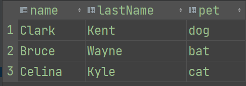
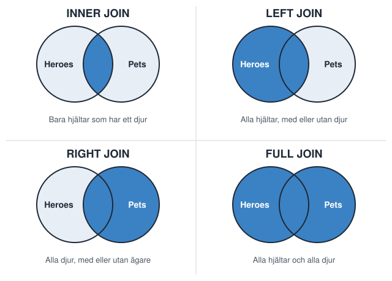
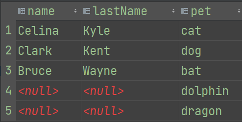
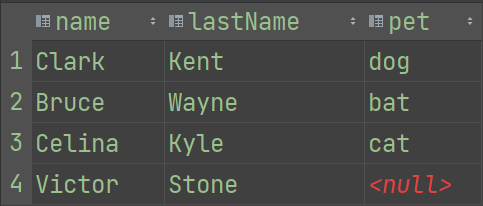
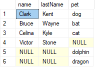
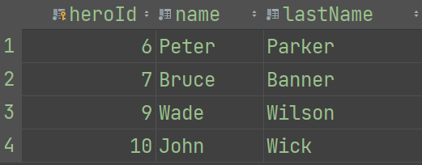

# SQL-CRUD — Heroes

🟢

En databas är ett program som lagrar "data", alltså information, i en fil. Ungefär som Excel, men med lite smartare funktioner för sökning och indexering.

## Disclaimer

Dokumentet utgår från MySQL men har kommentarer om hur man gör i SQL Server och SQLite. Det mesta fungerar likadant i alla tre, och där det skiljer sig står det.

## CRUDL

CRUD kallas ibland CRUDL, eftersom man vill kunna se en lista över alla rader i tabellen och inte bara en i taget.

| | SQL |
|---|---|
| **C**reate | `INSERT INTO tabell (fält) VALUES (värden), (värden);` |
| **R**ead | `SELECT fält FROM tabell WHERE villkor;` |
| **U**pdate | `UPDATE tabell SET fält = värde, fält2 = värde2 WHERE villkor;` |
| **D**elete | `DELETE FROM tabell WHERE fält = värde;` |
| **L**ist | `SELECT fält FROM tabell;` |

Text och strängar skrivs med enkla citattecken `' '`, siffror utan.

## Skapa databas

```sql
CREATE DATABASE DCHeroes;
USE DCHeroes;
```

`USE` talar om för skriptet att det i fortsättningen ska köra mot den valda databasen.

> **SQLite:** här är databasen en fil, och det finns varken `CREATE DATABASE` eller `USE`. Du skapar databasen genom att klicka på **New Database** i DB Browser, eller genom att öppna en koppling till ett filnamn från C#.

### Skapa den bara om den inte finns

För att vara säker på att databasen bara skapas om den inte redan finns kan du skriva:

```sql
CREATE DATABASE IF NOT EXISTS DCHeroes;
```

### Skapa om databasen

Ibland vill man vara säker på att allt är nollställt, till exempel när man demonstrerar ett projekt eller lämnar in en uppgift \*hint, hint\* 😉😉

Då kan man kolla om databasen finns, och i så fall *droppa* (radera) den och sedan skapa en ny, fräsch databas:

```sql
DROP DATABASE IF EXISTS DCHeroes;
CREATE DATABASE DCHeroes;
USE DCHeroes;
```

### Ta bort en databas

Vill du radera alla spår av din databas skriver du:

```sql
DROP DATABASE IF EXISTS DCHeroes;
```

### Välj databas

När du har skapat en databas, glöm inte att tala om för din query att du vill använda den (`USE`). Det behöver du inte tänka på om du angav databasnamnet i connection string när du kopplade upp dig. Men det är bra att använda om man kör många queries på en gång.

## Visa vilka databaser som finns på servern

```sql
SHOW DATABASES;
```

**SQL Server:**

```sql
SELECT name, database_id, create_date FROM sys.databases;
```

## Visa vilka tabeller som finns i databasen

```sql
SHOW TABLES;
```

**SQL Server:**

```sql
SELECT schema_name(t.schema_id) AS schema_name,
       t.name AS table_name,
       t.create_date,
       t.modify_date
FROM sys.tables t
ORDER BY schema_name, table_name;
```

**SQLite:**

```sql
SELECT name FROM sqlite_master WHERE type = 'table';
```

## Skapa tabeller

**Primary Key** är tabellens huvudnyckel. `AUTO_INCREMENT` betyder att räknaren ökar med ett varje gång en ny rad läggs till. Även här kan du använda `IF NOT EXISTS` för att inte försöka skapa en tabell som redan finns.

```sql
CREATE TABLE IF NOT EXISTS Heroes (
    heroId   INTEGER PRIMARY KEY AUTO_INCREMENT,
    name     VARCHAR(50) NOT NULL,
    lastName VARCHAR(50) NOT NULL,
    age      INTEGER,
    email    VARCHAR(50),
    phone    VARCHAR(50)
);

CREATE TABLE IF NOT EXISTS Pets (
    petId INTEGER PRIMARY KEY AUTO_INCREMENT,
    pet   VARCHAR(50)
);
```

> **SQLite:** skriv `INTEGER PRIMARY KEY AUTOINCREMENT` (ett ord, utan understreck). `VARCHAR(50)` fungerar, men SQLite bryr sig inte om längden. Allt blir `TEXT`.

### SQL Server

SQL Server har sin egen dialekt. `IDENTITY(1,1)` betyder att räknaren börjar på 1 och ökar med 1 för varje ny rad:

```sql
CREATE TABLE Heroes (
    heroId   INTEGER PRIMARY KEY IDENTITY(1,1) NOT NULL,
    name     VARCHAR(50) NOT NULL,
    lastName VARCHAR(50) NOT NULL,
    age      INTEGER,
    email    VARCHAR(50),
    phone    VARCHAR(50)
);

CREATE TABLE Pets (
    petId INTEGER PRIMARY KEY IDENTITY(1,1) NOT NULL,
    pet   VARCHAR(50)
);
```

Äldre versioner av SQL Server (före 2016) förstår inte `IF NOT EXISTS` i `CREATE TABLE`. Där får man göra så här i stället:

```sql
IF NOT EXISTS (SELECT * FROM sysobjects WHERE name = 'Heroes' AND xtype = 'U')
CREATE TABLE Heroes (
    heroId   INTEGER PRIMARY KEY IDENTITY(1,1) NOT NULL,
    name     VARCHAR(50) NOT NULL,
    lastName VARCHAR(50) NOT NULL,
    age      INTEGER,
    email    VARCHAR(50),
    phone    VARCHAR(50)
);
GO
```

### Kopplingstabell

En kopplingstabell kopplar ihop två eller flera andra tabeller. På de sista raderna anger vi vilket fält som ska kopplas till vilken tabell, som **Foreign Key**.

```sql
CREATE TABLE IF NOT EXISTS Owner (
    ownerId INTEGER PRIMARY KEY AUTO_INCREMENT,
    heroId  INTEGER,
    petId   INTEGER,
    FOREIGN KEY (heroId) REFERENCES Heroes(heroId),
    FOREIGN KEY (petId)  REFERENCES Pets(petId)
);
```

**SQL Server:**

```sql
CREATE TABLE Owner (
    ownerId INTEGER PRIMARY KEY IDENTITY(1,1) NOT NULL,
    heroId  INTEGER,
    petId   INTEGER,
    CONSTRAINT fk_hero FOREIGN KEY (heroId) REFERENCES Heroes(heroId),
    CONSTRAINT fk_pet  FOREIGN KEY (petId)  REFERENCES Pets(petId)
);
```

### FOREIGN KEY

Med raden `FOREIGN KEY (heroId) REFERENCES Heroes(heroId)` talar vi om för databasen att tabellen hänvisar till kolumnen `heroId` i tabellen `Heroes`. Det gör att vi inte kan radera hunden ur `Pets` utan att först ha raderat kopplingen till Clark Kent.

En sådan regel kallas **restriction** och finns för att hindra databasanvändarna från att göra dumma saker. Den gör också att vi inte kan radera tabellen `Pets` eller `Heroes` så länge det finns kopplingar i `Owner`, och inte heller rader i `Heroes` eller `Pets` som är kopplade via sin Primary Key.

> **SQLite:** här är kontrollen av Foreign Keys *avstängd* som standard. Slå på den med `PRAGMA foreign_keys = ON;` varje gång du öppnar databasen.

### Radera först, skapa sen

Du kan använda samma trick som när du skapade databasen:

```sql
DROP TABLE IF EXISTS Heroes;
```

och sedan köra `CREATE TABLE`.

## Ändra i en tabell

### Lägg till kolumn

```sql
ALTER TABLE tabellNamn ADD kolumn datatyp;
```

### Ta bort kolumn

```sql
ALTER TABLE tabellNamn DROP COLUMN kolumn;
```

### Ändra typ på en kolumn

```sql
-- MySQL
ALTER TABLE tabellNamn MODIFY COLUMN kolumn datatyp;

-- SQL Server
ALTER TABLE tabellNamn ALTER COLUMN kolumn datatyp;
```

> **SQLite:** det går inte att ändra typ på en kolumn. Man får skapa en ny tabell, kopiera över datan och ta bort den gamla.

## INSERT — mata in data

Mata in en hjälte:

```sql
INSERT INTO Heroes (name, lastName, age, email, phone)
VALUES ('Clark', 'Kent', 42, 'clark.kent@dailyplanet.com', '5555-1212-3434');
```

`INSERT INTO` lägger in en rad i tabellen.

### Mata in flera på samma gång

```sql
INSERT INTO Heroes (name, lastName, age, email, phone)
VALUES
    ('Bruce',  'Wayne', 42, 'bruce@waynecorp.com', '5555-4567-1212'),
    ('Celina', 'Kyle',  36, 'celina@meow.org',     '5555-4242-1331'),
    ('Victor', 'Stone', 35, 'cyborg@rus.com',      '5555-8888-8888');
```

Mata in djur:

```sql
INSERT INTO Pets (pet)
VALUES ('cat'), ('dog'), ('bat'), ('dolphin'), ('dragon');
```

Koppla djuren till sina hjältar:

```sql
INSERT INTO Owner (heroId, petId)
VALUES (1, 2), (2, 3), (3, 1);
```

## SELECT — visa listan på hjältar

```sql
SELECT * FROM Heroes;
```

### Visa listan på djur

```sql
SELECT * FROM Pets;
```

### Visa listan på ägare

```sql
SELECT * FROM Owner;
```

### Koppla ihop informationen från alla tre tabeller

För att se hur tabellerna hänger ihop kopplar vi ihop dem. I `FROM` talar vi om vilka tabeller som är inblandade. I `WHERE` förklarar vi för databasen hur informationen ska kopplas ihop.

```sql
SELECT name, lastName, pet
FROM Heroes, Pets, Owner
WHERE Owner.heroId = Heroes.heroId
  AND Owner.petId  = Pets.petId;
```



Som du ser försvinner Victor ur listan. Det beror på att vi frågade efter alla hjältar som är kopplade till ett husdjur, och Victor har inget. Det här kallas **inner join**. Man skriver sällan filtren som ovan. Det är snyggare och effektivare att använda `JOIN`.

Det finns fyra olika joins som vi ska titta på. Den blå ytan visar vilka rader som kommer med i resultatet. Heroes och Pets kopplas ihop via `Owner`.



### INNER JOIN

En inner join väljer bara de rader som matchar på båda sidor. Eftersom vi har tre tabeller gör vi en `INNER JOIN` från första tabellen till mittentabellen, och sedan från mittentabellen till den tredje.

```sql
SELECT Heroes.name, Heroes.lastName, Pets.pet
FROM Heroes
INNER JOIN Owner ON Heroes.heroId = Owner.heroId
INNER JOIN Pets  ON Owner.petId   = Pets.petId;
```

Den första `INNER JOIN` kopplar ihop `Heroes` med `Owner` och plockar fram alla matchningar. Sedan tar den andra `INNER JOIN` vid och kopplar ihop resultatet med `Pets`. Till sist presenteras allt.


### RIGHT JOIN

En right join kopplar ihop tabellerna men tar också med alla rader i den **högra tabellen**.

```sql
SELECT Heroes.name, Heroes.lastName, Pets.pet
FROM Heroes
RIGHT JOIN Owner ON Heroes.heroId = Owner.heroId
RIGHT JOIN Pets  ON Owner.petId   = Pets.petId;
```

Vi får en lista på alla djur och deras ägare. Finns ingen ägare står det `NULL` på ägarens plats. (Kanske inte det man förväntade sig, men det är all-right 😊)



### LEFT JOIN

En left join kopplar ihop tabellerna men tar också med alla rader i den **vänstra tabellen**.

```sql
SELECT Heroes.name, Heroes.lastName, Pets.pet
FROM Heroes
LEFT JOIN Owner ON Heroes.heroId = Owner.heroId
LEFT JOIN Pets  ON Owner.petId   = Pets.petId;
```

Vi får en lista på alla hjältar och deras djur. Finns inget djur står det `NULL` på djurets plats.



### FULL OUTER JOIN

En full join tar alla rader som matchar på båda sidor, plus alla som inte matchar på någon av sidorna. Varför man skulle vilja ha den listan är en bra fråga.

```sql
SELECT Heroes.name, Heroes.lastName, Pets.pet
FROM Heroes
FULL JOIN Owner ON Heroes.heroId = Owner.heroId
FULL JOIN Pets  ON Owner.petId   = Pets.petId;
```



> **MySQL** har inte stöd för `FULL OUTER JOIN`. Där får man slå ihop en `LEFT JOIN` och en `RIGHT JOIN` med `UNION`. **SQL Server** och **SQLite** (från version 3.39) klarar den.

## Transaktioner — skydd mot tabbar

En transaktion skyddar databasen mot felaktiga inmatningar eller raderingar. Ändringarna syns, men de sparas inte förrän du säger till.

```sql
-- MySQL
START TRANSACTION;
DELETE FROM Heroes WHERE heroId > 0;
SELECT * FROM Heroes;

-- SQL Server och SQLite
BEGIN TRANSACTION;
DELETE FROM Heroes WHERE heroId > 0;
SELECT * FROM Heroes;
```

### ROLLBACK återställer allt

```sql
ROLLBACK;
```

### COMMIT sparar ändringarna

```sql
COMMIT;
```

## UPDATE — ändra data i tabellen

Har man råkat mata in något fel är det lätt att rätta:

```sql
UPDATE Heroes
SET email = 'MrCyborg@cyborg.rus'
WHERE email = 'cyborg@rus.com';
```

Glöm aldrig `WHERE` i en `UPDATE`. Utan den ändras *alla* rader.

## ORDER BY — sortering

Man kan sortera resultatet direkt i frågan.

Sortera på förnamn:

```sql
SELECT name, lastName FROM Heroes ORDER BY name;
```

Sortera på efternamn:

```sql
SELECT name, lastName FROM Heroes ORDER BY lastName;
```

Sortera på ålder:

```sql
SELECT name, lastName FROM Heroes ORDER BY age;
```

### DESC — omvänd ordning (äldst först)

```sql
SELECT name, lastName FROM Heroes ORDER BY age DESC;
```

### ASC — stigande ordning (yngst först)

```sql
SELECT name, lastName FROM Heroes ORDER BY age ASC;
```

`ASC` behöver inte skrivas ut, eftersom det är standardvalet.

## COUNT — hur många hjältar finns det?

```sql
SELECT COUNT(heroId) FROM Heroes;
```

> Skriv `COUNT(` utan mellanslag. MySQL ger ett syntaxfel om det står `COUNT (heroId)`.

## DISTINCT — hur många olika åldrar finns det?

`DISTINCT` ser till att vi inte får några dubbletter.

```sql
SELECT COUNT(DISTINCT age) FROM Heroes;
```

## Hur många heter Bruce?

(Det kan vara både Bruce Banner och Bruce Wayne.)

```sql
SELECT COUNT(heroId) FROM Heroes WHERE name = 'Bruce';
```

## Hur många unika namn finns det?

Nu räknas alla Bruce som en, oavsett hur många de är:

```sql
SELECT COUNT(DISTINCT name) FROM Heroes;
```

## Fler hjältar att leka med

```sql
INSERT INTO Heroes (name, lastName, age, email, phone)
VALUES
    ('Diana',  'Prince',     28, 'diana@amazon.com',                 '555-555-5552'),
    ('Peter',  'Parker',     28, 'peter@dailybugle.com',             '555-155-5155'),
    ('Bruce',  'Banner',     28, 'bruce@culvertUni.org',             '555-545-5755'),
    ('Selina', 'Kyle',       25, 'selina@meow.org',                  '555-575-5559'),
    ('Wade',   'Wilson',     30, 'dead@pool.org',                    '555-585-1555'),
    ('John',   'Wick',       30, 'babayaga@continental.org',         '555-755-5254'),
    ('Arthur', 'Curry',      42, 'arthur@atlante.an',                '555-545-5255'),
    ('Barry',  'Allen',      21, 'barry.allen@centralcity.pd',       '555-558-8888'),
    ('James',  'Gordon',     45, 'james.gordon@gothamcity.pd',       '555-565-5655'),
    ('Alfred', 'Pennyworth', 52, 'alfred.pennyworth@waymansion.com', '555-535-3555'),
    ('Amanda', 'Waller',     43, 'boss@argus.org',                   '555-455-5554');
```

## DELETE FROM — radera

När vi har matat in alla ser vi att några inte hör hemma i DC-världen. Bruce Banner, Peter Parker, Wade Wilson och John Wick får åka ut.

Man kan ta bort dem genom att söka på namn, men det är inte alltid bra, eftersom flera personer kan heta likadant. Vi tar fram en lista på dem först:

```sql
SELECT heroId, name, lastName
FROM Heroes
WHERE lastName IN ('Parker', 'Banner', 'Wick', 'Wilson');
```



Dem kan du radera med gott samvete.

**Kör inte:**

```sql
DELETE FROM Heroes WHERE name = 'Bruce';
```

Det skulle även ta Bruce Wayne, alltså Batman, och det får inte hända. Vi letar i stället upp id:t på den hjälte vi vill radera i listan ovan.

Spindelmannen tar vi bort så här:

```sql
DELETE FROM Heroes WHERE heroId = 6;
```

Vi har fler att radera. För att slippa en massa `DELETE`-rader kan vi skriva:

```sql
DELETE FROM Heroes WHERE heroId IN (6, 7, 9, 10);
```

Du kan även använda `NOT IN` eller `BETWEEN` när du raderar, på exakt samma sätt som när du söker.

Eftersom vi raderar utifrån id kan vi vara 100 % säkra på att rätt rad försvinner.

## Mer sökning

Som du såg kan man använda specialord när man söker:

```sql
SELECT * FROM Heroes WHERE heroId IN (1, 2, 3, 4, 5);
SELECT * FROM Heroes WHERE heroId NOT IN (1, 3, 3, 7);
SELECT * FROM Heroes WHERE heroId BETWEEN 1 AND 5;
```

## Utmaning!

När vi tittar på listan ser vi att vi har två Catwoman. Den andra har namnet rätt stavat. Ta bort den andra Selina och ändra den första så att hon heter Selina.

Använd `SELECT`, `DELETE` och `UPDATE`.

## Bra länkar

- [MySQL Tutorial](https://www.mysqltutorial.org/)
- [W3Schools: MySQL](https://www.w3schools.com/mysql/mysql_sql.asp)
- [SQLZoo](https://sqlzoo.net/wiki/SQL_Tutorial)
