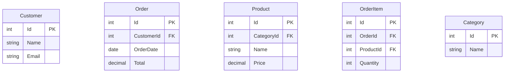
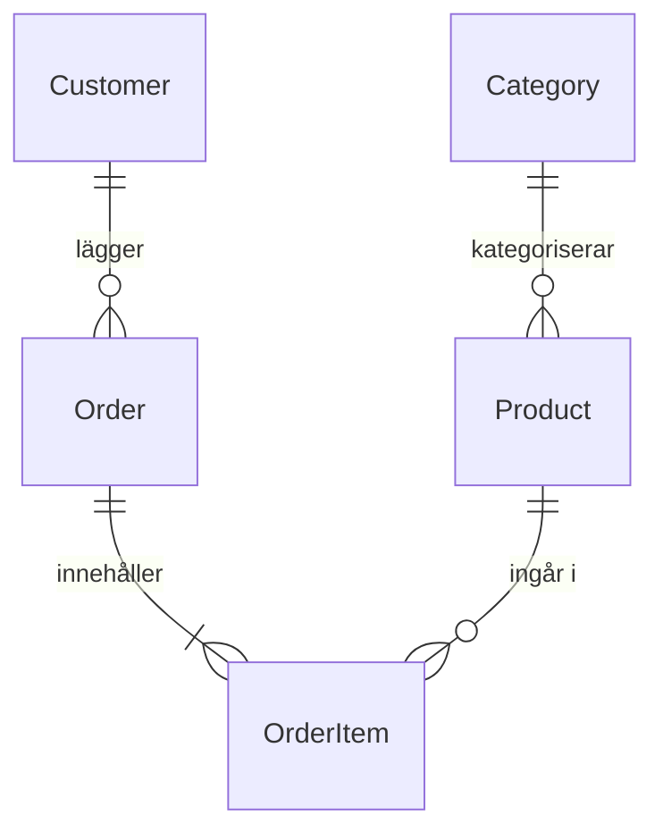
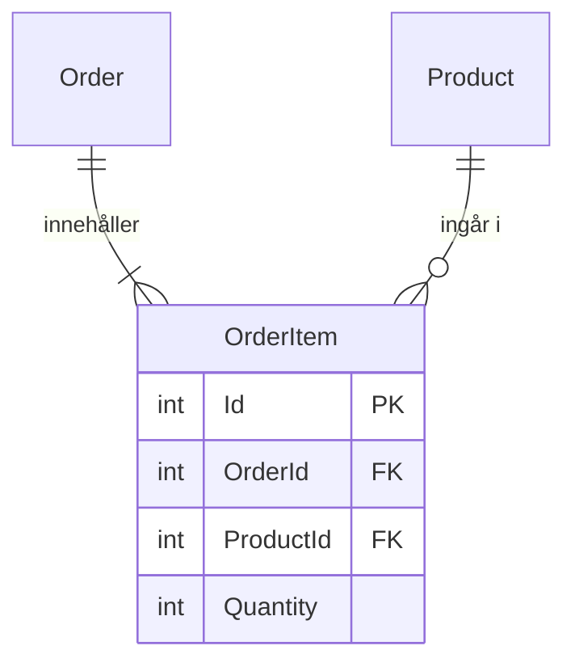
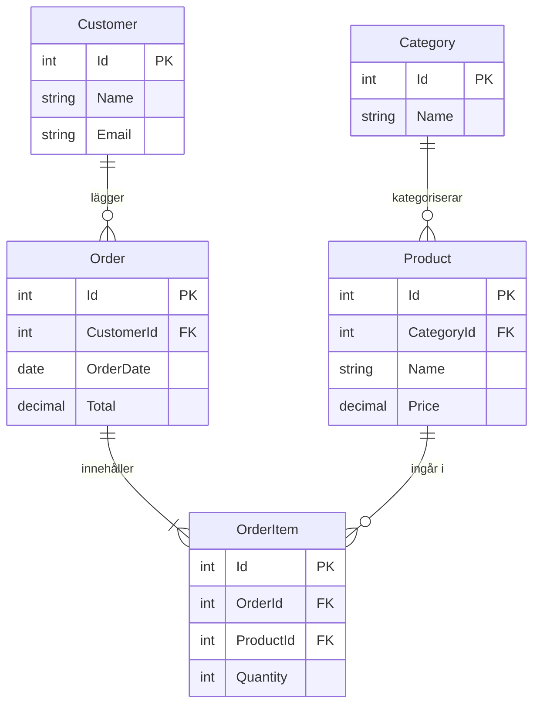

# ERD-diagram — Webshop

Ett ER-diagram visar databasens struktur på ett sätt som hjärnan faktiskt kan läsa. Rätt tabeller, rätt kopplingar, rätt kardinalitet — innan en enda `CREATE TABLE` skrivs.

Scenariot är en enkel webshop. Kunder lägger beställningar, beställningar innehåller produkter, produkter tillhör kategorier.

---

Vi börjar med entiteterna — tabellerna — en i taget. Varje ruta är en tabell, varje rad inuti är en kolumn.

`PK` = primärnyckel (unikt id för varje rad). `FK` = främmande nyckel (pekar på en annan tabell).

---

Nu lägger vi in relationerna. Varje streck är en koppling, symbolerna i ändarna berättar hur många.

| Symbol | Läses som |
|--------|-----------|
| `\|\|` | exakt en |
| `o{` | noll eller fler |
| `\|{` | en eller fler |

`Customer ||--o{ Order` = en kund kan ha noll eller fler beställningar, varje beställning tillhör exakt en kund.

`Order ||--|{ OrderItem` = en beställning måste ha minst en orderrad (det vore konstigt med en tom beställning).

---

`OrderItem` är kopplingstabellen som löser N:M-relationen mellan `Order` och `Product`. En beställning kan innehålla många produkter, och en produkt kan finnas i många beställningar — men varje orderrad vet exakt vilken beställning och vilken produkt den tillhör.

Utan `OrderItem` skulle vi behöva stoppa en lista av produkter direkt i `Order` — det bryter mot 1NF.

---

## Hela diagrammet

