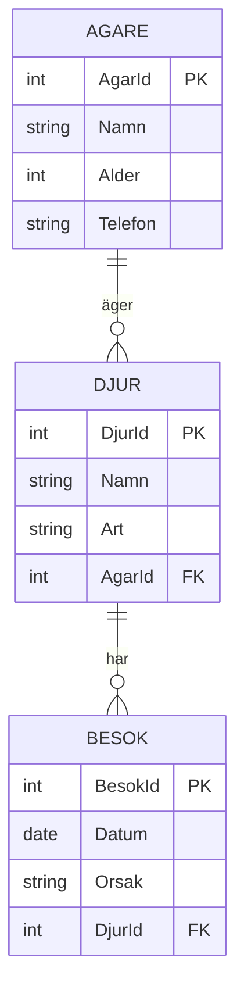

<!-- _class: lead -->
<!-- _paginate: false -->

# Djursjukhuset 🐾

Normalisering, relationer och JOINs — live

*Marcus Ackre Medina · CLO26 · v.43*

---

## Situationen

Ni har blivit anlitade av Klösarvet Djursjukhus AB.

De har en databas. En tabell. Allt i en rad.

```
Besok
------
BesokId | Datum      | DjurNamn | Art   | AgarNamn | AgarAlder | Telefon      | Orsak
1       | 2026-09-01 | Pluto    | Hund  | Sara     | 34        | 073-111 2233 | Klöv
2       | 2026-09-03 | Misse    | Katt  | Johan    | 52        | 070-555 9988 | Klöv
3       | 2026-09-08 | Pluto    | Hund  | Sara     | 34        | 073-111 2233 | Vaccination
4       | 2026-09-12 | Ronja    | Katt  | Sara     | 34        | 073-111 2233 | Vaccination
5       | 2026-09-15 | Fido     | Hund  | Lena     | 61        | 076-222 4455 | Kontroll
6       | 2026-10-01 | Misse    | Katt  | Johan    | 52        | 070-555 9988 | Kontroll
```

**Fråga:** Vad är fel här?

---

## Felet syns direkt

Sara visas **tre gånger** med exakt samma uppgifter.
Misse visas **två gånger** med exakt samma art och ägare.

Det kallas **redundans** — och det orsakar tre sorters problem.

---

## De tre anomalierna

**Insertion anomaly** — Kan vi lägga till ett nytt djur utan att det haft ett besök?

```sql
-- NEJ — alla kolumner om ägare och besök måste finnas
INSERT INTO Besok (DjurNamn, Art, AgarNamn) VALUES ('Bojje', 'Hund', 'Kalle');
-- KRASCHAR: Datum och BesokId kan inte vara NULL
```

**Update anomaly** — Sara byter telefon.

```sql
UPDATE Besok SET Telefon = '073-999 0000' WHERE AgarNamn = 'Sara';
-- Fungerar — om vi minns att köra det på ALLA tre raderna
-- Missar vi en rad har Sara plötsligt två telefonnummer
```

**Deletion anomaly** — Lenas enda besök tas bort.

```sql
DELETE FROM Besok WHERE BesokId = 5;
-- Lena och Fido finns inte längre i systemet
```

---

## Lösningen: normalisering

Vi bryter ut datan i separata tabeller med ett ansvar var.

**Steg 1 — identifiera entiteterna**

- Vad handlar datan egentligen om?
- Vad kan existera utan att vara kopplat till annat?

```
Ägare   → finns oavsett om de har djur
Djur    → finns oavsett om de haft besök
Besök   → kräver ett djur
```

---

## Den normaliserade strukturen

```
Agare
──────────────────────────────────────
AgarId | Namn  | Alder | Telefon
1      | Sara  | 34    | 073-111 2233
2      | Johan | 52    | 070-555 9988
3      | Lena  | 61    | 076-222 4455

Djur
──────────────────────────────────────
DjurId | Namn  | Art  | AgarId (FK)
1      | Pluto | Hund | 1
2      | Misse | Katt | 2
3      | Ronja | Katt | 1
4      | Fido  | Hund | 3

Besok
──────────────────────────────────────
BesokId | Datum      | Orsak       | DjurId (FK)
1       | 2026-09-01 | Klöv        | 1
2       | 2026-09-03 | Klöv        | 2
3       | 2026-09-08 | Vaccination | 1
4       | 2026-09-12 | Vaccination | 3
5       | 2026-09-15 | Kontroll    | 4
6       | 2026-10-01 | Kontroll    | 2
```

---

## ER-diagrammet



En ägare kan ha **många** djur.
Ett djur kan ha **många** besök.
Varje besök tillhör **ett** djur.

---

## Nu kan vi ställa riktiga frågor

Med tre tabeller och JOIN kan vi svara på allt som döljer sig i datan.

Och nu kör vi frågorna live. 🐾

---

## Fråga 1 — Vilken hund var här senast?

```sql
SELECT d.Namn, MAX(b.Datum) AS SenasteBesok
FROM Djur d
JOIN Besok b ON d.DjurId = b.DjurId
WHERE d.Art = 'Hund'
GROUP BY d.Namn
ORDER BY SenasteBesok DESC
LIMIT 1;
```

```
Namn  | SenasteBesok
──────┼─────────────
Fido  | 2026-09-15
```

Fido, Lenas kontrollbesök. Pluto var senast inne i september.

---

## Fråga 2 — Vilken kattägare är äldst?

```sql
SELECT a.Namn, a.Alder
FROM Agare a
JOIN Djur d ON a.AgarId = d.AgarId
WHERE d.Art = 'Katt'
ORDER BY a.Alder DESC
LIMIT 1;
```

```
Namn  | Alder
──────┼──────
Johan | 52
```

Johan, Misses ägare, är 52.
Sara är 34 och äger Ronja — men Johan vinner.

---

## Fråga 3 — Hur många besök har varje djur haft?

```sql
SELECT d.Namn, d.Art, COUNT(b.BesokId) AS AntalBesok
FROM Djur d
LEFT JOIN Besok b ON d.DjurId = b.DjurId
GROUP BY d.DjurId, d.Namn, d.Art
ORDER BY AntalBesok DESC;
```

```
Namn  | Art  | AntalBesok
──────┼──────┼───────────
Pluto | Hund | 2
Misse | Katt | 2
Ronja | Katt | 1
Fido  | Hund | 1
```

**Varför LEFT JOIN?** För att få med djur som inte haft ett enda besök.

---

## Fråga 4 — Vilka ägare har djur av mer än en art?

```sql
SELECT a.Namn, COUNT(DISTINCT d.Art) AS AntalArter
FROM Agare a
JOIN Djur d ON a.AgarId = d.AgarId
GROUP BY a.AgarId, a.Namn
HAVING COUNT(DISTINCT d.Art) > 1;
```

```
Namn | AntalArter
─────┼───────────
Sara | 2
```

Sara äger Pluto (hund) och Ronja (katt).
Johan äger bara Misse. Lena äger bara Fido.

---

## Fråga 5 — Alla besök med ägarnamn och djurnamn

```sql
SELECT a.Namn AS Agare, d.Namn AS Djur, d.Art, b.Datum, b.Orsak
FROM Besok b
JOIN Djur d   ON b.DjurId = d.DjurId
JOIN Agare a  ON d.AgarId = a.AgarId
ORDER BY b.Datum;
```

```
Agare | Djur  | Art  | Datum      | Orsak
──────┼───────┼──────┼────────────┼────────────
Sara  | Pluto | Hund | 2026-09-01 | Klöv
Johan | Misse | Katt | 2026-09-03 | Klöv
Sara  | Pluto | Hund | 2026-09-08 | Vaccination
Sara  | Ronja | Katt | 2026-09-12 | Vaccination
Lena  | Fido  | Hund | 2026-09-15 | Kontroll
Johan | Misse | Katt | 2026-10-01 | Kontroll
```

Tre tabeller, ett JOIN-kedjat svar.

---

## INNER vs LEFT — snabb repetition

```sql
-- INNER JOIN — bara djur som HAR besök
SELECT d.Namn, b.Datum
FROM Djur d
INNER JOIN Besok b ON d.DjurId = b.DjurId;

-- LEFT JOIN — ALLA djur, NULL om inget besök
SELECT d.Namn, b.Datum
FROM Djur d
LEFT JOIN Besok b ON d.DjurId = b.DjurId;
```

**Tumregel:** Är du osäker — ta LEFT JOIN.
Det ger dig fler rader, inte färre. Du ser direkt vad som saknas.

---

## Era uppgifter

Öppna SQLite Browser eller TiDB och skapa tabellerna.
Testa sedan dessa frågor:

1. Vilken orsak är vanligast på djursjukhuset?
2. Lista alla ägare som haft mer än ett besök totalt (räkna via deras djur)
3. Hitta djur som **inte** haft något besök alls
4. Visa alla katter och deras ägare, sorterat på ägarens ålder

---

## Sammanfattning

| Koncept | Vad det löser |
|---------|--------------|
| Normalisering | Tar bort redundans och anomalier |
| Primärnyckel | Identifierar varje rad unikt |
| Främmande nyckel | Kopplar tabeller till varandra |
| INNER JOIN | Bara rader som matchar i båda tabeller |
| LEFT JOIN | Alla rader från vänster, NULL om inget match |
| GROUP BY + COUNT | Räkna, summera, hitta mönster |

*Nästa steg: aggregat, subqueries och GROUP BY fördjupning på onsdag.*
