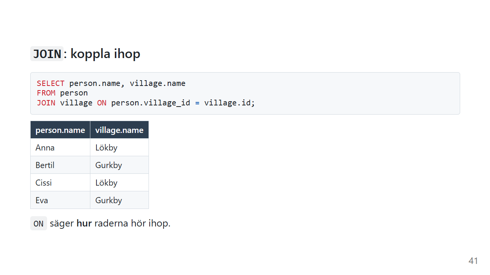
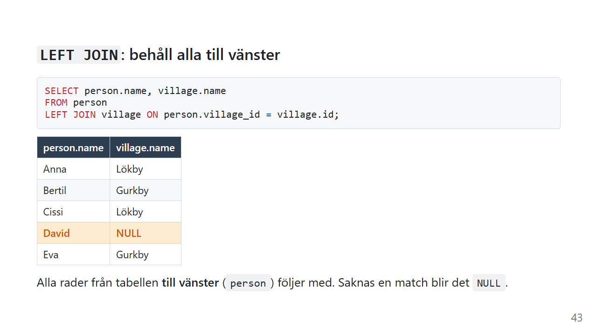
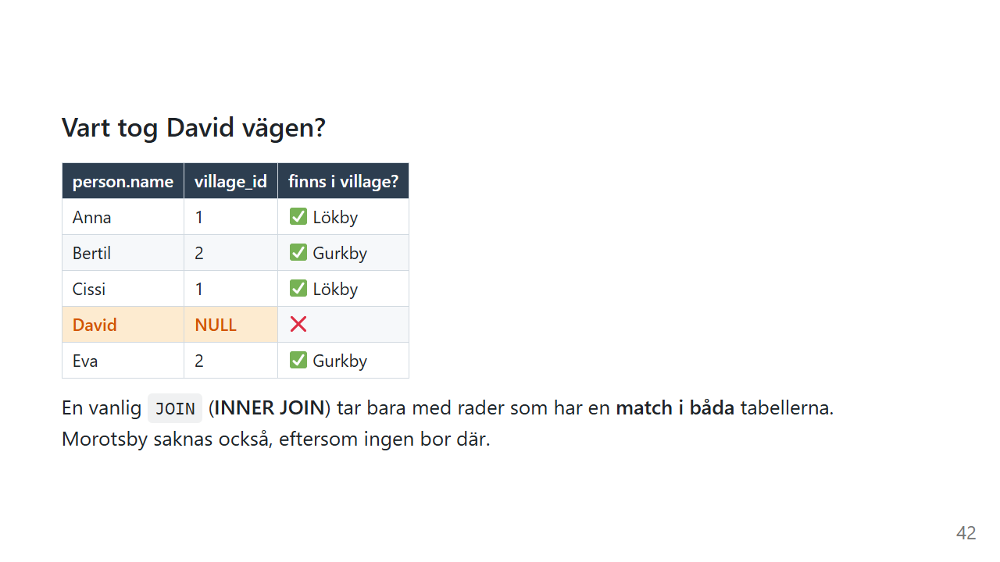
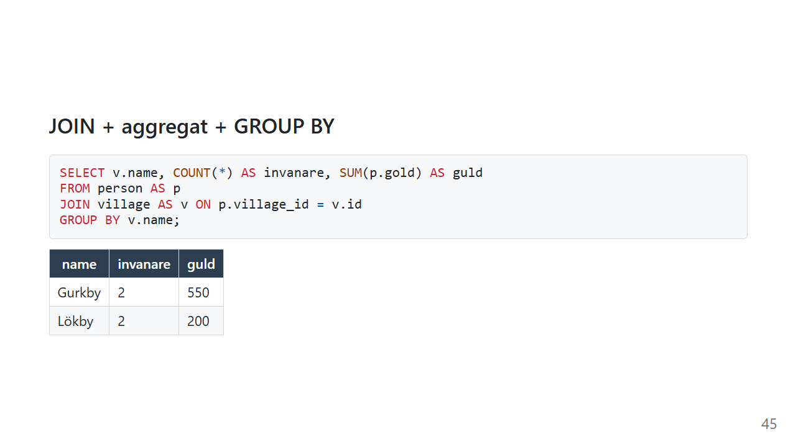

<!-- _class: lead -->
<!-- _paginate: false -->

# SQL JOINs 🔗

Koppla ihop tabeller — och förstå varför det spelar roll

*Marcus Ackre Medina · CLO26*

---

## Det vi går igenom

1. Varför behöver vi JOIN?
2. INNER JOIN — bara matchningar
3. LEFT JOIN — behåll allt från vänster
4. INNER vs LEFT — sida vid sida
5. Hitta poster som saknas
6. JOIN + GROUP BY
7. Vanliga misstag

---

## Problemet — data är utspridd

**Tabell: Students**

| StudentId | FirstName | LastName |
|-----------|-----------|----------|
| 1 | Anna | Svensson |
| 2 | Erik | Larsson |

**Tabell: Enrollments**

| EnrollmentId | StudentId | CourseCode |
|--------------|-----------|------------|
| 101 | 1 | CS101 |
| 102 | 1 | CS102 |

**Hur vet vi vilket namn som hör till vilken kurs?** 🤔

---

## Lösningen — JOIN



**JOIN = limmet som binder tabeller**

```sql
SELECT s.FirstName, s.LastName, e.CourseCode
FROM Students AS s
INNER JOIN Enrollments AS e
  ON s.StudentId = e.StudentId;
```

`ON` = **vilken kolumn binder dem samman?**

---

## INNER JOIN


**Visa bara rader som matchar i BÅDA tabellerna**

- Student saknar kurser → **syns inte**
- Kurs saknar student → **syns inte**
- Matchning finns → **syns**

> Tänk: "Ge mig bara det som finns på båda ställena"

---

## INNER JOIN — syntax

```sql
SELECT kolumner
FROM tabell1 AS alias1
INNER JOIN tabell2 AS alias2
  ON alias1.kolumn = alias2.kolumn;
```

**Tre delar:**

| Del | Vad det gör |
|-----|-------------|
| `AS alias` | Förkortar tabellnamnet — `s`, `e`, `o` |
| `ON` | Vilken kolumn kopplar tabellerna? |
| `tabell.kolumn` | Förtydligar varifrån kolumnen kommer |

---

## INNER JOIN — i praktiken

```sql
SELECT
    s.FirstName,
    s.LastName,
    e.CourseCode,
    e.Grade
FROM Students AS s
INNER JOIN Enrollments AS e
  ON s.StudentId = e.StudentId
WHERE e.Grade >= 4
ORDER BY s.LastName;
```

**Resultat:** Bara studenter som HÅR kurser och fått betyg ≥ 4

---

## LEFT JOIN



**Visa allt från vänster tabell + matchningar från höger**

- Alla från vänster → **syns alltid**
- Matchning från höger → **syns**
- Ingen matchning → **NULL**

> Tänk: "Ge mig alla från vänster, även om höger saknas"

---

## LEFT JOIN — syntax

```sql
SELECT kolumner
FROM tabell1 AS alias1
LEFT JOIN tabell2 AS alias2
  ON alias1.kolumn = alias2.kolumn;
```

**Skillnaden mot INNER JOIN är ett enda ord:**

```sql
-- INNER JOIN
FROM Students AS s INNER JOIN Enrollments AS e ON ...

-- LEFT JOIN
FROM Students AS s LEFT JOIN Enrollments AS e ON ...
```

---

## LEFT JOIN — NULL i resultatet

```sql
SELECT s.FirstName, s.LastName, e.CourseCode
FROM Students AS s
LEFT JOIN Enrollments AS e
  ON s.StudentId = e.StudentId;
```

**Resultat:**

| FirstName | LastName | CourseCode |
|-----------|----------|------------|
| Anna | Svensson | CS101 |
| Anna | Svensson | CS102 |
| **Erik** | **Larsson** | **NULL** |

Erik har inga kurser — men syns ändå! 👆

---

## INNER vs LEFT — sida vid sida



```sql
-- INNER JOIN — bara studenter MED kurser
SELECT s.FirstName, e.CourseCode
FROM Students AS s
INNER JOIN Enrollments AS e
  ON s.StudentId = e.StudentId;

-- LEFT JOIN — ALLA studenter
SELECT s.FirstName, e.CourseCode
FROM Students AS s
LEFT JOIN Enrollments AS e
  ON s.StudentId = e.StudentId;
```

---

## INNER vs LEFT — när använder jag vad?

| Situation | Välj |
|-----------|------|
| Visa kunder och deras ordrar (bara de som beställt) | INNER JOIN |
| Visa ALLA kunder, även utan ordrar | LEFT JOIN |
| Lista produkter och deras kategorier (alla produkter) | LEFT JOIN |
| Hitta vilka studenter som har betyg | INNER JOIN |

**Tumregel:** Är du rädd att tappa rader? → LEFT JOIN

---

## Hitta poster som SAKNAR matchning

```sql
-- Vilka studenter är INTE anmälda till någon kurs?
SELECT s.FirstName, s.LastName
FROM Students AS s
LEFT JOIN Enrollments AS e
  ON s.StudentId = e.StudentId
WHERE e.EnrollmentId IS NULL;
```

**Tricket:** LEFT JOIN + WHERE *höger kolumn* IS NULL

> De som saknar matchning har NULL på höger sida — filtrera på det!

---

## JOIN + GROUP BY



```sql
SELECT
    s.FirstName,
    s.LastName,
    COUNT(e.CourseCode) AS AntalKurser
FROM Students AS s
LEFT JOIN Enrollments AS e
  ON s.StudentId = e.StudentId
GROUP BY s.StudentId, s.FirstName, s.LastName
ORDER BY AntalKurser DESC;
```

**Räknar kurser per student — inkl. nollor**

---

## JOIN med flera tabeller

**Kedja en JOIN i taget:**

```sql
SELECT
    s.FirstName,
    c.CourseName,
    t.TeacherName
FROM Students AS s
INNER JOIN Enrollments AS e
  ON s.StudentId = e.StudentId
INNER JOIN Courses AS c
  ON e.CourseCode = c.CourseCode
INNER JOIN Teachers AS t
  ON c.TeacherId = t.TeacherId;
```

**Tips:** Börja med en JOIN — lägg till nästa när den fungerar

---

## ⚠️ ON vs WHERE — inte samma sak

**ON** = hur tabellerna kopplas ihop

```sql
FROM Students AS s
LEFT JOIN Enrollments AS e ON s.StudentId = e.StudentId
```

**WHERE** = filtrera resultatet efteråt

```sql
WHERE e.Grade >= 4
```

**Fällan:** WHERE på NULL-kolumn efter LEFT JOIN tar bort "vänsterraderna"!

```sql
-- ❌ Gör LEFT JOIN till INNER JOIN i praktiken
WHERE e.CourseCode IS NOT NULL

-- ✅ Acceptera NULL eller filtrera i ON-villkoret
```

---

## ⚠️ Vanliga misstag

### 1. Glömmer alias på kolumn

```sql
-- ❌ FEL: Vilken tabell är StudentId från?
SELECT StudentId, FirstName
FROM Students AS s
INNER JOIN Enrollments AS e ON s.StudentId = e.StudentId;

-- ✅ RÄTT
SELECT s.StudentId, s.FirstName
FROM Students AS s
INNER JOIN Enrollments AS e ON s.StudentId = e.StudentId;
```

### 2. Dubblerade rader

```sql
-- Student med 3 kurser → 3 rader utan GROUP BY
SELECT s.FirstName, COUNT(e.CourseCode) AS AntalKurser
FROM Students AS s
INNER JOIN Enrollments AS e ON s.StudentId = e.StudentId
GROUP BY s.StudentId, s.FirstName;  -- ← alltid GROUP BY på JOIN-kolumner
```

---

## Sammanfattning

| JOIN-typ | Vad du får |
|----------|------------|
| **INNER JOIN** | Bara rader som matchar i BÅDA tabellerna |
| **LEFT JOIN** | Alla från vänster + matchningar (NULL om saknas) |
| **LEFT JOIN + IS NULL** | Bara rader som INTE matchar |
| **JOIN + GROUP BY** | Aggregering över kopplade tabeller |

**Kom ihåg:**
- `ON` = hur tabellerna kopplas
- `WHERE` = filtrera efter join
- Alias (`s`, `e`) = tydlighet

---

## Övning 1 🟢

**Lista alla kurser och vilka studenter som går dem.**

- Visa: CourseCode, CourseName, StudentName
- Bara studenter som är anmälda
- Sortera på CourseCode

**Ledtråd:** INNER JOIN mellan Courses, Enrollments och Students

---

## Övning 2 🟡

**Visa alla studenter och antal kurser de går.**

- Inkludera studenter utan kurser (visa 0)
- Sortera på antal kurser, fallande

**Ledtråd:** LEFT JOIN + COUNT() + GROUP BY

---

## Övning 3 🔴

**Kursrapport:**
- Kursnamn
- Antal anmälda studenter
- Genomsnittsbetyg
- Bara kurser med fler än 5 studenter
- Sorterat på högst snittbetyg

**Ledtråd:** JOIN + GROUP BY + HAVING + AVG()

---

<!-- _class: lead -->
<!-- _paginate: false -->

## Frågor? 🤔

Resurser i kursmaterialet:
`kurs-02-databaser/01_intro_databaser/notes/sql/join.md`

*Varför gillar databasen parmiddagar?*
*För att den får joina två tabeller åt gången.* 😄
