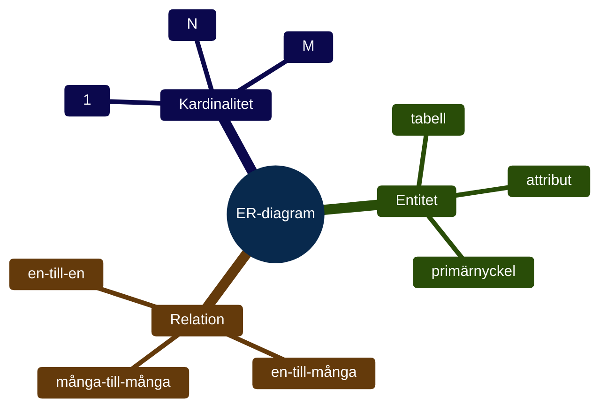
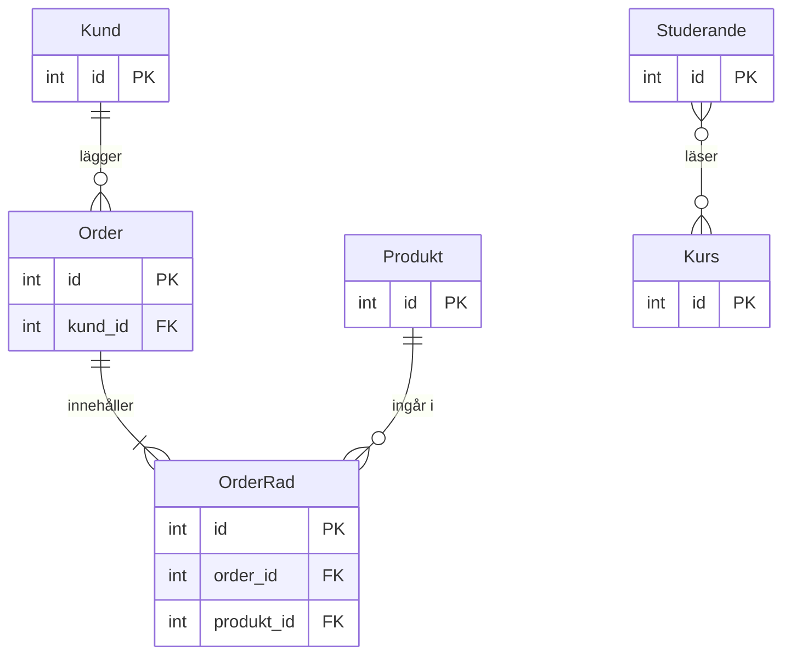

# Programmeringstermer — ER-diagram

Innan du skriver en enda rad SQL — rita. Ett ER-diagram är kartan som visar vad som ska byggas.



---

## Entitet

En **entitet** är ett "ting" som vi vill lagra information om. I en databas blir varje entitet en tabell.

Vanliga entiteter:
- `Kund` — en person som handlar
- `Produkt` — något som säljs
- `Order` — ett köp som görs

```sql
-- Entiteten Kund blir tabellen kunder
CREATE TABLE kunder (
  id    INTEGER PRIMARY KEY,
  namn  TEXT    NOT NULL,
  epost TEXT    NOT NULL
);
```

Entiteten ritar du som en rektangel i ER-diagrammet.

---

## Attribut

**Attribut** är egenskaperna hos en entitet — kolumnerna i tabellen. Varje attribut har en datatyp.

```sql
-- Entiteten Produkt med fyra attribut
CREATE TABLE produkter (
  id    INTEGER PRIMARY KEY,  -- attribut: id (nyckel)
  namn  TEXT    NOT NULL,     -- attribut: namn
  pris  REAL    NOT NULL,     -- attribut: pris
  lager INTEGER DEFAULT 0     -- attribut: lager
);
```

I diagrammet ritar du attributen som ovaler kopplade till rektangeln.

---

## Primärnyckel

**Primärnyckeln** (primary key) är det attribut som gör varje rad unik. Utan primärnyckel kan du inte garantera att rader är olika.

Regler för en bra primärnyckel:
- Unik — ingen annan rad har samma värde
- Aldrig NULL
- Stabil — ändras inte med tiden

```sql
-- INTEGER PRIMARY KEY AUTOINCREMENT sköter sig själv
CREATE TABLE djur (
  id  INTEGER PRIMARY KEY AUTOINCREMENT,
  art TEXT NOT NULL
);

INSERT INTO djur (art) VALUES ('lejon');
INSERT INTO djur (art) VALUES ('elefant');
```

### Output
```
id | art
1  | lejon
2  | elefant
```

`id` sätts automatiskt. Du behöver inte tänka på det.

---

## Främmande nyckel (Foreign Key)

**Främmande nyckeln** (foreign key) kopplar ihop två tabeller. Den pekar på primärnyckeln i en annan tabell.

```sql
-- kunder och ordrar — varje order tillhör en kund
CREATE TABLE kunder (
  id   INTEGER PRIMARY KEY,
  namn TEXT NOT NULL
);

CREATE TABLE ordrar (
  id       INTEGER PRIMARY KEY,
  kund_id  INTEGER NOT NULL,   -- ← främmande nyckel
  datum    TEXT    NOT NULL,
  FOREIGN KEY (kund_id) REFERENCES kunder(id)
);
```

```sql
-- Kalle (id=1) gör en order
INSERT INTO kunder VALUES (1, 'Kalle');
INSERT INTO ordrar VALUES (1, 1, '2025-10-15');
```

### Output (ordrar)
```
id | kund_id | datum
1  | 1       | 2025-10-15
```

`kund_id = 1` pekar på Kalle i kundtabellen.

---

## Relationstyper och kardinalitet

**Kardinalitet** beskriver hur många instanser av en entitet som kan kopplas till en annan.



| Symbol | Läses som | Exempel |
|--------|-----------|---------|
| `\|\|--\|\|` | En-till-en | Person har ett pass |
| `\|\|--o{` | En-till-många | Kund lägger noll eller fler orders |
| `\|\|--\|{` | En-till-många (obligatorisk) | Order har minst en orderrad |
| `}o--o{` | Många-till-många | Studerande läser kurser |

### En-till-många (1:N) — vanligast

En kund kan göra många ordrar. En order tillhör exakt en kund.

```sql
-- kund_id i ordrar gör relationen 1:N
```

### Många-till-många (M:N)

En studerande kan ha många kurser. En kurs kan ha många studerande.

Löses med en **kopplingstabell**:

```sql
CREATE TABLE studerande_kurser (
  studerande_id INTEGER,
  kurs_id       INTEGER,
  PRIMARY KEY (studerande_id, kurs_id)
);
```

### En-till-en (1:1) — ovanligast

En person har ett pass. Ett pass tillhör en person.

---

## Från diagram till tabeller

**Steg 1:** Identifiera entiteterna (substantiv i kravbilden)

**Steg 2:** Lista attributen för varje entitet

**Steg 3:** Bestäm primärnycklar

**Steg 4:** Rita relationer och sätt kardinalitet

**Steg 5:** Skapa kopplingstabell för varje M:N-relation

Exempel: "En butik har produkter. Kunder gör ordrar på produkter."

```
Entiteter: Kund, Order, Produkt
Relationer:
  Kund 1:N Order
  Order M:N Produkt → kopplingstabell orderrader
```

Rita diagrammet INNAN du skriver SQL. Det sparar dig timmar av omarbete.
