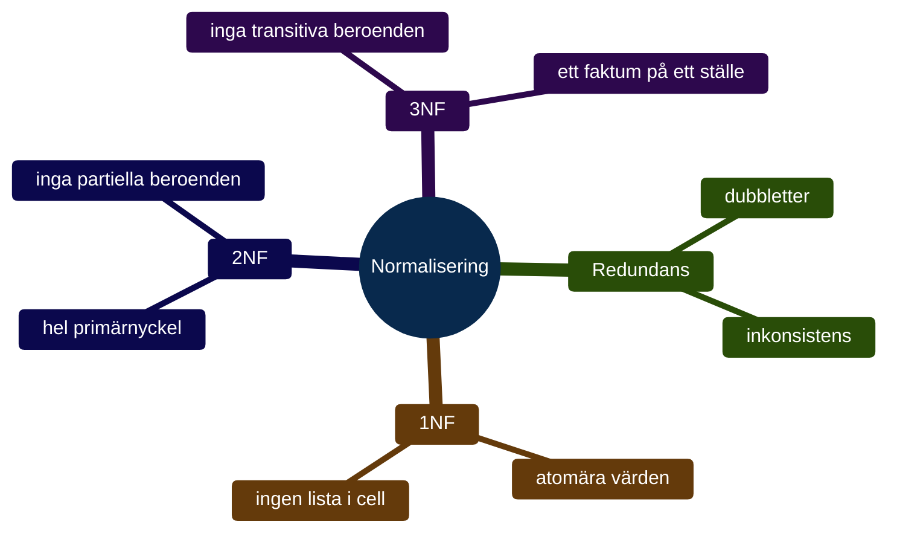

# Programmeringstermer — Normalisering

En ostrukturerad databas är som ett kylskåp utan hyllor — allt ligger i en hög och du hittar aldrig det du letar efter.



---

## Redundans

Redundans betyder att samma information lagras på flera ställen i databasen. Det låter ofarligt — men det leder snabbt till problem.

**Exempel:** Kalle lägger in en kund i tre olika tabeller. Kunden byter adress. Nu måste Kalle uppdatera tre rader. Missar han en? Nu stämmer inte datan.

```sql
-- Dålig design — stad upprepas på varje rad
-- namn         | stad        | produkt
-- Anna Svensson| Göteborg    | Laptop
-- Anna Svensson| Göteborg    | Mus
-- Anna Svensson| Stockholm   | Kabel  ← inkonsistent!
```

Normalisering löser det — ett faktum lagras på ett ställe.

---

## 1NF — Första normalformen

En tabell är i **1NF** (First Normal Form) om varje cell innehåller ett enda atomärt värde — alltså inte en lista, inte flera värden separerade med komma.

**Bryter mot 1NF:**

```sql
-- Fel: flera telefonnummer i en cell
CREATE TABLE kunder (
  id INTEGER PRIMARY KEY,
  namn TEXT,
  telefon TEXT  -- "070-111, 073-222" ← lista i en cell
);
```

**Korrekt 1NF:**

```sql
-- Rätt: en telefon per rad
CREATE TABLE kundtelefoner (
  id       INTEGER PRIMARY KEY,
  kund_id  INTEGER,
  telefon  TEXT
);
```

### Output (korrekt 1NF)
```
id | kund_id | telefon
1  | 42      | 070-111
2  | 42      | 073-222
```

Varje rad representerar ett faktum. Inga listor.

---

## 2NF — Andra normalformen

En tabell är i **2NF** om den är i 1NF och alla icke-nyckelkolumner beror på hela primärnyckeln — inte bara en del av den.

Det här problemet uppstår bara när primärnyckeln är sammansatt (flera kolumner).

**Exempel — tabell med sammansatt nyckel:**

```sql
-- Fel: produkt_namn beror bara på produkt_id,
--      inte på kombinationen (order_id + produkt_id)
CREATE TABLE orderrader (
  order_id     INTEGER,
  produkt_id   INTEGER,
  antal        INTEGER,
  produkt_namn TEXT,   -- ← beror bara på produkt_id
  PRIMARY KEY (order_id, produkt_id)
);
```

**Korrekt 2NF — dela upp:**

```sql
CREATE TABLE orderrader (
  order_id   INTEGER,
  produkt_id INTEGER,
  antal      INTEGER,
  PRIMARY KEY (order_id, produkt_id)
);

CREATE TABLE produkter (
  id   INTEGER PRIMARY KEY,
  namn TEXT
);
```

Produktnamnet lever i sin egna tabell. Om det ändras — ändrar du det på ett ställe.

---

## 3NF — Tredje normalformen

En tabell är i **3NF** om den är i 2NF och inga icke-nyckelkolumner beror på andra icke-nyckelkolumner. Det kallas **transitivt beroende**.

**Exempel — transitivt beroende:**

```sql
-- Fel: postnummer bestämmer stad.
--      stad beror alltså på postnummer, inte på kund_id
CREATE TABLE kunder (
  id         INTEGER PRIMARY KEY,
  namn       TEXT,
  postnummer TEXT,
  stad       TEXT   -- ← beror på postnummer, inte på id
);
```

**Korrekt 3NF:**

```sql
CREATE TABLE kunder (
  id         INTEGER PRIMARY KEY,
  namn       TEXT,
  postnummer TEXT
);

CREATE TABLE postnummer (
  postnummer TEXT PRIMARY KEY,
  stad       TEXT
);
```

### Output
```
-- kunder
id | namn | postnummer
1  | Erik | 41103

-- postnummer
postnummer | stad
41103      | Göteborg
```

Nu lagras staden på ett enda ställe. Byter 41103 stad? En uppdatering räcker.

---

## Normalformerna i korthet

| Normalform | Krav |
|------------|------|
| 1NF | Atomära värden — inga listor i celler |
| 2NF | Inga partiella beroenden på primärnyckeln |
| 3NF | Inga transitiva beroenden mellan kolumner |

I praktiken räcker det oftast att nå 3NF. Högre normalformer (BCNF, 4NF) är specialfall som du kan läsa om när du stöter på dem i verkligheten.
