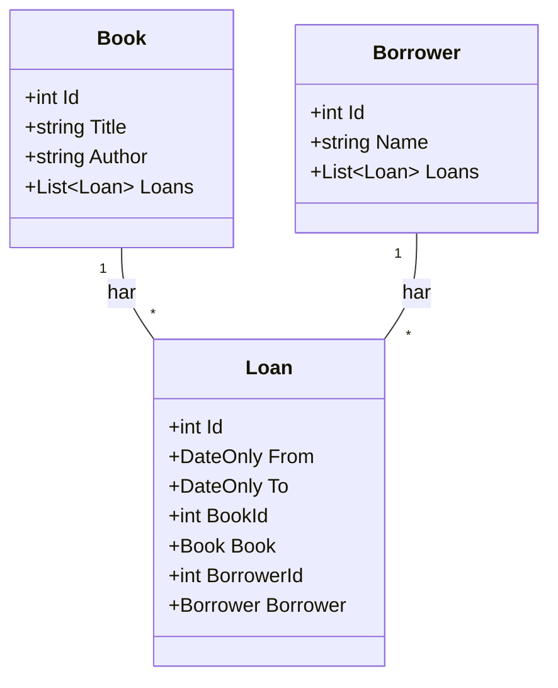

# Läxa C: Tildas bibliotek

**Till:** torsdag 12 november · **Tid:** ca 3–4 timmar för 🟢 + 🟡 · **Gör den:** ensam

**Mål:** När du är klar kan du bygga ett litet system med EF Core: klasser, relationer, migrationer, och en spärr mot krockar. Det är samma delar som i Inlämning 1.

## Berättelsen

Tilda, skrivaren i tornet, har skrivit ner allt Mira gjort. Nu är tornet fullt av böcker, och folk från byn vill låna dem.

"Jag tappar bort vem som har vad," suckar Tilda. "Och i går lånade jag ut samma bok till två personer samtidigt."

Mira tittar på högarna. "Du behöver en databas."

Du har inte bråttom, och du behöver inte göra allt.

## Så här fungerar läxan

| Märke | Betyder | Hur många |
|-------|---------|-----------|
| 🟢 Obligatorisk | Alla ska klara dessa | 2 per del (Del 2: 3, med "Rita först") |
| 🟡 Mer övning | De flesta klarar dessa | 1 per del |
| 🥷 Ninja | Frivillig utmaning | 1 per del |

- Två delar: **böckerna** och **lånen**. Båda görs i samma projekt, `LibraryDb`.
- Samma recept som på måndagen: paketen `Microsoft.EntityFrameworkCore.Sqlite` och `Microsoft.EntityFrameworkCore.Design`.
- Klasserna ligger **under** koden i `Program.cs`.
- Identifierare på engelska, utskrifter på svenska.
- Förväntad output gäller en tom databas. Ta bort `library.db` för att börja om.
- Fastnar du: öppna tipset. Fastnar du fortfarande: skriv ner frågan och ta med den till fredag.

---

## Del 1: Böckerna

Skapa projektet och lägg till paketen först, innan du skriver någon kod:

```bash
dotnet new console -n LibraryDb
cd LibraryDb
dotnet add package Microsoft.EntityFrameworkCore.Sqlite
dotnet add package Microsoft.EntityFrameworkCore.Design
```

> ⚠️ Kör kommandona i mappen där `LibraryDb.csproj` ligger (efter `cd LibraryDb`). Står du i en annan mapp hittar `dotnet add package` och `dotnet ef` inte projektet.

Verktyget `dotnet-ef` installerade du i måndags. Det behövs bara en gång per dator.

Börja sedan med en enda klass och kontexten:

```csharp
class Book
{
    public int Id { get; set; }
    public string Title { get; set; } = "";
    public string Author { get; set; } = "";
}

class LibraryContext : DbContext
{
    public DbSet<Book> Books => Set<Book>();

    protected override void OnConfiguring(DbContextOptionsBuilder options)
        => options.UseSqlite("Data Source=library.db");
}
```

Gör migrationen: `dotnet ef migrations add Init`

### Uppgift 1 🟢 Tre böcker på hyllan

Spara *Drakens dagbok* (Tilda), *Kartor för nybörjare* (Mira) och *Brons hemlighet* (Tilda). Skriv ut alla böcker.

**Förväntad output:**
```text
1: Drakens dagbok av Tilda
2: Kartor för nybörjare av Mira
3: Brons hemlighet av Tilda
```

<details markdown="1">
<summary>Tips</summary>

Öppna databasen med `using var db = new LibraryContext();` och `db.Database.Migrate();`. Sedan `Add` tre gånger och `SaveChanges()` en gång.

</details>

<details markdown="1">
<summary>Lösningsförslag</summary>

```csharp
using var db = new LibraryContext();
db.Database.Migrate();

db.Books.Add(new Book { Title = "Drakens dagbok", Author = "Tilda" });
db.Books.Add(new Book { Title = "Kartor för nybörjare", Author = "Mira" });
db.Books.Add(new Book { Title = "Brons hemlighet", Author = "Tilda" });
db.SaveChanges();
foreach (Book book in db.Books.ToList())
{
    Console.WriteLine($"{book.Id}: {book.Title} av {book.Author}");
}
```

</details>

**Titta i DB Browser:** öppna `library.db` i DB Browser for SQLite. Fliken **Database Structure** visar tabellen `Books`. Fliken **Browse Data** visar de tre böckerna.

### Uppgift 2 🟢 Allt Tilda skrivit

Skriv ut alla böcker av Tilda, sorterade efter titel.

**Förväntad output:**
```text
Tilda skrev: Brons hemlighet
Tilda skrev: Drakens dagbok
```

<details markdown="1">
<summary>Tips</summary>

`Where(...)` för att välja, `OrderBy(...)` för att sortera.

</details>

<details markdown="1">
<summary>Lösningsförslag</summary>

```csharp
foreach (Book book in db.Books.Where(b => b.Author == "Tilda").OrderBy(b => b.Title).ToList())
{
    Console.WriteLine($"Tilda skrev: {book.Title}");
}
```

</details>

### Uppgift 3 🟡 Kartboken försvinner

Mira tar tillbaka sin kartbok. Ta bort *Kartor för nybörjare* och skriv ut hur många böcker som är kvar.

**Förväntad output:**
```text
Böcker kvar: 2
```

<details markdown="1">
<summary>Tips</summary>

Hitta boken med `FirstOrDefault`. Kolla att den inte är `null` innan du tar bort den.

</details>

<details markdown="1">
<summary>Lösningsförslag</summary>

```csharp
Book? map = db.Books.FirstOrDefault(b => b.Title == "Kartor för nybörjare");
if (map != null)
{
    db.Books.Remove(map);
    db.SaveChanges();
}
Console.WriteLine($"Böcker kvar: {db.Books.Count()}");
```

</details>

### Uppgift 4 🥷 Vad skrev EF Core?

Skriv ut SQL:en för frågan i uppgift 2 med `ToQueryString()`.

<details markdown="1">
<summary>Lösningsförslag</summary>

```csharp
Console.WriteLine(db.Books.Where(b => b.Author == "Tilda").ToQueryString());
```

```text
SELECT "b"."Id", "b"."Author", "b"."Title"
FROM "Books" AS "b"
WHERE "b"."Author" = 'Tilda'
```

</details>

---

## Del 2: Lånen

Ett lån kopplar ihop en bok och en låntagare under en period. Lägg till två klasser, ge `Book` en lista och lägg till två tabeller i kontexten:

```csharp
class Borrower
{
    public int Id { get; set; }
    public string Name { get; set; } = "";
    public List<Loan> Loans { get; set; } = new();
}

class Loan
{
    public int Id { get; set; }
    public DateOnly From { get; set; }
    public DateOnly To { get; set; }
    public int BookId { get; set; }
    public Book Book { get; set; } = null!;
    public int BorrowerId { get; set; }
    public Borrower Borrower { get; set; } = null!;
}
```

I `Book`: `public List<Loan> Loans { get; set; } = new();`

I `LibraryContext`: `Borrowers` och `Loans`, på samma sätt som `Books`.

Gör en ny migration: `dotnet ef migrations add AddLoans`

Har du `library.db` öppen i DB Browser: klicka **Close Database** först, annars kan filen vara låst. Ta bort `library.db` innan du kör. Koden från del 1 körs också och lägger in böckerna på nytt, och då stämmer förväntad output.

### Rita först 🟢 Bibliotekets klassdiagram

Rita ett klassdiagram över `Book`, `Borrower` och `Loan` innan du skriver mer kod. Papper och penna räcker. Mermaid går också bra.

1. Rita en ruta per klass. Skriv klassens namn överst.
2. Skriv egenskaperna i rutan, med typ: `+int Id`.
3. Dra en linje mellan klasser som hör ihop.
4. Skriv `1` och `*` vid linjerna. Hur många lån kan en bok ha? Hur många böcker har ett lån?

Samma sorts diagram gör du i Inlämning 1. Det behöver inte vara perfekt. Det ska visa hur du tänkt.

<details markdown="1">
<summary>Lösningsförslag</summary>



En `Book` kan ha många `Loan`, och en `Borrower` kan ha många `Loan`. Varje `Loan` hör till exakt en bok och en låntagare. `Loan` är klassen i mitten som kopplar ihop dem.

</details>

### Uppgift 5 🟢 Mira lånar en bok

Skapa låntagaren Mira. Låt henne låna *Drakens dagbok* 10–24 november 2026.

<details markdown="1">
<summary>Tips</summary>

Du kan sätta `Book = diary` och `Borrower = mira` direkt i lånet. EF Core sparar låntagaren och fyller i båda id:na.

</details>

<details markdown="1">
<summary>Lösningsförslag</summary>

```csharp
Book diary = db.Books.First(b => b.Title == "Drakens dagbok");
var mira = new Borrower { Name = "Mira" };
db.Loans.Add(new Loan { Book = diary, Borrower = mira, From = new DateOnly(2026, 11, 10), To = new DateOnly(2026, 11, 24) });
db.SaveChanges();
```

`First` kastar ett fel om boken inte finns. Här vet vi att den finns. I ett riktigt program använder du `FirstOrDefault` och kollar `null`.

</details>

**Titta i DB Browser:** tryck uppdatera i **Browse Data** och välj tabellen `Loans`. Vilka värden står i `BookId` och `BorrowerId`? Hitta samma id i `Books` och `Borrowers`.

### Uppgift 6 🟢 Vem har vad?

Skriv ut alla lån med låntagare, bok, datum och antal dagar.

**Förväntad output:**
```text
Mira lånar Drakens dagbok 2026-11-10 till 2026-11-24 (14 dagar)
```

<details markdown="1">
<summary>Tips</summary>

Du behöver två `Include`: en för boken och en för låntagaren. Antal dagar: `loan.To.DayNumber - loan.From.DayNumber`.

</details>

<details markdown="1">
<summary>Lösningsförslag</summary>

```csharp
foreach (Loan loan in db.Loans.Include(l => l.Book).Include(l => l.Borrower).ToList())
{
    int days = loan.To.DayNumber - loan.From.DayNumber;
    Console.WriteLine($"{loan.Borrower.Name} lånar {loan.Book.Title} {loan.From:yyyy-MM-dd} till {loan.To:yyyy-MM-dd} ({days} dagar)");
}
```

</details>

### Uppgift 7 🟡 Boken kommer tillbaka

Mira lämnar tillbaka boken. Ta bort lånet och skriv ut hur många lån som är kvar.

**Förväntad output:**
```text
Lån kvar: 0
```

<details markdown="1">
<summary>Lösningsförslag</summary>

```csharp
Loan? returned = db.Loans.FirstOrDefault(l => l.BookId == diary.Id);
if (returned != null)
{
    db.Loans.Remove(returned);
    db.SaveChanges();
}
Console.WriteLine($"Lån kvar: {db.Loans.Count()}");
```

</details>

### Uppgift 8 🥷 Aldrig mer två lån samtidigt

Tilda vill aldrig mer låna ut samma bok två gånger samtidigt. Skriv metoden `TryLend` som:

1. svarar `Slutdatumet måste komma efter startdatumet.` om datumen är fel,
2. svarar `<titel> är redan utlånad då.` om lånet krockar med ett annat lån av samma bok,
3. annars sparar lånet och svarar med en bekräftelse.

Låna först ut *Drakens dagbok* 1–10 december. Testa sedan 5–15 december och 10–20 december.

**Förväntad output:**
```text
Drakens dagbok är redan utlånad då.
Mira lånar Drakens dagbok 2026-12-10 till 2026-12-20.
```

<details markdown="1">
<summary>Tips</summary>

Det är samma regel som på måndagen: två perioder krockar om `l.From < to && from < l.To`. Kolla först att `to` kommer efter `from`. Det är en vakt med `if`.

</details>

<details markdown="1">
<summary>Lösningsförslag</summary>

Vakten först, sedan krockkontrollen, och sist sparas lånet:

```csharp
db.Loans.Add(new Loan { Book = diary, Borrower = mira, From = new DateOnly(2026, 12, 1), To = new DateOnly(2026, 12, 10) });
db.SaveChanges();
Console.WriteLine(TryLend(db, diary, mira, new DateOnly(2026, 12, 5), new DateOnly(2026, 12, 15)));
Console.WriteLine(TryLend(db, diary, mira, new DateOnly(2026, 12, 10), new DateOnly(2026, 12, 20)));

static string TryLend(LibraryContext db, Book book, Borrower borrower, DateOnly from, DateOnly to)
{
    if (to <= from)
    {
        return "Slutdatumet måste komma efter startdatumet.";
    }
    bool taken = db.Loans.Any(l => l.BookId == book.Id && l.From < to && from < l.To);
    if (taken)
    {
        return $"{book.Title} är redan utlånad då.";
    }
    db.Loans.Add(new Loan { Book = book, Borrower = borrower, From = from, To = to });
    db.SaveChanges();
    return $"{borrower.Name} lånar {book.Title} {from:yyyy-MM-dd} till {to:yyyy-MM-dd}.";
}
```

Lånet 10–20 december går bra, eftersom det förra lämnas tillbaka den 10:e. Klarade du den här har du byggt spärren som ger VG i Inlämning 1.

</details>

---

Tilda stänger den sista boken och ler. "Nu vet jag var allt är."
