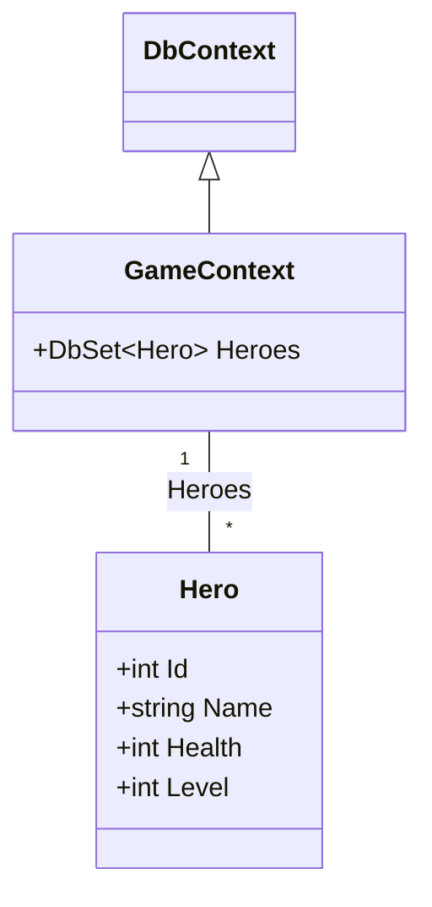

# Övning: Hjältarna i databasen

**Tid:** ca 45 minuter · **Gör den:** i par (en skriver, en läser högt, byt efter varje uppgift)

**Mål:** När du är klar kan du spara, läsa, ändra och ta bort objekt i en databas med EF Core.

## Berättelsen

Mira har fått sällskap. Fler hjältar vill in i äventyret, och JSON-filen räcker inte längre. Idag får hjältarna en riktig databas.

## Innan du börjar

1. Skapa projektet och lägg till paketen:

```bash
dotnet new console -n HeroDb
cd HeroDb
dotnet add package Microsoft.EntityFrameworkCore.Sqlite
dotnet add package Microsoft.EntityFrameworkCore.Design
dotnet tool install --global dotnet-ef
```

Den sista raden behövs bara en gång per dator. Står det att verktyget redan är installerat är allt som det ska.

2. Lägg klasserna **under** koden i `Program.cs`. Överst i filen: `using Microsoft.EntityFrameworkCore;`

```csharp
class Hero
{
    public int Id { get; set; }
    public string Name { get; set; } = "";
    public int Health { get; set; }
    public int Level { get; set; }
}

class GameContext : DbContext
{
    public DbSet<Hero> Heroes => Set<Hero>();

    protected override void OnConfiguring(DbContextOptionsBuilder options)
        => options.UseSqlite("Data Source=game.db");
}
```

3. Skapa ritningen: `dotnet ef migrations add Init`

4. Installera **DB Browser for SQLite** från [sqlitebrowser.org](https://sqlitebrowser.org). Den är gratis och finns för Windows, Mac och Linux. Med den kan du titta in i databasen och se vad din kod gjort.

   Filen `game.db` skapas första gången du kör programmet. Den hamnar i mappen programmet körs från. Kör du `dotnet run` i mappen `HeroDb` hamnar den där. Startar du med knappen i Visual Studio hamnar den i `bin/Debug/net10.0/`.

> **Tips:** Stäng databasen i DB Browser (**Close Database**) innan du kör programmet efter en ny migration, annars kan filen vara låst. Ändra inte data i DB Browser medan programmet körs. Har du ändrat något: tryck **Write Changes** eller **Revert Changes**.

**Börja om från noll:** ta bort filen `game.db`. Nästa `dotnet run` skapar en ny, tom databas. Förväntad output nedan gäller en tom databas.

## Klassdiagram

Läs diagrammet först, skriv koden sedan.



En `Hero` har fyra egenskaper. `GameContext` ärver från `DbContext` och håller många `Hero` i `Heroes`.

---

## Uppgift 1 🟢 Spara Mira

1. Öppna databasen med `using var db = new GameContext();` och `db.Database.Migrate();`
2. Skapa Mira: 100 i hälsa, nivå 1.
3. Lägg till henne och spara.
4. Skriv ut hennes Id.

**Förväntad output:**
```text
Sparade Mira med Id 1
```

<details markdown="1">
<summary>Tips</summary>

Att spara är två steg: `db.Heroes.Add(...)` och sedan `db.SaveChanges()`. Du sätter aldrig `Id` själv. Det gör databasen.

</details>

<details markdown="1">
<summary>Lösningsförslag</summary>

`Migrate()` skapar databasen. Sedan läggs Mira till och sparas:

```csharp
using var db = new GameContext();
db.Database.Migrate();

var mira = new Hero { Name = "Mira", Health = 100, Level = 1 };
db.Heroes.Add(mira);
db.SaveChanges();
Console.WriteLine($"Sparade {mira.Name} med Id {mira.Id}");
```

Efter `SaveChanges()` har `mira.Id` fått sitt värde från databasen.

</details>

**Titta i DB Browser:** öppna `game.db`. I fliken **Database Structure** ser du tabellen `Heroes` med kolumnerna `Id`, `Name`, `Health` och `Level`. Där finns också `__EFMigrationsHistory`, där EF Core skriver upp att migrationen `Init` är körd. Gå sedan till fliken **Browse Data**, välj `Heroes` och tryck uppdatera. Syns Mira?

## Uppgift 2 🟢 Fler hjältar

1. Lägg till Zelda (80 hälsa, nivå 3), Bruno (40, nivå 2) och Ada (65, nivå 5).
2. Spara en gång.
3. Skriv ut alla hjältar.

**Förväntad output:**
```text
1: Mira, 100 hälsa, nivå 1
2: Zelda, 80 hälsa, nivå 3
3: Bruno, 40 hälsa, nivå 2
4: Ada, 65 hälsa, nivå 5
```

<details markdown="1">
<summary>Tips</summary>

Du kan anropa `Add` flera gånger och spara alla med en enda `SaveChanges()`. Alla hjältar får du med `db.Heroes.ToList()`.

</details>

<details markdown="1">
<summary>Lösningsförslag</summary>

Tre `Add`, en `SaveChanges()`, och sedan en vanlig `foreach`:

```csharp
db.Heroes.Add(new Hero { Name = "Zelda", Health = 80, Level = 3 });
db.Heroes.Add(new Hero { Name = "Bruno", Health = 40, Level = 2 });
db.Heroes.Add(new Hero { Name = "Ada", Health = 65, Level = 5 });
db.SaveChanges();
foreach (Hero hero in db.Heroes.ToList())
{
    Console.WriteLine($"{hero.Id}: {hero.Name}, {hero.Health} hälsa, nivå {hero.Level}");
}
```

</details>

## Uppgift 3 🟡 Mira går upp en nivå

1. Hämta hjälten med Id 1 med `Find`.
2. Öka nivån med 1 och spara.
3. Finns ingen hjälte med Id 1: skriv ut `Ingen hjälte med Id 1`.

**Förväntad output:**
```text
Mira gick upp till nivå 2
```

<details markdown="1">
<summary>Tips</summary>

`Find` ger `null` om ingen hittas. Kolla med `if` innan du använder objektet. Du ändrar objektet som vanligt, och `SaveChanges()` skickar ändringen.

</details>

<details markdown="1">
<summary>Lösningsförslag</summary>

`Hero?` betyder att svaret kan vara `null`:

```csharp
Hero? found = db.Heroes.Find(1);
if (found != null)
{
    found.Level = found.Level + 1;
    db.SaveChanges();
    Console.WriteLine($"{found.Name} gick upp till nivå {found.Level}");
}
else
{
    Console.WriteLine("Ingen hjälte med Id 1");
}
```

Du skrev ingen `UPDATE`. EF Core märkte själv att `Level` hade ändrats.

</details>

**Titta i DB Browser:** tryck uppdatera i **Browse Data**. Står Mira på nivå 2?

## Uppgift 4 🟡 De starka först

1. Hämta alla hjältar med minst 50 i hälsa.
2. Sortera dem med högst nivå först.
3. Skriv ut dem.

**Förväntad output:**
```text
Ada (nivå 5, 65 hälsa)
Zelda (nivå 3, 80 hälsa)
Mira (nivå 2, 100 hälsa)
```

<details markdown="1">
<summary>Tips</summary>

Samma LINQ som på listor: `Where(...)` och `OrderByDescending(...)`. Avsluta med `ToList()`.

</details>

<details markdown="1">
<summary>Lösningsförslag</summary>

```csharp
var strong = db.Heroes.Where(h => h.Health >= 50).OrderByDescending(h => h.Level).ToList();
foreach (Hero hero in strong)
{
    Console.WriteLine($"{hero.Name} (nivå {hero.Level}, {hero.Health} hälsa)");
}
```

Bruno saknas, eftersom han bara har 40 i hälsa.

</details>

## Uppgift 5 🔴 Bruno lämnar äventyret

1. Hitta Bruno med `FirstOrDefault` och hans namn.
2. Ta bort honom och spara.
3. Skriv ut hur många hjältar som är kvar.
4. Skriv ut SQL:en som EF Core skapar för frågan i uppgift 4, med `ToQueryString()`.

**Förväntad output:**
```text
Hjältar kvar: 3
SELECT "h"."Id", "h"."Health", "h"."Level", "h"."Name"
FROM "Heroes" AS "h"
WHERE "h"."Health" >= 50
```

<details markdown="1">
<summary>Tips</summary>

`ToQueryString()` fungerar på frågan **innan** du skriver `ToList()`.

</details>

<details markdown="1">
<summary>Lösningsförslag</summary>

```csharp
Hero? bruno = db.Heroes.FirstOrDefault(h => h.Name == "Bruno");
if (bruno != null)
{
    db.Heroes.Remove(bruno);
    db.SaveChanges();
}
Console.WriteLine($"Hjältar kvar: {db.Heroes.Count()}");
Console.WriteLine(db.Heroes.Where(h => h.Health >= 50).ToQueryString());
```

Det är samma SQL som ni skrev för hand i databaskursen.

</details>

**Titta i DB Browser:** tryck uppdatera i **Browse Data**. Är Bruno borta?

**Spara projektet.** Nästa övning bygger vidare på samma databas.
