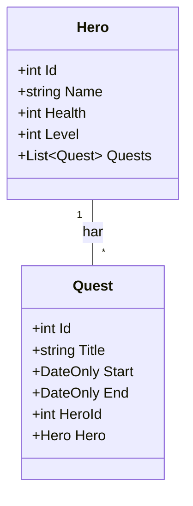

# Övning: Mira tar uppdrag

**Tid:** ca 45 minuter · **Gör den:** i par

**Mål:** När du är klar kan du skapa en relation mellan två klasser, göra en ny migration och hindra att två perioder krockar.

## Berättelsen

Hjältarna sitter i databasen och väntar. Nu kommer uppdragen. Men en hjälte kan inte vara på två ställen samtidigt, och det ska programmet se till.

## Innan du börjar

Fortsätt i projektet `HeroDb` från förra övningen. Ta **inte** bort `game.db`. Hjältarna från förra övningen ska finnas kvar. Paketen är redan installerade, så du behöver inga nya.

Har du `game.db` öppen i DB Browser: klicka **Close Database** innan du kör programmet med den nya migrationen. Annars kan filen vara låst.

## Klassdiagram

Så här ser klasserna ut när uppgift 1 är klar:



En `Hero` har många `Quest`. Varje `Quest` hör till exakt en `Hero`, och `HeroId` håller ihop dem.

---

## Uppgift 1 🟢 En ny klass och en ny ritning

1. Lägg till klassen `Quest` under `Hero`:

```csharp
class Quest
{
    public int Id { get; set; }
    public string Title { get; set; } = "";
    public DateOnly Start { get; set; }
    public DateOnly End { get; set; }
    public int HeroId { get; set; }          // främmande nyckel
    public Hero Hero { get; set; } = null!;  // tillbaka till hjälten
}
```

2. Ge `Hero` en lista: `public List<Quest> Quests { get; set; } = new();`
3. Lägg till `public DbSet<Quest> Quests => Set<Quest>();` i `GameContext`.
4. Gör en ny migration: `dotnet ef migrations add AddQuests`
5. Byt ut koden överst i `Program.cs`, så att den bara öppnar databasen och skriver ut antalet hjältar.

**Förväntad output:**
```text
Hjältar i databasen: 3
```

Hjältarna finns kvar. Migrationen lade till en tabell utan att röra det som redan fanns.

<details markdown="1">
<summary>Tips</summary>

Får du felet `PendingModelChangesWarning`? Då har du glömt steg 4. Klasserna och ritningen stämmer inte överens.

</details>

<details markdown="1">
<summary>Lösningsförslag</summary>

```csharp
using var db = new GameContext();
db.Database.Migrate();

Console.WriteLine($"Hjältar i databasen: {db.Heroes.Count()}");
```

`Migrate()` ser att `AddQuests` inte är körd än och kör den. Tabellen `Quests` skapas.

</details>

**Titta i DB Browser:** öppna `game.db` igen och gå till fliken **Database Structure**. Ser du den nya tabellen `Quests` och kolumnen `HeroId`? Det är den främmande nyckeln. I `__EFMigrationsHistory` står nu både `Init` och `AddQuests`.

## Uppgift 2 🟢 Mira får två uppdrag

1. Hämta Mira med `FirstOrDefault`.
2. Lägg till två uppdrag i hennes lista:
   - *Rädda bron*, 9–12 november 2026
   - *Hitta kartan*, 15–18 november 2026
3. Spara.

**Förväntad output:**
```text
Mira fick två uppdrag
```

<details markdown="1">
<summary>Tips</summary>

Ett datum skapar du med `new DateOnly(2026, 11, 9)`. Du behöver inte sätta `HeroId`. EF Core fyller i det när du lägger uppdraget i `mira.Quests`.

</details>

<details markdown="1">
<summary>Lösningsförslag</summary>

```csharp
Hero? mira = db.Heroes.FirstOrDefault(h => h.Name == "Mira");
if (mira == null)
{
    Console.WriteLine("Hittade inte Mira. Har du kört övning 1?");
    return;
}
mira.Quests.Add(new Quest { Title = "Rädda bron", Start = new DateOnly(2026, 11, 9), End = new DateOnly(2026, 11, 12) });
mira.Quests.Add(new Quest { Title = "Hitta kartan", Start = new DateOnly(2026, 11, 15), End = new DateOnly(2026, 11, 18) });
db.SaveChanges();
Console.WriteLine("Mira fick två uppdrag");
```

`return` avslutar programmet direkt om Mira saknas.

</details>

**Titta i DB Browser:** fliken **Browse Data**, tabellen `Quests`, tryck uppdatera. Vilket `HeroId` har uppdragen? Jämför med Miras `Id` i tabellen `Heroes`.

## Uppgift 3 🟢 Vem gör vad?

Skriv ut alla hjältar med sina uppdrag och hur många dagar varje uppdrag tar.

**Förväntad output:**
```text
Mira har 2 uppdrag
  Rädda bron: 2026-11-09 till 2026-11-12 (3 dagar)
  Hitta kartan: 2026-11-15 till 2026-11-18 (3 dagar)
Zelda har 0 uppdrag
Ada har 0 uppdrag
```

<details markdown="1">
<summary>Tips</summary>

Utan `Include(h => h.Quests)` blir alla listor tomma. Antal dagar: `quest.End.DayNumber - quest.Start.DayNumber`. Datumformat: `{quest.Start:yyyy-MM-dd}`.

</details>

<details markdown="1">
<summary>Lösningsförslag</summary>

```csharp
foreach (Hero hero in db.Heroes.Include(h => h.Quests).ToList())
{
    Console.WriteLine($"{hero.Name} har {hero.Quests.Count} uppdrag");
    foreach (Quest quest in hero.Quests)
    {
        int days = quest.End.DayNumber - quest.Start.DayNumber;
        Console.WriteLine($"  {quest.Title}: {quest.Start:yyyy-MM-dd} till {quest.End:yyyy-MM-dd} ({days} dagar)");
    }
}
```

Två `foreach` i varandra: en för hjältarna och en för varje hjältes uppdrag.

</details>

## Uppgift 4 🟡 Ett uppdrag till Zelda, och tillbaka igen

1. Hämta Zelda.
2. Lägg till uppdraget *Vakta porten* (20–21 november) direkt i `db.Quests`, med `HeroId = zelda.Id`.
3. Skriv ut hur många uppdrag Zelda har.
4. Ta sedan bort *Vakta porten* och skriv ut hur många uppdrag som finns totalt.

**Förväntad output:**
```text
Zelda har 1 uppdrag
Uppdrag totalt: 2
```

<details markdown="1">
<summary>Tips</summary>

Det finns två sätt att koppla ett uppdrag till en hjälte: lägga det i hjältens lista, eller sätta `HeroId`. Här övar du det andra sättet. Att ta bort: `db.Quests.Remove(...)` och `SaveChanges()`.

</details>

<details markdown="1">
<summary>Lösningsförslag</summary>

```csharp
Hero? zelda = db.Heroes.FirstOrDefault(h => h.Name == "Zelda");
if (zelda != null)
{
    db.Quests.Add(new Quest { Title = "Vakta porten", Start = new DateOnly(2026, 11, 20), End = new DateOnly(2026, 11, 21), HeroId = zelda.Id });
    db.SaveChanges();
    Console.WriteLine($"Zelda har {db.Quests.Count(q => q.HeroId == zelda.Id)} uppdrag");
}

Quest? gate = db.Quests.FirstOrDefault(q => q.Title == "Vakta porten");
if (gate != null)
{
    db.Quests.Remove(gate);
    db.SaveChanges();
}
Console.WriteLine($"Uppdrag totalt: {db.Quests.Count()}");
```

Att ta bort en bokning i Hotel Grandioso fungerar precis så.

</details>

## Uppgift 5 🔴 Kan Mira ta uppdraget?

Skriv metoden `CanTakeQuest(GameContext db, int heroId, DateOnly start, DateOnly end)`. Den svarar `upptagen` om hjälten redan har ett uppdrag som krockar, annars `ledig`.

Testa två perioder för Mira:

**Förväntad output:**
```text
11–14 nov: upptagen
12–15 nov: ledig
```

12–15 november är ledigt, eftersom *Rädda bron* slutar den 12:e och *Hitta kartan* börjar den 15:e.

<details markdown="1">
<summary>Tips</summary>

Kom ihåg regeln från lektionen: två perioder krockar om den nya börjar innan den gamla slutar, **och** den gamla börjar innan den nya slutar. `Any(...)` svarar `true` om minst ett uppdrag uppfyller villkoret.

</details>

<details markdown="1">
<summary>Lösningsförslag</summary>

Metoden läggs efter koden men före klasserna, som en `static`-metod:

```csharp
Console.WriteLine($"11–14 nov: {CanTakeQuest(db, mira.Id, new DateOnly(2026, 11, 11), new DateOnly(2026, 11, 14))}");
Console.WriteLine($"12–15 nov: {CanTakeQuest(db, mira.Id, new DateOnly(2026, 11, 12), new DateOnly(2026, 11, 15))}");

static string CanTakeQuest(GameContext db, int heroId, DateOnly start, DateOnly end)
{
    bool busy = db.Quests.Any(q => q.HeroId == heroId && q.Start < end && start < q.End);
    return busy ? "upptagen" : "ledig";
}
```

Byt `Quests` mot `Bookings`, `HeroId` mot `RoomId` och `Start`/`End` mot `CheckIn`/`CheckOut`. Då har du spärren mot dubbelbokning i Hotel Grandioso.

</details>
