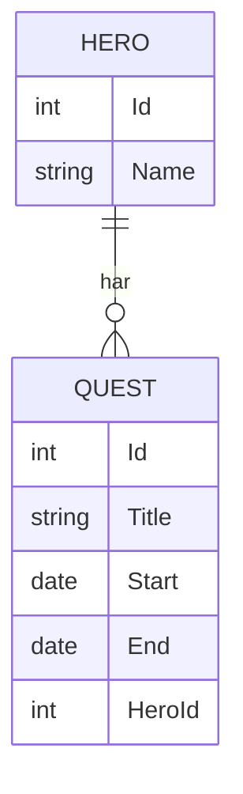

# Mira tar uppdrag (EF Core, relationer)

Det här är läsversionen av måndagens andra lektion. Mira får uppdrag, och vi ser till att hon aldrig kan vara på två ställen samtidigt.

Vi bygger vidare i samma projekt, med samma NuGet-paket som förra gången. Inget nytt behöver installeras.

## En hjälte, många uppdrag

En hjälte kan ha många uppdrag. Varje uppdrag hör till en hjälte. I databaskursen ritade ni det som ett ER-diagram:



Kolumnen `HeroId` i tabellen `Quests` säger vem uppdraget hör till. Den kallas **främmande nyckel**.

## Två klasser som pekar på varandra

```csharp
class Hero
{
    public int Id { get; set; }
    public string Name { get; set; } = "";
    public List<Quest> Quests { get; set; } = new();   // en hjälte har många uppdrag
}

class Quest
{
    public int Id { get; set; }
    public string Title { get; set; } = "";
    public DateOnly Start { get; set; }
    public DateOnly End { get; set; }

    public int HeroId { get; set; }          // främmande nyckel: vem uppdraget hör till
    public Hero Hero { get; set; } = null!;  // navigering tillbaka till hjälten
}
```

Hjälten har en lista med uppdrag. Uppdraget har `HeroId` och en property `Hero` som pekar tillbaka. EF Core förstår av namnen att det är en relation.

`= null!` betyder "jag lovar att EF fyller i den här". Utan den varnar kompilatorn.

Kontexten får en tabell till:

```csharp
class GameContext : DbContext
{
    public DbSet<Hero> Heroes => Set<Hero>();
    public DbSet<Quest> Quests => Set<Quest>();

    protected override void OnConfiguring(DbContextOptionsBuilder options)
        => options.UseSqlite("Data Source=game.db");
}
```

En ny klass betyder en ny ritning. Gör en ny migration:

```bash
dotnet ef migrations add AddQuests
```

Glömmer du migrationen säger EF Core ifrån med felet `PendingModelChangesWarning`. Det betyder "klasserna och ritningen stämmer inte överens".

**Titta i DB Browser:** stäng databasen i DB Browser (**Close Database**) innan du kör programmet, så att filen inte är låst. Kör programmet. `Migrate()` kör då den nya migrationen. Öppna filen igen och gå till fliken **Database Structure**. Där finns nu tabellen `Quests` med kolumnen `HeroId`, den främmande nyckeln. I `__EFMigrationsHistory` står nu både `Init` och `AddQuests`.

## Spara en hjälte med uppdrag

```csharp
// En hjälte med två uppdrag. EF fyller i HeroId åt oss.
var mira = new Hero { Name = "Mira" };
mira.Quests.Add(new Quest { Title = "Rädda bron", Start = new DateOnly(2026, 11, 9), End = new DateOnly(2026, 11, 12) });
mira.Quests.Add(new Quest { Title = "Hitta kartan", Start = new DateOnly(2026, 11, 15), End = new DateOnly(2026, 11, 18) });
db.Heroes.Add(mira);
db.SaveChanges();
```

Du lägger uppdragen i Miras lista som vanligt. När du sparar skriver EF Core både hjälten och uppdragen, och fyller i `HeroId`.

Kontrollera det i DB Browser: fliken **Browse Data**, tabellen `Quests`, tryck uppdatera. Båda uppdragen har samma `HeroId` som Miras `Id` i tabellen `Heroes`.

## Include: hämta det som hör ihop

```csharp
// Include hämtar uppdragen tillsammans med hjälten
foreach (Hero hero in db.Heroes.Include(h => h.Quests).ToList())
{
    Console.WriteLine($"{hero.Name} har {hero.Quests.Count} uppdrag:");
    foreach (Quest quest in hero.Quests)
    {
        int days = quest.End.DayNumber - quest.Start.DayNumber;
        Console.WriteLine($"  {quest.Title}: {quest.Start:yyyy-MM-dd} till {quest.End:yyyy-MM-dd} ({days} dagar)");
    }
}
```

```text
Mira har 2 uppdrag:
  Rädda bron: 2026-11-09 till 2026-11-12 (3 dagar)
  Hitta kartan: 2026-11-15 till 2026-11-18 (3 dagar)
```

EF Core hämtar bara det du ber om. Utan `Include` är listan `Quests` tom, trots att uppdragen finns i databasen.

`DayNumber` är dagens nummer räknat från år 1. Skillnaden mellan två `DayNumber` är antalet dagar. Samma sak blir antalet nätter på ett hotell.

## Kan Mira vara på två ställen samtidigt?

Mira är upptagen 9–12 november. Någon vill ge henne ett nytt uppdrag 11–14 november. Krockar det?

Två perioder kan krocka på fyra sätt:

```text
Befintligt:        |=========|
1. Börjar inne:          |=========|
2. Slutar inne:  |=========|
3. Ligger inne:      |===|
4. Täcker allt: |=================|
```

Det verkar kräva fyra if-satser. Men en enda regel räcker: **två perioder krockar om den nya börjar innan den gamla slutar, och den gamla börjar innan den nya slutar.**

```csharp
// En rad fångar alla sätt två perioder kan krocka på
bool busy = db.Quests.Any(q => q.HeroId == mira.Id && q.Start < newEnd && newStart < q.End);
Console.WriteLine(busy ? "Upptagen! Mira är redan på ett uppdrag då." : "Ledig, uppdraget är bokat.");
```

Testa regeln på de fyra fallen ovan. Den stämmer på alla. Lägg också märke till att ett nytt uppdrag får börja samma dag som det förra slutar, eftersom vi använder `<` och inte `<=`.

Samma rad fungerar på ett hotell. Byt hjälte mot rum och uppdrag mot bokning, så kan Margareta i receptionen aldrig dubbelboka ett rum.

## Sammanfattning

1. En relation är en lista på ena sidan och `XxxId` plus navigering på den andra.
2. Ny klass betyder ny migration.
3. `Include` hämtar det som hör ihop.
4. Två perioder krockar om `a.Start < b.End && b.Start < a.End`.

## Hela koden

```csharp
using Microsoft.EntityFrameworkCore;

using var db = new GameContext();
db.Database.Migrate();

// En hjälte med två uppdrag. EF fyller i HeroId åt oss.
var mira = new Hero { Name = "Mira" };
mira.Quests.Add(new Quest { Title = "Rädda bron", Start = new DateOnly(2026, 11, 9), End = new DateOnly(2026, 11, 12) });
mira.Quests.Add(new Quest { Title = "Hitta kartan", Start = new DateOnly(2026, 11, 15), End = new DateOnly(2026, 11, 18) });
db.Heroes.Add(mira);
db.SaveChanges();

// Include hämtar uppdragen tillsammans med hjälten
foreach (Hero hero in db.Heroes.Include(h => h.Quests).ToList())
{
    Console.WriteLine($"{hero.Name} har {hero.Quests.Count} uppdrag:");
    foreach (Quest quest in hero.Quests)
    {
        int days = quest.End.DayNumber - quest.Start.DayNumber;
        Console.WriteLine($"  {quest.Title}: {quest.Start:yyyy-MM-dd} till {quest.End:yyyy-MM-dd} ({days} dagar)");
    }
}

// Kan Mira ta ett nytt uppdrag 11–14 november?
var newStart = new DateOnly(2026, 11, 11);
var newEnd = new DateOnly(2026, 11, 14);

// En rad fångar alla sätt två perioder kan krocka på
bool busy = db.Quests.Any(q => q.HeroId == mira.Id && q.Start < newEnd && newStart < q.End);
Console.WriteLine(busy ? "Upptagen! Mira är redan på ett uppdrag då." : "Ledig, uppdraget är bokat.");

// Samma rad med en period som inte krockar: 12–15 november
busy = db.Quests.Any(q => q.HeroId == mira.Id && q.Start < new DateOnly(2026, 11, 15) && new DateOnly(2026, 11, 12) < q.End);
Console.WriteLine(busy ? "Upptagen!" : "Ledig 12–15 november.");

class Hero
{
    public int Id { get; set; }
    public string Name { get; set; } = "";
    public List<Quest> Quests { get; set; } = new();   // en hjälte har många uppdrag
}

class Quest
{
    public int Id { get; set; }
    public string Title { get; set; } = "";
    public DateOnly Start { get; set; }
    public DateOnly End { get; set; }

    public int HeroId { get; set; }          // främmande nyckel: vem uppdraget hör till
    public Hero Hero { get; set; } = null!;  // navigering tillbaka till hjälten
}

class GameContext : DbContext
{
    public DbSet<Hero> Heroes => Set<Hero>();
    public DbSet<Quest> Quests => Set<Quest>();

    protected override void OnConfiguring(DbContextOptionsBuilder options)
        => options.UseSqlite("Data Source=game.db");
}
```
