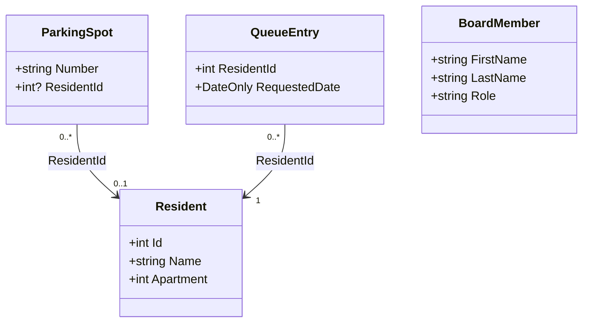

# Övning: Parkeringskön i Brf Solgläntan

**Tid:** ca 45 minuter. 🟢 först, sedan 🟡, sist 🔴.
Läs först `notes/linq_soka_i_data.md` om du inte redan har gjort det.

---

## Berättelsen

Brf Solgläntan är ett bostadsrättsområde i Malmö med åtta lägenheter och sex parkeringsplatser. Styrelsen har en kölista för alla som vill ha en plats, och en regel:

- Den som **inte har någon parkeringsplats** får prioritet i kön.
- Den som **redan har en plats** och vill ha fler hamnar bakom, på en vanlig kölista.
- Inom varje grupp går det på datum: äldst först.

Din uppgift är att svara på styrelsens frågor med LINQ.

---

## Datan i ett diagram (UML)

Så här hänger klasserna ihop. En pil visar vilken klass som pekar på vilken. `ResidentId` är ett nummer som pekar på en boendes `Id`.



Läs diagrammet så här:
- En parkeringsplats hör till **högst en** boende (`0..1`), men en boende kan ha **flera** platser (`0..*`). Anna har två.
- Är `ResidentId` `null` på en plats är den ledig. Frågetecknet i `int?` betyder att talet får vara `null`.
- Varje rad i kön hör till **en** boende.
- Styrelseledamöterna (`BoardMember`) är fristående och pekar inte på någon annan klass.

---

## Startkod

Skapa ett nytt konsolprojekt och klistra in det här. Du ska inte ändra något av det. Dina egna lösningar skriver du **före** raderna som börjar med `record`, alltså efter `board`-listan.

```cs
var residents = new List<Resident>
{
    new(1, "Anna", 1), new(2, "Bertil", 2), new(3, "Cecilia", 3), new(4, "Emil", 4),
    new(5, "Elin", 5), new(6, "Farid", 6), new(7, "Greta", 7), new(8, "Hugo", 8)
};

var spots = new List<ParkingSpot>
{
    new("P1", 1), new("P2", 1), new("P3", 2),
    new("P4", null), new("P5", 3), new("P6", null)
};

var queue = new List<QueueEntry>
{
    new(4, new DateOnly(2026, 1, 10)), new(1, new DateOnly(2026, 1, 12)),
    new(5, new DateOnly(2026, 2, 1)),  new(6, new DateOnly(2026, 2, 15)),
    new(2, new DateOnly(2026, 3, 1))
};

var board = new List<BoardMember>
{
    new("Hugo", "Berg", "Ordförande"), new("Anna", "Svensson", "Kassör"), new("Farid", "Berg", "Sekreterare"),
    new("Cecilia", "Ek", "Ledamot"), new("Elin", "Svensson", "Ledamot"), new("Emil", "Berg", "Suppleant")
};

record Resident(int Id, string Name, int Apartment);
record ParkingSpot(string Number, int? ResidentId);   // null = ledig plats
record QueueEntry(int ResidentId, DateOnly RequestedDate);
record BoardMember(string FirstName, string LastName, string Role);
```

### Vad matas in i varje lista

Varje `new(...)` fyller i en klass, i samma ordning som fälten i diagrammet.

| Lista | Så läser du en rad | Exempel |
|---|---|---|
| `residents` | `new(Id, Name, Apartment)` | `new(1, "Anna", 1)` är boende nummer 1, Anna, i lägenhet 1 |
| `spots` | `new(Number, ResidentId)` | `new("P1", 1)` är plats P1 som tillhör boende 1 (Anna). `new("P4", null)` är en ledig plats |
| `queue` | `new(ResidentId, RequestedDate)` | `new(4, new DateOnly(2026, 1, 10))` är boende 4 (Emil) som ställde sig i kön den 10 januari 2026 |
| `board` | `new(FirstName, LastName, Role)` | `new("Hugo", "Berg", "Ordförande")` är Hugo Berg, ordförande |

`DateOnly` är ett datum utan klockslag. `new DateOnly(2026, 1, 10)` betyder år, månad, dag.

Siffrorna i `spots` och `queue` är **boendens `Id`**, inte lägenhetsnummer. `new("P3", 2)` betyder att plats P3 hör till boende 2 (Bertil), som bor i lägenhet 2.

**Varför ligger `record`-raderna sist?** Filen har ingen `Main`-metod, utan raderna överst körs i tur och ordning. Då kräver C# att all kod som körs står före deklarationer av nya typer som `record` och `class`. Lägger du en `record` mitt bland raderna som körs får du ett kompileringsfel. Därför skriver du dina lösningar före `record`-raderna, och typerna står längst ned.

Annas lägenhet har två platser (P1 och P2). Bertil har en (P3), Cecilia har en (P5), och P4 och P6 är lediga. Styrelsen (`board`) har sex ledamöter.

---

## 🟢 Del 1: Hitta och plocka ut

### Uppgift 1: Lediga platser
Skriv ut numren på alla lediga parkeringsplatser.

Förväntad output:
```
Lediga platser: P4, P6
```

<details>
<summary>Ledtråd</summary>

En ledig plats har `ResidentId` som är `null`. Du behöver ett steg som behåller dem (`Where`) och ett som plockar ut numret (`Select`). `string.Join(", ", ...)` sätter ihop dem till en rad.
</details>

### Uppgift 2: Lägenheter längre bort
Skriv ut namnen på de boende som bor i lägenhet 6 eller högre.

Förväntad output:
```
Lägenhet över 5: Farid, Greta, Hugo
```

### Uppgift 3: Räkna och fråga
Skriv ut hur många lediga platser det finns, och om någon boende har mer än en plats.

Förväntad output:
```
Antal lediga: 2
Någon med fler än en plats? True
```

<details>
<summary>Ledtråd</summary>

`Count` räknar de som uppfyller ett villkor. `Any` svarar `True` eller `False`. För en boende kan du räkna hens platser med `spots.Count(s => s.ResidentId == r.Id)`.
</details>

---

## 🟡 Del 2: Sortera och kombinera

### Uppgift 4: Kön efter datum
Skriv ut namnen på alla i kön, äldsta förfrågan först. Namnet hittar du genom att slå upp boenden med `queue`-postens `ResidentId`.

Förväntad output:
```
Kö efter datum: Emil, Anna, Elin, Farid, Bertil
```

<details>
<summary>Ledtråd</summary>

Sortera med `OrderBy(q => q.RequestedDate)`. För att få fram namnet kan du i `Select` använda `residents.First(r => r.Id == q.ResidentId).Name`.
</details>

### Uppgift 5: Boende utan plats
Skriv ut namnen på alla boende som inte har någon parkeringsplats alls.

Förväntad output:
```
Utan plats: Emil, Elin, Farid, Greta, Hugo
```

<details>
<summary>Ledtråd</summary>

Du vill behålla en boende om det **inte** finns någon plats som hör till hen. Vänd på `Any` med `!`.
</details>

### Uppgift 6: Styrelsen i bokstavsordning
Skriv ut styrelsens ledamöter sorterade på **efternamn**. De som har samma efternamn ska sorteras på **förnamn**. Skriv ett namn per rad, efternamn först.

Förväntad output:
```
Berg Emil
Berg Farid
Berg Hugo
Ek Cecilia
Svensson Anna
Svensson Elin
```

<details>
<summary>Ledtråd</summary>

Börja med att försöka sortera två gånger efter varandra, först på efternamn och sedan på förnamn. Stämmer resultatet med förväntad output? Fundera på varför det blev som det blev.
</details>

<details>
<summary>Fastnat efter flera försök? Läs här</summary>

Varje `OrderBy` börjar om och sorterar hela listan på nytt, så den andra raderar den första. Du letar efter ett steg som sorterar **vidare inom** de som är lika. Det heter `ThenBy`: `OrderBy(...).ThenBy(...)`. (Det finns varken `ThenOrderBy` eller `ThenSortBy`, så det är fel namn om du försökte med dem.)
</details>

---

## 🔴 Del 3: Styrelsens regel

### Uppgift 7: Kön med prioritet
Skriv ut kön så som styrelsen vill ha den: först de som saknar plats (äldst först), sedan de som redan har en plats (äldst först).

Förväntad output:
```
Prioriterad kö: Emil, Elin, Farid, Anna, Bertil
```

Lägg märke till att Anna har äldre datum än Elin och Farid, men hamnar bakom dem. Det är regeln.

<details>
<summary>Ledtråd</summary>

Du sorterar på två saker efter varandra, som i uppgift 6. Det första du sorterar på är "har personen redan en plats?" (`true` eller `false`). Tänk på vilket av `false` och `true` som kommer först.
</details>

### Uppgift 8: Nästa lediga plats
Vem ska få nästa lediga plats? Skriv ut platsens nummer och namnet.

Förväntad output:
```
P4 går till Emil
```

---

## Till handledningen

1. I uppgift 7: varför hamnar `false` före `true` när vi sorterar?
2. Kan du skriva uppgift 1 både med en loop och med LINQ? Vilken av dem är lättast att läsa?
3. I uppgift 6: vad hände när du sorterade två gånger efter varandra med `OrderBy`, och varför?
