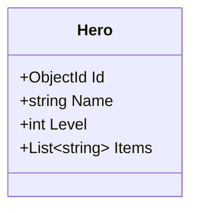

# Övning: Mira i en låda

**Tid:** ca 20 minuter · **Gör den:** i par

**Mål:** När du är klar kan du förklara skillnaden mellan en SQL-databas och en dokumentdatabas, och när du väljer vilken.

Uppgift 1 och 2 görs med papper och penna. Uppgift 3 och 4 kräver Docker och är frivilliga idag.

## Klassdiagram

Det här är klassen `Hero` som du använder i uppgift 3 och 4:



Det finns bara en ruta. `Items` är en lista inne i hjälten, inte en egen klass. Därför blir hela hjälten ett enda dokument.

---

## Uppgift 1 🟢 Rita Mira som dokument

Mira har namnet Mira, nivå 2, och bär ett svärd, en karta och en lykta. Hon har också två uppdrag: *Rädda bron* och *Hitta kartan*.

Skriv Mira som **ett** JSON-dokument, med uppdragen inne i dokumentet.

<details markdown="1">
<summary>Tips</summary>

En lista skrivs med `[ ]`. En lista med objekt blir `[ { ... }, { ... } ]`.

</details>

<details markdown="1">
<summary>Lösningsförslag</summary>

```json
{
  "Name": "Mira",
  "Level": 2,
  "Items": ["Svärd", "Karta", "Lykta"],
  "Quests": [
    { "Title": "Rädda bron", "Start": "2026-11-09", "End": "2026-11-12" },
    { "Title": "Hitta kartan", "Start": "2026-11-15", "End": "2026-11-18" }
  ]
}
```

Allt om Mira ligger i ett dokument. I EF Core låg uppdragen i en egen tabell.

</details>

## Uppgift 2 🟢 Var hör det hemma?

Välj SQL (EF Core) eller dokument (MongoDB) för varje fall, och skriv en mening om varför.

1. Hotellbokningar, där ett rum aldrig får dubbelbokas.
2. Varje spelares inventarie, där två spelare kan ha helt olika saker.
3. Ett blogginlägg med kommentarer som alltid visas tillsammans.

<details markdown="1">
<summary>Lösningsförslag</summary>

1. **SQL.** Bokningar, rum och gäster hänger ihop och måste stämma. Relationer och regler passar bäst i en SQL-databas.
2. **Dokument.** Inventariet ser olika ut för varje spelare och läses alltid som en helhet.
3. **Dokument fungerar bra.** Kommentarerna visas alltid med inlägget och kan ligga inne i det. SQL fungerar också. Det finns inget enda rätt svar.

</details>

## Uppgift 3 🟡 Kör MongoDB (frivillig)

1. Starta MongoDB: `docker run -d --name mongo -p 27017:27017 mongo`
2. Skapa ett projekt och lägg till paketet i projektmappen (där `.csproj`-filen ligger): `dotnet add package MongoDB.Driver`
3. Spara Mira med `InsertOne` och skriv ut alla hjältar med nivå 2 eller högre.

**Förväntad output** (ditt Id blir ett annat):
```text
Sparade Mira med Id 6730f1c2a4b5c6d7e8f90123
Mira, nivå 2, bär: Svärd, Karta, Lykta
```

<details markdown="1">
<summary>Tips</summary>

Överst i filen: `using MongoDB.Bson;` och `using MongoDB.Driver;`. Klassen behöver `public ObjectId Id { get; set; }`.

</details>

<details markdown="1">
<summary>Lösningsförslag</summary>

```csharp
using MongoDB.Bson;
using MongoDB.Driver;

// Tänk på att lägga till Try Catch
var client = new MongoClient("mongodb://localhost:27017");
IMongoDatabase db = client.GetDatabase("game");
IMongoCollection<Hero> heroes = db.GetCollection<Hero>("heroes");

var mira = new Hero
{
    Name = "Mira",
    Level = 2,
    Items = new List<string> { "Svärd", "Karta", "Lykta" }
};
heroes.InsertOne(mira);
Console.WriteLine($"Sparade {mira.Name} med Id {mira.Id}");

List<Hero> found = heroes.Find(h => h.Level >= 2).ToList();
foreach (Hero hero in found)
{
    Console.WriteLine($"{hero.Name}, nivå {hero.Level}, bär: {string.Join(", ", hero.Items)}");
}

class Hero
{
    public ObjectId Id { get; set; }
    public string Name { get; set; } = "";
    public int Level { get; set; }
    public List<string> Items { get; set; } = new();
}
```

Ingen migration och ingen `SaveChanges()`. Dokumentet sparas direkt.

</details>

## Uppgift 4 🔴 Vem bär en karta? (frivillig)

1. Hitta alla hjältar som har `"Karta"` i sin lista `Items`.
2. Höj Miras nivå till 3 med `UpdateOne`.
3. Ta bort Mira med `DeleteOne` och skriv ut hur många hjältar som är kvar.

<details markdown="1">
<summary>Lösningsförslag</summary>

```csharp
List<Hero> withMap = heroes.Find(h => h.Items.Contains("Karta")).ToList();
Console.WriteLine($"Med karta: {withMap.Count}");

heroes.UpdateOne(h => h.Id == mira.Id, Builders<Hero>.Update.Set(h => h.Level, 3));

heroes.DeleteOne(h => h.Id == mira.Id);
Console.WriteLine($"Hjältar kvar: {heroes.CountDocuments(h => true)}");
```

`Contains` letar inne i listan i dokumentet. I SQL hade du behövt en `JOIN`.

</details>
