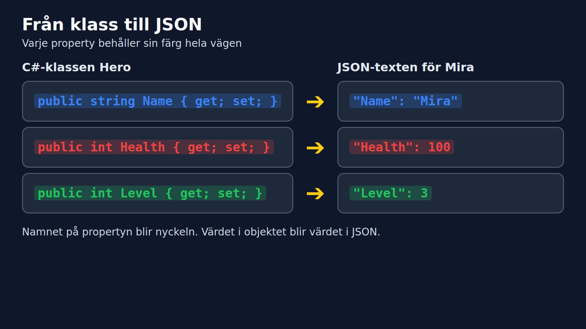
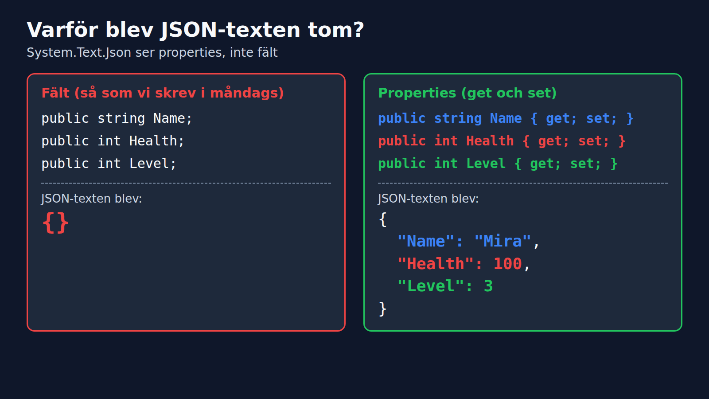

# Spara Mira i en fil, del 1

**Kurs:** Fördjupad OOP i C#
**Modul:** 01 Spara och ladda data (JSON)

Marcus Ackre Medina · YRGO · CLO26

---

## Förra gången: vad ser man genom en `abstract class`?

```csharp
List<Character> scene = new List<Character> { mira, zelda };

foreach (Character c in scene)
{
    Console.WriteLine($"{c.Name}: {c.Speak()}");   // fungerar
    c.FlyAway();                                   // kompileringsfel
}
```

Listan vet bara det som står i `Character`. `FlyAway()` finns bara på `Wizard`.

---

## ...och genom ett `interface`?

```csharp
IHealer healer = zelda;

healer.Heal(mira);     // fungerar
healer.Attack();       // kompileringsfel

List<IHealer> healers = scene.OfType<IHealer>().ToList();
```

Interfacet släpper bara igenom det det har lovat: `Heal()`. Zelda är fortfarande en `Wizard`, men härifrån syns bara läkaren.

---

## Samma objekt, olika fönster


---

## Mira i minnet

```csharp
Hero mira = new Hero("Mira", 100);
```

Objektet bor i minnet. Stänger vi programmet töms minnet.

Nästa gång vi startar får vi bygga om henne från noll.

Vad händer med Mira när vi stänger programmet? Vi behöver en plats där hon kan sova över natten.

---

## Idén: en textfil

Vi gör om objektet till text och sparar texten i en fil.

Det finns ett vanligt format för det. Det heter **JSON**.

Ni har sett det förut, fast kanske inte tänkt på det.

---

## Samma Mira, som text



---

## Tre små regler

```json
{
  "Name": "Mira",
  "Health": 100,
  "Level": 3
}
```

- Texter står inom citattecken. Tal gör inte det.
- Varje rad är `"nyckel": värde`.
- Klammrarna `{ }` hör ihop, som ett objekt.

---

## Att göra om objekt till text heter Serialize

```csharp
using System.Text.Json;

string json = JsonSerializer.Serialize(mira);
Console.WriteLine(json);
```

`Serialize` tar ett objekt och ger tillbaka text.

---

## Vi provar med Hero från måndagen

```csharp
class Hero
{
    public string Name;
    public int Health;
    public int Level;
}
```

Det är samma klass som vi skrev förra gången.

---

## Resultatet

```
{}
```

Tomt. Ingen `Name`, ingen `Health`, inget alls.

Vad tror ni har hänt?

---

## Varför blev det tomt?



---

## Lösningen: properties

```csharp
class Hero
{
    public string Name { get; set; } = "";
    public int Health { get; set; }
    public int Level { get; set; }
}
```

`{ get; set; }` gör fältet till en property. Nu ser `JsonSerializer` det.

---

## Nu fungerar det

```csharp
Hero mira = new Hero { Name = "Mira", Health = 100, Level = 3 };
string json = JsonSerializer.Serialize(mira);
Console.WriteLine(json);
```

**Output:**
```
{"Name":"Mira","Health":100,"Level":3}
```

Rätt innehåll, men allt på en rad.

---

## Gör texten läsbar

```csharp
JsonSerializerOptions options = new JsonSerializerOptions
{
    WriteIndented = true
};

string json = JsonSerializer.Serialize(mira, options);
```

**Output:**
```
{
  "Name": "Mira",
  "Health": 100,
  "Level": 3
}
```
