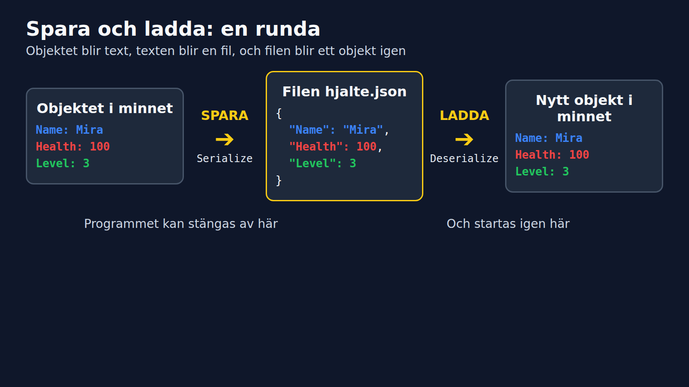

# Spara Mira i en fil, del 2

**Kurs:** Fördjupad OOP i C#
**Modul:** 01 Spara och ladda data (JSON)

Marcus Ackre Medina · YRGO · CLO26

---

## Där vi var

Mira är text. Det heter `Serialize`, och vi fixade den tomma `{}` med properties.

```json
{
  "Name": "Mira",
  "Health": 100,
  "Level": 3
}
```

Nu: skriv texten till en fil, och läs tillbaka den.

---

## Spara i en fil

```csharp
File.WriteAllText("hjalte.json", json);
```

Nu finns en riktig fil, `hjalte.json`. Öppna den i VS Code och se efter.

---

## Var hamnade filen?

Den ligger bredvid programmet, i mappen `bin/Debug/net10.0/`.

```csharp
Console.WriteLine(Path.GetFullPath("hjalte.json"));
```

Skriv ut sökvägen, så vet ni var ni ska leta.

---

## Ladda: från fil till objekt

```csharp
string text = File.ReadAllText("hjalte.json");
Hero loaded = JsonSerializer.Deserialize<Hero>(text)!;

Console.WriteLine($"{loaded.Name} är level {loaded.Level}");
```

**Output:**
```
Mira är level 3
```

`Deserialize<Hero>` gör text till ett `Hero`-objekt igen.

---

## Hela rundan



---

## Det stora testet

Vi har ett objekt, en fil och en väg tillbaka.

Men har vi bevisat att Mira överlever en natt?

<!-- WOW-MOMENT: stäng programmet, starta om, och hjälten finns kvar -->

---

## Programmet som minns

```csharp
string path = "mira.json";
Hero hero;

if (File.Exists(path))
{
    hero = JsonSerializer.Deserialize<Hero>(File.ReadAllText(path))!;
    Console.WriteLine($"Välkommen tillbaka, {hero.Name}!");
}
else
{
    hero = new Hero { Name = "Mira", Health = 100, Level = 1 };
    Console.WriteLine("Ny hjälte skapad.");
}
```

---

## Hon levlar upp varje gång

```csharp
hero.Level++;
File.WriteAllText(path, JsonSerializer.Serialize(hero));
Console.WriteLine($"{hero.Name} är nu level {hero.Level}.");
```

Kör. **Stäng. Kör igen.** Kör en gång till.

```
Ny hjälte skapad.
Mira är nu level 2.

Välkommen tillbaka, Mira!
Mira är nu level 3.
```

---

## Samma sak i ett riktigt system

Spel och appar sparar inställningar på samma sätt.

```csharp
class GameSettings
{
    public string PlayerName { get; set; } = "";
    public bool MusicOn { get; set; }
    public int Volume { get; set; }
}
```

---

## settings.json

```json
{
  "PlayerName": "Mira",
  "MusicOn": true,
  "Volume": 70
}
```

Ny klass, nya properties, exakt samma tre steg: `Serialize`, `WriteAllText`, `Deserialize`.

---

## Skriv själva, 2 minuter

1. Vad gör `Serialize`, och vad gör `Deserialize`?
2. Varför blev JSON-texten `{}` när vi hade fält?
3. Vad gör `WriteIndented = true`?

---

## Nu: er tur

Ni sparar och laddar en egen hjälte, i par. Mira har fått sällskap av er.
