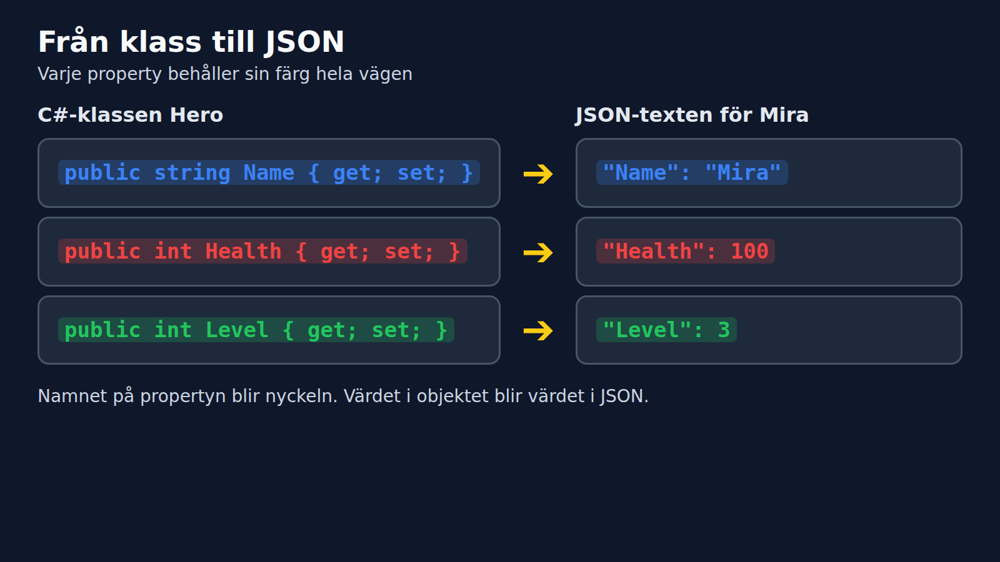
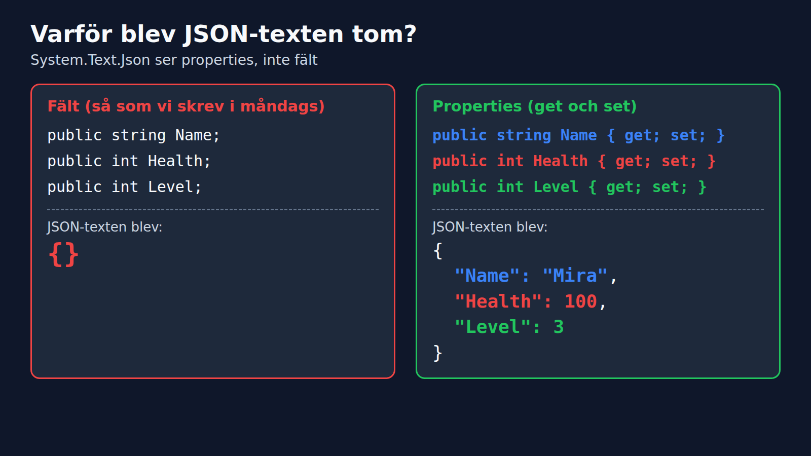
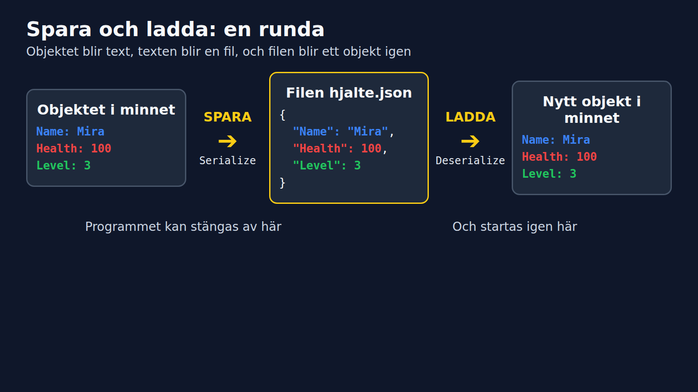

# Spara ett objekt som JSON

Det här är läsversionen av onsdagens förmiddag. Vi sparar Mira i en fil, och startar om programmet för att se att hon finns kvar.

## Problemet: Mira försvinner

Ett objekt bor i minnet. När programmet stängs töms minnet, och Mira är borta. För att hon ska överleva behöver vi spara henne någonstans, och en textfil duger bra.

## JSON är objekt som text

JSON är ett textformat. Vi tar objektet Mira och skriver ner dess värden:



```json
{
  "Name": "Mira",
  "Health": 100,
  "Level": 3
}
```

Tre regler räcker:

- Texter står inom citattecken. Tal gör inte det.
- Varje rad är `"nyckel": värde`.
- Klammrarna `{ }` hör ihop, som ett objekt.

## Serialize: objekt till text

```csharp
using System.Text.Json;

string json = JsonSerializer.Serialize(mira);
Console.WriteLine(json);
```

## Första försöket ger `{}`

Med klassen från måndagen blir resultatet tomt:

```csharp
class Hero
{
    public string Name;
    public int Health;
    public int Level;
}
```

**Output:**
```
{}
```



`System.Text.Json` ser properties, inte fält. Ett fält är `public string Name;`. En property är `public string Name { get; set; }`.

## Fixa med properties

```csharp
class Hero
{
    public string Name { get; set; } = "";
    public int Health { get; set; }
    public int Level { get; set; }
}

Hero mira = new Hero { Name = "Mira", Health = 100, Level = 3 };
string json = JsonSerializer.Serialize(mira);
Console.WriteLine(json);
```

**Output:**
```
{"Name":"Mira","Health":100,"Level":3}
```

## Läsbar text med WriteIndented

```csharp
JsonSerializerOptions options = new JsonSerializerOptions
{
    WriteIndented = true
};

string json = JsonSerializer.Serialize(mira, options);
```

**Output:**
```
{
  "Name": "Mira",
  "Health": 100,
  "Level": 3
}
```

## Spara och ladda

```csharp
// Spara
File.WriteAllText("hjalte.json", json);

// Ladda
string text = File.ReadAllText("hjalte.json");
Hero loaded = JsonSerializer.Deserialize<Hero>(text)!;

Console.WriteLine($"{loaded.Name} är level {loaded.Level}");
```

**Output:**
```
Mira är level 3
```

Filen hamnar bredvid programmet, i `bin/Debug/net10.0/`. Vill du veta var den ligger: `Console.WriteLine(Path.GetFullPath("hjalte.json"));`



## Programmet som minns

```csharp
string path = "mira.json";
Hero hero;

if (File.Exists(path))
{
    hero = JsonSerializer.Deserialize<Hero>(File.ReadAllText(path))!;
    Console.WriteLine($"Välkommen tillbaka, {hero.Name}!");
}
else
{
    hero = new Hero { Name = "Mira", Health = 100, Level = 1 };
    Console.WriteLine("Ny hjälte skapad.");
}

hero.Level++;
File.WriteAllText(path, JsonSerializer.Serialize(hero));
Console.WriteLine($"{hero.Name} är nu level {hero.Level}.");
```

Första körningen:
```
Ny hjälte skapad.
Mira är nu level 2.
```

Andra körningen:
```
Välkommen tillbaka, Mira!
Mira är nu level 3.
```

## Samma sak i ett riktigt system

Spel och appar sparar inställningar på samma sätt.

```csharp
class GameSettings
{
    public string PlayerName { get; set; } = "";
    public bool MusicOn { get; set; }
    public int Volume { get; set; }
}
```

```json
{
  "PlayerName": "Mira",
  "MusicOn": true,
  "Volume": 70
}
```

Ny klass, men samma tre steg: `Serialize`, `File.WriteAllText`, `Deserialize`.

## Att ta med dig

1. `Serialize` gör ett objekt till text. `Deserialize` gör text till ett objekt.
2. `System.Text.Json` kräver properties. Fält ger `{}`.
3. `WriteIndented = true` ger läsbar JSON.
4. `File.WriteAllText` och `File.ReadAllText` sköter filen.
5. Samma tre steg fungerar för vilken klass som helst.

Termer finns i `termer/json_spara_objekt.md`.
