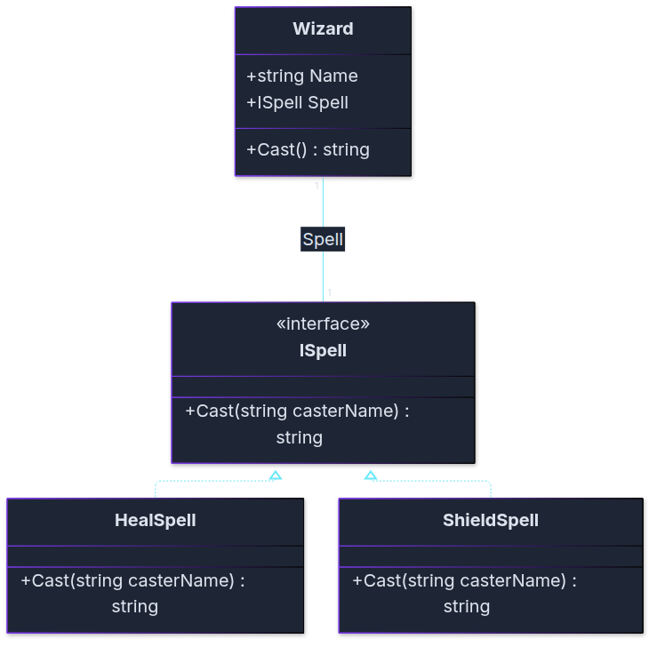

# Läxa D: Mira och verktygslådan

**Till:** fredag 13 november · **Tid:** ca 2–3 timmar för 🟢 + 🟡 · **Gör den:** ensam

## Berättelsen

Efter striden vid bron hittar Mira en gammal verktygslåda under en sten. Den är full av lappar.
På varje lapp står ett namn: *Strategy*, *Factory*, *Observer*. Under namnet står ett problem som verktyget löser.

Zelda läser lapparna högt. "Det här har vi redan gjort", säger hon. "Vi visste bara inte vad det hette."

I kväll provar Mira verktygen ett i taget. Du hjälper henne.

## Så här fungerar läxan

| Märke | Betyder |
|-------|---------|
| 🟢 Obligatorisk | Alla ska klara dessa |
| 🟡 Mer övning | De flesta klarar dessa |
| 🥷 Ninja | Frivillig utmaning |

- Fyra delar: **Strategy**, **Factory**, **Observer** och **känna igen**. Del 4 har ingen kod.
- Skapa ett **nytt konsolprojekt per del**, så att klasserna inte krockar.
- Klasserna skrivs **efter** koden som körs i `Program.cs`, annars får du felet CS8803.
- Identifierare skrivs på engelska. Utskrifterna är på svenska.
- Skriv koden själv innan du öppnar lösningsförslaget. Det är när du kör fast som du lär dig mest.
- Fastnar du helt: skriv ner frågan och ta med den till fredag.

---

# Del 1: Strategy

*Lappen säger: "Samma uppgift, flera sätt. Lägg varje sätt i en egen klass."
Zelda kan två trollformler. Hon vill kunna byta mellan dem utan att lära om allt.*

### Rita först 🟢 Zeldas klassdiagram

Läs uppgift 1.1 nedan. Rita sedan ett klassdiagram innan du skriver kod. Papper och penna räcker. Mermaid går också bra.

1. Rita en ruta per klass och en för interfacet. Skriv `<<interface>>` överst i interfacets ruta.
2. Skriv fälten och metoderna i rutorna, till exempel `+Cast() string`.
3. Dra en streckad linje från varje trollformel till `ISpell`.
4. Dra en linje från `Wizard` till `ISpell`. Skriv `Spell` vid linjen.

Samma sorts diagram gör du i Inlämning 1. Det behöver inte vara perfekt. Det ska visa hur du tänkt.

<details markdown="1">
<summary>Lösningsförslag</summary>



<!-- mermaid: diagrams/lara_d_mira_och_verktygsladan_1.mmd -->

`HealSpell` och `ShieldSpell` lovar att kunna `ISpell`. En `Wizard` har en `Spell`, och linjen går till interfacet. Jämför med diagrammet i Strategy-övningen: samma form, andra namn.

</details>

### Uppgift 1.1 🟢 Zeldas trollformler

1. Skapa `interface ISpell` med `string Cast(string casterName);`.
2. Skapa `HealSpell` (`Zelda läker gruppen. (+20 hälsa)`) och `ShieldSpell` (`Zelda lägger en sköld runt Mira.`).
3. Skapa `Wizard` med `Name`, `Spell` (av typen `ISpell`), en konstruktor och `Cast()` som frågar trollformeln.
4. Låt Zelda kasta läkning, byt till sköld med en rad och kasta igen.

**Förväntad output:**
```
Zelda läker gruppen. (+20 hälsa)
Zelda lägger en sköld runt Mira.
```

<details markdown="1">
<summary>Tips</summary>

Det är samma form som Mira och vapnen. `Wizard` motsvarar `Hero`, och `ISpell` motsvarar `IAttackStrategy`.

</details>

<details markdown="1">
<summary>Lösningsförslag</summary>

```csharp
// Hela programmet: läxa D, uppgift 1.1
Wizard zelda = new Wizard("Zelda", new HealSpell());
Console.WriteLine(zelda.Cast());

zelda.Spell = new ShieldSpell();
Console.WriteLine(zelda.Cast());

interface ISpell
{
    string Cast(string casterName);
}

class HealSpell : ISpell
{
    public string Cast(string casterName)
    {
        return $"{casterName} läker gruppen. (+20 hälsa)";
    }
}

class ShieldSpell : ISpell
{
    public string Cast(string casterName)
    {
        return $"{casterName} lägger en sköld runt Mira.";
    }
}

class Wizard
{
    public string Name;
    public ISpell Spell;

    public Wizard(string name, ISpell spell)
    {
        Name = name;
        Spell = spell;
    }

    public string Cast()
    {
        return Spell.Cast(Name);
    }
}
```

</details>

### Uppgift 1.2 🟡 Trollboken

1. Lägg till `LightningSpell`: `Zelda kallar ner en blixt! (12 skada)`.
2. Lägg alla tre trollformlerna i en `List<ISpell>`, en "trollbok".
3. Gå igenom trollboken med `foreach`. Byt Zeldas trollformel och kasta den, en i taget.

**Förväntad output:**
```
Zelda läker gruppen. (+20 hälsa)
Zelda lägger en sköld runt Mira.
Zelda kallar ner en blixt! (12 skada)
```

<details markdown="1">
<summary>Tips</summary>

Listan är av typen `List<ISpell>`. I loopen: `zelda.Spell = spell;` och sedan `zelda.Cast()`.

</details>

<details markdown="1">
<summary>Lösningsförslag</summary>

```csharp
// Hela programmet: läxa D, uppgift 1.2
Wizard zelda = new Wizard("Zelda", new HealSpell());

List<ISpell> spellBook = new List<ISpell>();
spellBook.Add(new HealSpell());
spellBook.Add(new ShieldSpell());
spellBook.Add(new LightningSpell());

foreach (ISpell spell in spellBook)
{
    zelda.Spell = spell;
    Console.WriteLine(zelda.Cast());
}

interface ISpell
{
    string Cast(string casterName);
}

class HealSpell : ISpell
{
    public string Cast(string casterName)
    {
        return $"{casterName} läker gruppen. (+20 hälsa)";
    }
}

class ShieldSpell : ISpell
{
    public string Cast(string casterName)
    {
        return $"{casterName} lägger en sköld runt Mira.";
    }
}

class LightningSpell : ISpell
{
    public string Cast(string casterName)
    {
        return $"{casterName} kallar ner en blixt! (12 skada)";
    }
}

class Wizard
{
    public string Name;
    public ISpell Spell;

    public Wizard(string name, ISpell spell)
    {
        Name = name;
        Spell = spell;
    }

    public string Cast()
    {
        return Spell.Cast(Name);
    }
}
```

</details>

---

# Del 2: Factory

*Nästa lapp: "Skapa saker på ett enda ställe." Byns butik säljer drycker. Kunderna säger bara en färg.*

### Uppgift 2.1 🟢 Dryckesfabriken

1. Skapa `Potion` med `Name`, `Power` och en konstruktor.
2. Skapa `static class PotionFactory` med `Potion Create(string color)`:
   - `"red"` ger `Läkande dryck` med kraften 30.
   - `"blue"` ger `Magidryck` med kraften 20.
   - Annan färg ger `throw new ArgumentException($"Butiken har ingen dryck som heter '{color}'.")`.
3. Beställ en röd och en blå dryck och skriv ut dem.

**Förväntad output:**
```
Läkande dryck ger 30.
Magidryck ger 20.
```

<details markdown="1">
<summary>Tips</summary>

Fabriken behöver inga nya klasser för varje dryck. Den kan skapa samma klass med olika värden: `return new Potion("Läkande dryck", 30);`.

</details>

<details markdown="1">
<summary>Lösningsförslag</summary>

```csharp
// Hela programmet: läxa D, uppgift 2.1
Potion red = PotionFactory.Create("red");
Potion blue = PotionFactory.Create("blue");

Console.WriteLine($"{red.Name} ger {red.Power}.");
Console.WriteLine($"{blue.Name} ger {blue.Power}.");

class Potion
{
    public string Name;
    public int Power;

    public Potion(string name, int power)
    {
        Name = name;
        Power = power;
    }
}

static class PotionFactory
{
    public static Potion Create(string color)
    {
        switch (color)
        {
            case "red":
                return new Potion("Läkande dryck", 30);
            case "blue":
                return new Potion("Magidryck", 20);
            default:
                throw new ArgumentException($"Butiken har ingen dryck som heter '{color}'.");
        }
    }
}
```

</details>

### Uppgift 2.2 🟡 Inköpslistan

Mira har en inköpslista: `"red,blue,green"`. Butiken har ingen grön dryck.

1. Dela listan med `Split(',')` och beställ varje dryck från fabriken.
2. Fånga felet för den gröna drycken, skriv ut det och fortsätt.
3. Skriv ut hur många drycker Mira fick.

**Förväntad output:**
```
Butiken har ingen dryck som heter 'green'.
Mira köpte 2 drycker.
```

<details markdown="1">
<summary>Tips</summary>

`try`/`catch` ska ligga inuti `foreach`, runt anropet till fabriken.

</details>

<details markdown="1">
<summary>Lösningsförslag</summary>

```csharp
// Hela programmet: läxa D, uppgift 2.2
string shoppingList = "red,blue,green";
List<Potion> bag = new List<Potion>();

foreach (string color in shoppingList.Split(','))
{
    try
    {
        bag.Add(PotionFactory.Create(color));
    }
    catch (ArgumentException ex)
    {
        Console.WriteLine(ex.Message);
    }
}

Console.WriteLine($"Mira köpte {bag.Count} drycker.");

class Potion
{
    public string Name;
    public int Power;

    public Potion(string name, int power)
    {
        Name = name;
        Power = power;
    }
}

static class PotionFactory
{
    public static Potion Create(string color)
    {
        switch (color)
        {
            case "red":
                return new Potion("Läkande dryck", 30);
            case "blue":
                return new Potion("Magidryck", 20);
            default:
                throw new ArgumentException($"Butiken har ingen dryck som heter '{color}'.");
        }
    }
}
```

</details>

---

# Del 3: Observer

*Sista lappen: "När något händer, säg till alla som vill veta." Byn bygger ett vakttorn vid bron.*

### Uppgift 3.1 🟢 Vakttornet

1. Skapa `interface IAlarmListener` med `void OnAlarm(string danger);`.
2. Skapa `Baker` (`Bagaren stänger luckan.`) och `Guard` (`Vakten springer mot Gruff.`, med rätt fara).
3. Skapa `Watchtower` med `Subscribe` och `RaiseAlarm(string danger)`, som först skriver `Tornet: Gruff närmar sig!` och sedan säger till alla.
4. Låt bagaren och vakten prenumerera och slå larm om Gruff.

**Förväntad output:**
```
Tornet: Gruff närmar sig!
Bagaren stänger luckan.
Vakten springer mot Gruff.
```

<details markdown="1">
<summary>Tips</summary>

`Watchtower` har en `List<IAlarmListener>`. `RaiseAlarm` går igenom listan med `foreach` och anropar `OnAlarm(danger)`.

</details>

<details markdown="1">
<summary>Lösningsförslag</summary>

```csharp
// Hela programmet: läxa D, uppgift 3.1
Watchtower tower = new Watchtower();
tower.Subscribe(new Baker());
tower.Subscribe(new Guard());

tower.RaiseAlarm("Gruff");

interface IAlarmListener
{
    void OnAlarm(string danger);
}

class Baker : IAlarmListener
{
    public void OnAlarm(string danger)
    {
        Console.WriteLine("Bagaren stänger luckan.");
    }
}

class Guard : IAlarmListener
{
    public void OnAlarm(string danger)
    {
        Console.WriteLine($"Vakten springer mot {danger}.");
    }
}

class Watchtower
{
    private List<IAlarmListener> listeners = new List<IAlarmListener>();

    public void Subscribe(IAlarmListener listener)
    {
        listeners.Add(listener);
    }

    public void RaiseAlarm(string danger)
    {
        Console.WriteLine($"Tornet: {danger} närmar sig!");

        foreach (IAlarmListener listener in listeners)
        {
            listener.OnAlarm(danger);
        }
    }
}
```

</details>

### Uppgift 3.2 🟡 Mira lyssnar också

1. Skapa klassen `Hero` med `Name`, som håller löftet `IAlarmListener` och skriver `Mira drar svärdet mot Gruff.`.
2. Låt Mira prenumerera på tornet. Ändra ingenting i `Watchtower`.

**Förväntad output:**
```
Tornet: Gruff närmar sig!
Bagaren stänger luckan.
Vakten springer mot Gruff.
Mira drar svärdet mot Gruff.
```

<details markdown="1">
<summary>Tips</summary>

`Hero` behöver en konstruktor för namnet. I `OnAlarm` använder du både `Name` och `danger`.

</details>

<details markdown="1">
<summary>Lösningsförslag</summary>

```csharp
// Hela programmet: läxa D, uppgift 3.2
Watchtower tower = new Watchtower();
tower.Subscribe(new Baker());
tower.Subscribe(new Guard());
tower.Subscribe(new Hero("Mira"));

tower.RaiseAlarm("Gruff");

interface IAlarmListener
{
    void OnAlarm(string danger);
}

class Baker : IAlarmListener
{
    public void OnAlarm(string danger)
    {
        Console.WriteLine("Bagaren stänger luckan.");
    }
}

class Guard : IAlarmListener
{
    public void OnAlarm(string danger)
    {
        Console.WriteLine($"Vakten springer mot {danger}.");
    }
}

class Hero : IAlarmListener
{
    public string Name;

    public Hero(string name)
    {
        Name = name;
    }

    public void OnAlarm(string danger)
    {
        Console.WriteLine($"{Name} drar svärdet mot {danger}.");
    }
}

class Watchtower
{
    private List<IAlarmListener> listeners = new List<IAlarmListener>();

    public void Subscribe(IAlarmListener listener)
    {
        listeners.Add(listener);
    }

    public void RaiseAlarm(string danger)
    {
        Console.WriteLine($"Tornet: {danger} närmar sig!");

        foreach (IAlarmListener listener in listeners)
        {
            listener.OnAlarm(danger);
        }
    }
}
```

</details>

---

# Del 4: Känna igen 🟢

*Zelda vänder på lådan. På botten står det: "Den som känner igen verktygen behöver inte bära dem."*

Ingen kod här. Skriv vilket mönster som passar och **en mening om varför**.
Välj bland: Strategy, Factory, Observer, Iterator, Singleton, Repository.

1. En karta i mobilen visar vägen för bil, cykel eller promenad.
2. När en ny video kommer får alla prenumeranter en notis.
3. Ett ritprogram skapar en cirkel, en kvadrat eller en triangel beroende på vilken knapp du trycker på.
4. Du går igenom alla namn i en lista med `foreach`.
5. En app har en enda databasanslutning som alla delar av appen använder.
6. En klass sköter all läsning och skrivning mot databasen, så att resten av appen slipper SQL.

<details markdown="1">
<summary>Lösningsförslag</summary>

1. **Strategy:** samma uppgift (visa vägen), flera sätt som går att byta.
2. **Observer:** en händelse (ny video), många som vill veta.
3. **Factory:** ett val (knappen) avgör vilket objekt som skapas, på ett ställe.
4. **Iterator:** `foreach` går igenom samlingen utan att du behöver veta hur den är byggd.
5. **Singleton:** bara ett exemplar i hela appen.
6. **Repository:** en klass som sköter allt mot databasen, som i måndags.

Har du en annan motivering som håller? Ta med den till fredag. Det finns ofta mer än ett rimligt svar.

</details>

---

# 🥷 Ninja: verktygen jobbar ihop

När Mira har låg hälsa ska hon automatiskt backa och byta till pilbåge.
Kombinera Strategy (vapnen) och Observer (någon som lyssnar på hälsan).

1. Ge `Hero` både ett vapen (`IAttackStrategy Weapon`) och en lista med `IHealthObserver`.
2. Skapa `WeaponSwitcher : IHealthObserver`. Den får hjälten i konstruktorn och byter till `BowAttack` när hälsan är under 30.
3. Låt Mira attackera, ta 80 i skada och attackera igen.

**Förväntad output:**
```
Mira svingar svärdet! (10 skada)
Mira backar och tar fram pilbågen.
Mira skjuter en pil på håll! (7 skada)
```

<details markdown="1">
<summary>Tips</summary>

`WeaponSwitcher` behöver ett fält som pekar på hjälten, så att den kan skriva `hero.Weapon = new BowAttack();`.

</details>

<details markdown="1">
<summary>Lösningsförslag</summary>

```csharp
// Hela programmet: läxa D, ninja
Hero mira = new Hero("Mira", 100, new SwordAttack());
mira.Subscribe(new WeaponSwitcher(mira));

Console.WriteLine(mira.Attack());
mira.TakeDamage(80);
Console.WriteLine(mira.Attack());

interface IAttackStrategy
{
    string Attack(string attackerName);
}

class SwordAttack : IAttackStrategy
{
    public string Attack(string attackerName)
    {
        return $"{attackerName} svingar svärdet! (10 skada)";
    }
}

class BowAttack : IAttackStrategy
{
    public string Attack(string attackerName)
    {
        return $"{attackerName} skjuter en pil på håll! (7 skada)";
    }
}

interface IHealthObserver
{
    void OnHealthChanged(string heroName, int health);
}

// En observer som byter strategi: två mönster som jobbar ihop
class WeaponSwitcher : IHealthObserver
{
    private Hero hero;

    public WeaponSwitcher(Hero hero)
    {
        this.hero = hero;
    }

    public void OnHealthChanged(string heroName, int health)
    {
        if (health < 30)
        {
            hero.Weapon = new BowAttack();
            Console.WriteLine($"{heroName} backar och tar fram pilbågen.");
        }
    }
}

class Hero
{
    public string Name;
    public int Health;
    public IAttackStrategy Weapon;
    private List<IHealthObserver> observers = new List<IHealthObserver>();

    public Hero(string name, int health, IAttackStrategy weapon)
    {
        Name = name;
        Health = health;
        Weapon = weapon;
    }

    public void Subscribe(IHealthObserver observer)
    {
        observers.Add(observer);
    }

    public void TakeDamage(int amount)
    {
        Health = Math.Max(0, Health - amount);

        foreach (IHealthObserver observer in observers)
        {
            observer.OnHealthChanged(Name, Health);
        }
    }

    public string Attack()
    {
        return Weapon.Attack(Name);
    }
}
```

`Hero` vet inte att den byter vapen. Det är lyssnaren som bestämmer det.

</details>
