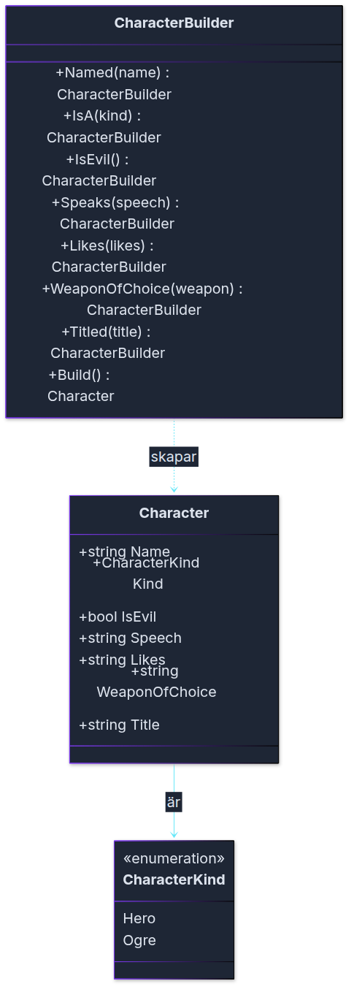

# Övning: Builder

Mira ska ut i världen, och hon har en ogre som väntar på henne. Ni är byggarna. Ni skapar karaktärerna ett steg, en mening i taget.

**Efter övningen kan du:** bygga ett objekt med en byggare som läser som en mening, och se vad som händer när ett steg utelämnas.

**Hur ni jobbar:** i par. **En skriver, en läser högt.** Byt roller efter varje uppgift.
Skapa ett nytt konsolprojekt. Klasserna skrivs **efter** koden som körs i `Program.cs`, annars får ni felet CS8803.

## Klassdiagram

Så här hänger klasserna ihop i uppgift 1 och 2:



<!-- mermaid: diagrams/ovning_builder_1.mmd -->

`CharacterBuilder` vet hur en `Character` ska byggas. `Character` känner inte till byggaren.

---

## 🟢 Uppgift 1: Mira, en mening i taget

> **Vad:** en byggare är en klass som samlar värden, ett steg i taget, och sist skapar objektet.
> **När:** när ett objekt har många egenskaper, och några av dem är valfria.
> **Hur:** varje steg är en metod som returnerar byggaren själv, och `Build()` skapar objektet.

1. Skapa `enum CharacterKind { Hero, Ogre }`.
2. Skapa klassen `Character` med egenskaperna `Name` och `Kind`, och en konstruktor som tar båda.
3. Skapa klassen `CharacterBuilder` med metoderna `Named(string name)` och `IsA(CharacterKind kind)`. Varje metod ska returnera `this`.
4. Lägg till metoden `Build()` som returnerar en `Character`.
5. Skapa Mira med `new CharacterBuilder().Named("Mira").IsA(CharacterKind.Hero).Build()` och skriv ut hennes namn och art.

**Förväntad output:**
```
Mira är en Hero
```

<details markdown="1">
<summary>Tips</summary>

Startvärdet för `kind` i byggaren gör att en karaktär alltid har en art, även när du inte sätter den.

</details>

<details markdown="1">
<summary>Lösningsförslag</summary>

```csharp
// Hela programmet: övning Builder, uppgift 1
Character mira = new CharacterBuilder().Named("Mira").IsA(CharacterKind.Hero).Build();
Console.WriteLine($"{mira.Name} är en {mira.Kind}");

enum CharacterKind { Hero, Ogre }

class Character
{
    public string Name { get; }
    public CharacterKind Kind { get; }

    public Character(string name, CharacterKind kind)
    {
        Name = name;
        Kind = kind;
    }
}

class CharacterBuilder
{
    private string name = "Okänd";
    private CharacterKind kind = CharacterKind.Hero;

    public CharacterBuilder Named(string name)
    {
        this.name = name;
        return this;
    }

    public CharacterBuilder IsA(CharacterKind kind)
    {
        this.kind = kind;
        return this;
    }

    public Character Build()
    {
        return new Character(name, kind);
    }
}
```

`Named` och `IsA` returnerar `this`, så att nästa meningen kan börja direkt efter. Det är därför kedjan läser som en mening.

</details>

---

## 🟢 Uppgift 2: Grölf, en ond ogre

1. Lägg till egenskaperna `IsEvil`, `Speech`, `Likes` och `WeaponOfChoice` i `Character`, och i konstruktorn.
2. Lägg till `IsEvil()`, `Speaks(string)`, `Likes(string)` och `WeaponOfChoice(string)` i `CharacterBuilder`. `IsEvil()` tar inga parametrar och sätter egenskapen till `true`.
3. Skapa Grölf: `Named("Grölf")`, `IsEvil()`, `IsA(CharacterKind.Ogre)`, `Speaks("aggghhh")`, `Likes("to mame")` och `WeaponOfChoice("Club")`.
4. Skriv ut Grölf och en karaktär som bara fick `Named("Nisse")`.

**Förväntad output:**
```
Grölf är en ond Ogre. Säger "aggghhh", gillar to mame och slåss med Club.
Nisse är en god Hero. Säger "", gillar  och slåss med käpp.
```

<details markdown="1">
<summary>Tips</summary>

Skriv ut med en strängmall: `$"{Name} är en {(IsEvil ? "ond" : "god")} {Kind}..."`. Det är samma uttryck som i `ToString()` i lektionens exempel.

</details>

<details markdown="1">
<summary>Lösningsförslag</summary>

```csharp
// Hela programmet: övning Builder, uppgift 2
Character grolf = new CharacterBuilder()
    .Named("Grölf")
    .IsEvil()
    .IsA(CharacterKind.Ogre)
    .Speaks("aggghhh")
    .Likes("to mame")
    .WeaponOfChoice("Club")
    .Build();

Character nisse = new CharacterBuilder().Named("Nisse").Build();

Console.WriteLine(grolf);
Console.WriteLine(nisse);
```

Klasserna i lösningen är de från lektionen. `Character.ToString()` ser ut så här:

```csharp
public override string ToString()
{
    string side = IsEvil ? "ond" : "god";
    return $"{Name} är en {side} {Kind}. Säger \"{Speech}\", gillar {Likes} och slåss med {WeaponOfChoice}.";
}
```

Nisse fick inga andra meningar, så han får standardvärdena i byggaren. Det är byggarens poäng: det som inte sägs blir ett rimligt värde.

</details>

---

## 🟡 Uppgift 3: en titel

1. Lägg till egenskapen `Title` i `Character` med standardvärdet `""`. Lägg även till metoden `Titled(string title)` i `CharacterBuilder`.
2. Ändra `ToString()` så att titeln bara skrivs ut när den finns. En karaktär utan titel ska inte få ett tomt tillägg.
3. Skapa Mira med titeln `"Drakslayer"`, och skriv ut henne. Skapa sedan Nisse utan titel och skriv ut honom. Vad skiljer utskrifterna åt?

<details markdown="1">
<summary>Tips</summary>

Ett villkor i `ToString()` räcker: `if (Title != "")`. Det är en sträng, så jämför med `""`.

</details>

<details markdown="1">
<summary>Lösningsförslag</summary>

```csharp
// Hela programmet: övning Builder, uppgift 3
Character mira = new CharacterBuilder()
    .Named("Mira")
    .IsA(CharacterKind.Hero)
    .Titled("Drakslayer")
    .Build();

Character nisse = new CharacterBuilder().Named("Nisse").Build();

Console.WriteLine(mira);
Console.WriteLine(nisse);
```

I `Character` får konstruktorn en parameter till, `title`, och `Title` sätts i den:
```csharp
public string Title { get; }

public Character(string name, CharacterKind kind, bool isEvil, string speech, string likes, string weaponOfChoice, string title)
{
    // ... samma tilldelningar som förut ...
    Title = title;
}

public override string ToString()
{
    string side = IsEvil ? "ond" : "god";
    string title = Title != "" ? $" (\"{Title}\")" : "";
    return $"{Name}{title} är en {side} {Kind}. Säger \"{Speech}\", gillar {Likes} och slåss med {WeaponOfChoice}.";
}
```

Mira får titeln i utskriften, och Nisse gör inte det. `Titled` i byggaren sätter titeln, och standardvärdet `""` gör att titeln inte syns.

</details>

---

## Vad ni ska kunna efter övningen

- Förklara varför varje metod i byggaren returnerar `this`.
- Förklara vad som händer när en mening utelämnas.
- Peka ut i klassdiagrammet vilken klass som skapar vilken.
