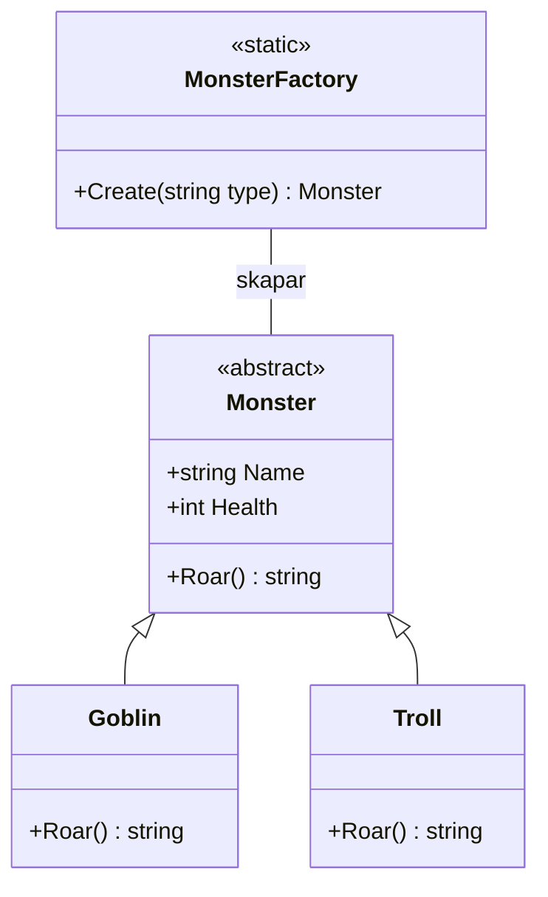
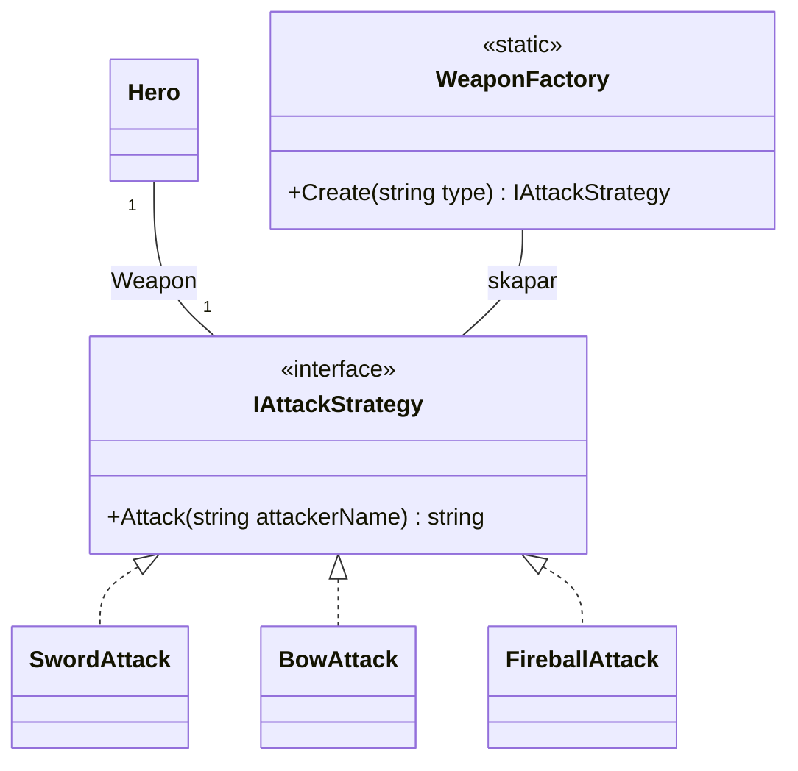

# Övning: Factory

**Efter övningen kan du:** samla koden som skapar objekt i en fabrik, och låta resten av programmet beställa i stället för att skapa.

**Hur ni jobbar:** i par. **En skriver, en läser högt.** Byt roller efter varje uppgift.
Nytt konsolprojekt. Klasserna skrivs **efter** koden som körs i `Program.cs`.

## Klassdiagram

Så här hänger klasserna i uppgift 1 ihop:



En `Goblin` och ett `Troll` ärver från `Monster`. `MonsterFactory` skapar monster och lämnar tillbaka dem som `Monster`.

I uppgift 4 gör du samma sak med vapnen från Strategy:



Fabriken lämnar tillbaka ett `IAttackStrategy`. Den streckade linjen visar vilka klasser som lovar att kunna det.

---

## 🟢 Uppgift 1: monsterfabriken

> **Vad:** en fabrik är en klass vars enda jobb är att skapa objekt.
> **När:** när programmet ska skapa ett av flera slags objekt, och valet görs från text eller på flera ställen.
> **Hur:** en `static class` med en metod `Create(string type)` som returnerar basklassen.

1. Skapa `abstract class Monster` med `Name`, `Health`, en konstruktor och `public abstract string Roar();`.
2. Skapa `Goblin` (30 hälsa, `Hihihi!`) och `Troll` (80 hälsa, `GRRRUUMF!`).
3. Skapa `static class MonsterFactory` med `Create(string type)` som returnerar rätt monster för `"goblin"` och `"troll"`.
   Okänd typ ska ge `throw new ArgumentException(...)`.
4. Beställ en goblin och ett troll från fabriken och skriv ut dem.

**Förväntad output:**
```
Goblin (30 hälsa): Hihihi!
Troll (80 hälsa): GRRRUUMF!
```

<details markdown="1">
<summary>Tips</summary>

Metoden returnerar `Monster`, men inuti skriver du `return new Goblin();`. Det går eftersom en `Goblin` *är* ett `Monster`.

</details>

<details markdown="1">
<summary>Lösningsförslag</summary>

```csharp
// Hela programmet: övning Factory, uppgift 1
Monster first = MonsterFactory.Create("goblin");
Monster second = MonsterFactory.Create("troll");

Console.WriteLine($"{first.Name} ({first.Health} hälsa): {first.Roar()}");
Console.WriteLine($"{second.Name} ({second.Health} hälsa): {second.Roar()}");

abstract class Monster
{
    public string Name;
    public int Health;

    public Monster(string name, int health)
    {
        Name = name;
        Health = health;
    }

    public abstract string Roar();
}

class Goblin : Monster
{
    public Goblin() : base("Goblin", 30) { }

    public override string Roar()
    {
        return "Hihihi!";
    }
}

class Troll : Monster
{
    public Troll() : base("Troll", 80) { }

    public override string Roar()
    {
        return "GRRRUUMF!";
    }
}

static class MonsterFactory
{
    public static Monster Create(string type)
    {
        switch (type)
        {
            case "goblin":
                return new Goblin();
            case "troll":
                return new Troll();
            default:
                throw new ArgumentException($"Det finns inget monster som heter '{type}'.");
        }
    }
}
```

Koden högst upp skriver aldrig `new Goblin()`. Den beställer.

</details>

## 🟢 Uppgift 2: ett nytt monster

1. Lägg till `Skeleton` med namnet `Skelett`, 40 hälsa och vrålet `Klapper klapper!`.
2. Lägg till en rad i fabriken för `"skeleton"`.
3. Beställ ett skelett och skriv ut det.
4. Räkna: hur många ställen behövde ni ändra?

**Förväntad output** (den nya raden):
```
Skelett (40 hälsa): Klapper klapper!
```

<details markdown="1">
<summary>Tips</summary>

Två ställen: en ny klass och en ny `case` i fabriken. Koden som beställer behöver bara en ny rad för att beställa.

</details>

<details markdown="1">
<summary>Lösningsförslag</summary>

```csharp
// Hela programmet: övning Factory, uppgift 2
Monster skeleton = MonsterFactory.Create("skeleton");
Console.WriteLine($"{skeleton.Name} ({skeleton.Health} hälsa): {skeleton.Roar()}");

abstract class Monster
{
    public string Name;
    public int Health;

    public Monster(string name, int health)
    {
        Name = name;
        Health = health;
    }

    public abstract string Roar();
}

class Goblin : Monster
{
    public Goblin() : base("Goblin", 30) { }

    public override string Roar()
    {
        return "Hihihi!";
    }
}

// Det nya monstret
class Skeleton : Monster
{
    public Skeleton() : base("Skelett", 40) { }

    public override string Roar()
    {
        return "Klapper klapper!";
    }
}

static class MonsterFactory
{
    public static Monster Create(string type)
    {
        switch (type)
        {
            case "goblin":
                return new Goblin();
            case "skeleton":
                return new Skeleton();   // Den enda nya raden i fabriken
            default:
                throw new ArgumentException($"Det finns inget monster som heter '{type}'.");
        }
    }
}
```

</details>

## 🟡 Uppgift 3: en våg från text

Nivåer i spel sparas ofta som text. Den här nivån ser ut så här: `"goblin,goblin,troll,unicorn"`.

1. Dela texten med `Split(',')`.
2. Beställ ett monster för varje ord och lägg det i en `List<Monster>`.
3. `unicorn` finns inte. Fånga felet med `try`/`catch`, skriv ut det och fortsätt med nästa.
4. Skriv ut hur många monster vågen fick.

**Förväntad output:**
```
Hoppar över: Det finns inget monster som heter 'unicorn'.
Vågen har 3 monster.
```

<details markdown="1">
<summary>Tips</summary>

Lägg `try`/`catch` **inuti** `foreach`. Då stoppar ett fel bara det ordet, inte hela vågen.

</details>

<details markdown="1">
<summary>Lösningsförslag</summary>

```csharp
// Hela programmet: övning Factory, uppgift 3
string waveText = "goblin,goblin,troll,unicorn";
string[] types = waveText.Split(',');

List<Monster> wave = new List<Monster>();
foreach (string type in types)
{
    try
    {
        wave.Add(MonsterFactory.Create(type));
    }
    catch (ArgumentException ex)
    {
        Console.WriteLine($"Hoppar över: {ex.Message}");
    }
}

Console.WriteLine($"Vågen har {wave.Count} monster.");

abstract class Monster
{
    public string Name;
    public int Health;

    public Monster(string name, int health)
    {
        Name = name;
        Health = health;
    }

    public abstract string Roar();
}

class Goblin : Monster
{
    public Goblin() : base("Goblin", 30) { }

    public override string Roar()
    {
        return "Hihihi!";
    }
}

class Troll : Monster
{
    public Troll() : base("Troll", 80) { }

    public override string Roar()
    {
        return "GRRRUUMF!";
    }
}

static class MonsterFactory
{
    public static Monster Create(string type)
    {
        switch (type)
        {
            case "goblin":
                return new Goblin();
            case "troll":
                return new Troll();
            default:
                throw new ArgumentException($"Det finns inget monster som heter '{type}'.");
        }
    }
}
```

Nu kan en nivådesigner skriva nya nivåer som text, utan att röra koden.

</details>

## 🔴 Uppgift 4: en fabrik som skapar strategier

Ta vapnen från Strategy-övningen (`IAttackStrategy`, `SwordAttack`, `BowAttack`, `FireballAttack`, `Hero`).

1. Skapa `static class WeaponFactory` med `IAttackStrategy Create(string type)` för `"sword"`, `"bow"` och `"fireball"`.
2. Skapa Mira med `WeaponFactory.Create("sword")` och skriv ut attacken.
3. Byt vapen med `WeaponFactory.Create("fireball")` och skriv ut igen.

**Förväntad output:**
```
Mira svingar svärdet! (10 skada)
Mira kastar ett eldklot! (15 skada)
```

<details markdown="1">
<summary>Tips</summary>

Fabriken returnerar interfacet `IAttackStrategy`, inte en klass. Det är helt okej: allt som håller löftet går att returnera.

</details>

<details markdown="1">
<summary>Lösningsförslag</summary>

```csharp
// Hela programmet: övning Factory, uppgift 4
Hero mira = new Hero("Mira", WeaponFactory.Create("sword"));
Console.WriteLine(mira.Attack());

mira.Weapon = WeaponFactory.Create("fireball");
Console.WriteLine(mira.Attack());

interface IAttackStrategy
{
    string Attack(string attackerName);
}

class SwordAttack : IAttackStrategy
{
    public string Attack(string attackerName)
    {
        return $"{attackerName} svingar svärdet! (10 skada)";
    }
}

class BowAttack : IAttackStrategy
{
    public string Attack(string attackerName)
    {
        return $"{attackerName} skjuter en pil på håll! (7 skada)";
    }
}

class FireballAttack : IAttackStrategy
{
    public string Attack(string attackerName)
    {
        return $"{attackerName} kastar ett eldklot! (15 skada)";
    }
}

class Hero
{
    public string Name;
    public IAttackStrategy Weapon;

    public Hero(string name, IAttackStrategy weapon)
    {
        Name = name;
        Weapon = weapon;
    }

    public string Attack()
    {
        return Weapon.Attack(Name);
    }
}

static class WeaponFactory
{
    public static IAttackStrategy Create(string type)
    {
        switch (type)
        {
            case "sword":
                return new SwordAttack();
            case "bow":
                return new BowAttack();
            case "fireball":
                return new FireballAttack();
            default:
                throw new ArgumentException($"Det finns inget vapen som heter '{type}'.");
        }
    }
}
```

Factory skapar, Strategy gör jobbet. Två mönster som jobbar ihop.

</details>
