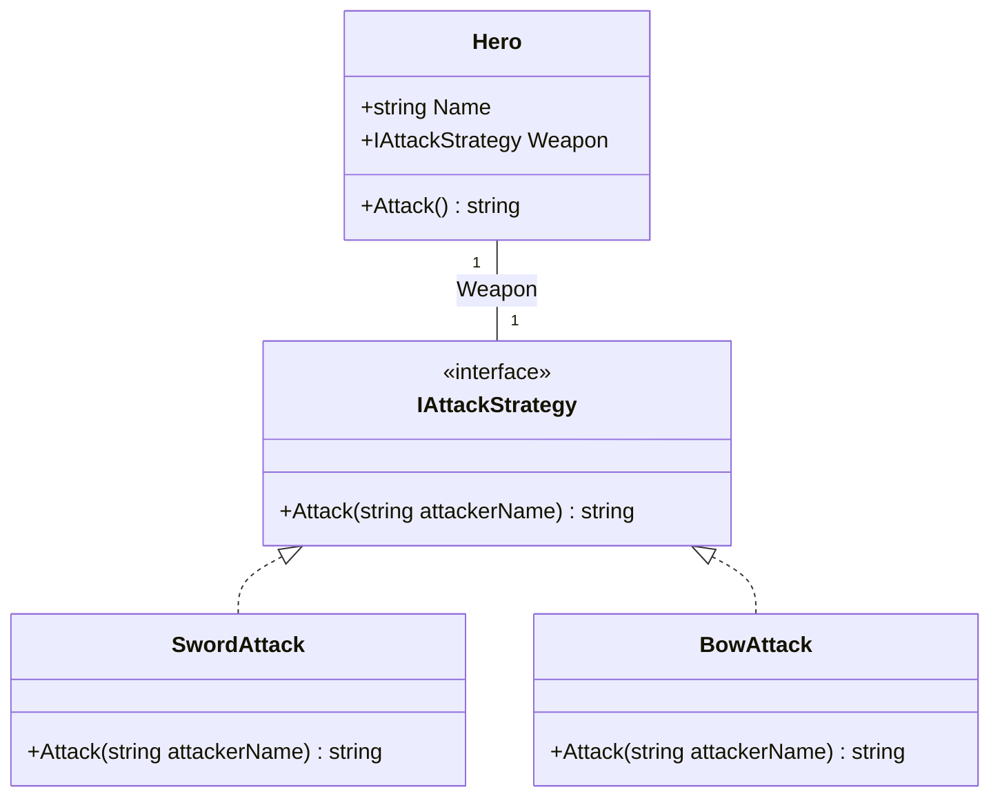

# Övning: Strategy

**Efter övningen kan du:** byta beteende på ett objekt genom att byta strategi, och lägga till en ny strategi utan att ändra den klass som använder den.

**Hur ni jobbar:** i par. **En skriver, en läser högt.** Byt roller efter varje uppgift.
Skapa ett nytt konsolprojekt. Klasserna skrivs **efter** koden som körs i `Program.cs`, annars får ni felet CS8803.

## Klassdiagram

Så här hänger klasserna i uppgift 1 ihop:



`SwordAttack` och `BowAttack` lovar att kunna `IAttackStrategy`. Det är den streckade linjen. En `Hero` har ett `Weapon`, och linjen går till interfacet, inte till ett visst vapen.

---

## 🟢 Uppgift 1: Mira och två vapen

> **Vad:** en strategi är ett sätt att göra något, i en egen klass.
> **När:** när samma uppgift kan göras på flera sätt och du vill kunna byta.
> **Hur:** ett `interface` för uppgiften, en klass per sätt, och ett fält av interfacets typ i den klass som använder det.

1. Skapa `interface IAttackStrategy` med metoden `string Attack(string attackerName);`.
2. Skapa `SwordAttack` och `BowAttack` som båda använder interfacet.
3. Skapa `Hero` med fälten `Name` och `Weapon` (av typen `IAttackStrategy`) och en konstruktor.
4. Ge `Hero` metoden `Attack()` som frågar vapnet: `return Weapon.Attack(Name);`.
5. Skapa Mira med svärd, skriv ut attacken, byt till pilbåge med **en rad** och skriv ut igen.

**Förväntad output:**
```
Mira svingar svärdet! (10 skada)
Mira skjuter en pil på håll! (7 skada)
```

<details markdown="1">
<summary>Tips</summary>

Bytet är bara en tilldelning: `mira.Weapon = new BowAttack();`. Ingenting i `Hero` behöver ändras för det.

</details>

<details markdown="1">
<summary>Lösningsförslag</summary>

`Hero` vet inte hur något vapen fungerar. Den vet bara att vapnet kan attackera.

```csharp
// Hela programmet: övning Strategy, uppgift 1
Hero mira = new Hero("Mira", new SwordAttack());
Console.WriteLine(mira.Attack());

mira.Weapon = new BowAttack();
Console.WriteLine(mira.Attack());

interface IAttackStrategy
{
    string Attack(string attackerName);
}

class SwordAttack : IAttackStrategy
{
    public string Attack(string attackerName)
    {
        return $"{attackerName} svingar svärdet! (10 skada)";
    }
}

class BowAttack : IAttackStrategy
{
    public string Attack(string attackerName)
    {
        return $"{attackerName} skjuter en pil på håll! (7 skada)";
    }
}

class Hero
{
    public string Name;
    public IAttackStrategy Weapon;

    public Hero(string name, IAttackStrategy weapon)
    {
        Name = name;
        Weapon = weapon;
    }

    public string Attack()
    {
        return Weapon.Attack(Name);
    }
}
```

Lägg märke till att `Hero` inte innehåller ett enda ord om svärd eller pilar.

</details>

## 🟢 Uppgift 2: ett nytt vapen utan att röra Hero

1. Lägg till klassen `IceAttack` som skriver `Mira fryser fienden med is! (8 skada)` (med rätt namn).
2. Låt Mira byta till isvapnet och skriv ut attacken.
3. Kontrollera: ändrade ni något i `Hero`? Svaret ska vara nej.

**Förväntad output** (de nya raderna):
```
Mira fryser fienden med is! (8 skada)
```

<details markdown="1">
<summary>Tips</summary>

Kopiera `BowAttack`, byt namn på klassen och ändra texten. Det är allt.

</details>

<details markdown="1">
<summary>Lösningsförslag</summary>

```csharp
// Hela programmet: övning Strategy, uppgift 2
Hero mira = new Hero("Mira", new SwordAttack());
Console.WriteLine(mira.Attack());

mira.Weapon = new IceAttack();
Console.WriteLine(mira.Attack());

interface IAttackStrategy
{
    string Attack(string attackerName);
}

class SwordAttack : IAttackStrategy
{
    public string Attack(string attackerName)
    {
        return $"{attackerName} svingar svärdet! (10 skada)";
    }
}

// Det nya vapnet. Inget annat i programmet behövde ändras.
class IceAttack : IAttackStrategy
{
    public string Attack(string attackerName)
    {
        return $"{attackerName} fryser fienden med is! (8 skada)";
    }
}

class Hero
{
    public string Name;
    public IAttackStrategy Weapon;

    public Hero(string name, IAttackStrategy weapon)
    {
        Name = name;
        Weapon = weapon;
    }

    public string Attack()
    {
        return Weapon.Attack(Name);
    }
}
```

</details>

## 🟡 Uppgift 3: samma mönster, en reseapp

Nu ett annat tema med samma struktur. En reseapp räknar ut hur lång tid en resa tar.

1. Skapa `interface IRouteStrategy` med `string Describe(double km);`.
2. Skapa tre strategier:
   - `WalkStrategy`: 12 minuter per km, skriver `Promenad: 36 minuter` för 3 km.
   - `BikeStrategy`: 4 minuter per km, skriver `Cykel: 12 minuter`.
   - `CarStrategy`: 2 minuter per km plus 5 minuter för parkering, skriver `Bil: 11 minuter (inklusive parkering)`.
3. Skapa `TripPlanner` med fältet `Strategy` och metoden `string Plan(double km)`.
4. Planera en resa på 3 km med alla tre strategierna.

**Förväntad output:**
```
Promenad: 36 minuter
Cykel: 12 minuter
Bil: 11 minuter (inklusive parkering)
```

<details markdown="1">
<summary>Tips</summary>

`TripPlanner` är som `Hero`: den har en strategi och frågar den. `Plan` behöver bara en rad: `return Strategy.Describe(km);`.

</details>

<details markdown="1">
<summary>Lösningsförslag</summary>

```csharp
// Hela programmet: övning Strategy, uppgift 3
TripPlanner planner = new TripPlanner(new WalkStrategy());
Console.WriteLine(planner.Plan(3));

planner.Strategy = new BikeStrategy();
Console.WriteLine(planner.Plan(3));

planner.Strategy = new CarStrategy();
Console.WriteLine(planner.Plan(3));

interface IRouteStrategy
{
    string Describe(double km);
}

class WalkStrategy : IRouteStrategy
{
    public string Describe(double km)
    {
        // Man går ungefär 5 km i timmen, alltså 12 minuter per km
        return $"Promenad: {km * 12} minuter";
    }
}

class BikeStrategy : IRouteStrategy
{
    public string Describe(double km)
    {
        return $"Cykel: {km * 4} minuter";
    }
}

class CarStrategy : IRouteStrategy
{
    public string Describe(double km)
    {
        return $"Bil: {km * 2 + 5} minuter (inklusive parkering)";
    }
}

class TripPlanner
{
    public IRouteStrategy Strategy;

    public TripPlanner(IRouteStrategy strategy)
    {
        Strategy = strategy;
    }

    public string Plan(double km)
    {
        return Strategy.Describe(km);
    }
}
```

Samma form som Mira och vapnen. Det är det som gör det till ett mönster.

</details>

## 🔴 Uppgift 4: spelaren väljer vapen

1. Fråga spelaren: `Välj vapen: 1 = svärd, 2 = pilbåge, 3 = eldklot`.
2. Läs svaret med `Console.ReadLine()` och välj rätt strategi. Okänt val ger svärdet.
3. Skapa Mira med det valda vapnet och skriv ut attacken.

**Förväntad output** (om spelaren skriver `2`):
```
Välj vapen: 1 = svärd, 2 = pilbåge, 3 = eldklot
Mira skjuter en pil på håll! (7 skada)
```

Fundera: valet blev en ny `if`/`else if`. Var i programmet borde den ligga? Efter lunch får den ett namn.

<details markdown="1">
<summary>Tips</summary>

Gör en variabel `IAttackStrategy weapon;` och ge den ett värde i varje gren av `if`-satsen.

</details>

<details markdown="1">
<summary>Lösningsförslag</summary>

```csharp
// Hela programmet: övning Strategy, uppgift 4
Console.WriteLine("Välj vapen: 1 = svärd, 2 = pilbåge, 3 = eldklot");
string? input = Console.ReadLine();

IAttackStrategy weapon;
if (input == "2")
{
    weapon = new BowAttack();
}
else if (input == "3")
{
    weapon = new FireballAttack();
}
else
{
    weapon = new SwordAttack();   // Svärdet är standard, även vid okänt val
}

Hero mira = new Hero("Mira", weapon);
Console.WriteLine(mira.Attack());

interface IAttackStrategy
{
    string Attack(string attackerName);
}

class SwordAttack : IAttackStrategy
{
    public string Attack(string attackerName)
    {
        return $"{attackerName} svingar svärdet! (10 skada)";
    }
}

class BowAttack : IAttackStrategy
{
    public string Attack(string attackerName)
    {
        return $"{attackerName} skjuter en pil på håll! (7 skada)";
    }
}

class FireballAttack : IAttackStrategy
{
    public string Attack(string attackerName)
    {
        return $"{attackerName} kastar ett eldklot! (15 skada)";
    }
}

class Hero
{
    public string Name;
    public IAttackStrategy Weapon;

    public Hero(string name, IAttackStrategy weapon)
    {
        Name = name;
        Weapon = weapon;
    }

    public string Attack()
    {
        return Weapon.Attack(Name);
    }
}
```

Koden som *väljer* vapen ligger nu mitt i `Program.cs`. Det är precis det problem som Factory löser.

</details>
