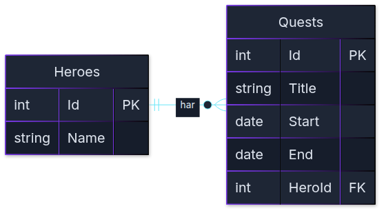
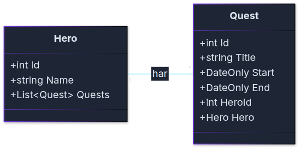
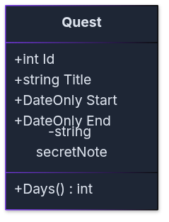
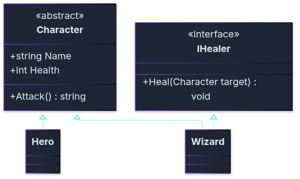

# UML: en ritning av koden

**Klassdiagram, före designmönstren**

Kurs 3 · Fördjupad OOP i C#

---

## Ni har redan ritat ett sådant här

Mira och hennes uppdrag, som ett ERD:

<!-- mermaid: diagrams/uml_klassdiagram_marp_1.mmd -->

Tabeller, kolumner, PK och FK. Det här kan ni.

---

## Samma sak, ritad som klasser

<!-- mermaid: diagrams/uml_klassdiagram_marp_2.mmd -->

Det här är ett **klassdiagram**. Det ritar klasserna i C#, inte tabellerna.

---

## Det som är likadant

- En ruta per sak: `Hero` och `Quest`
- Varje ruta har en lista med det den innehåller
- En linje mellan dem: **en** hjälte har **många** uppdrag

| ERD | Klassdiagram |
|-----|--------------|
| `\|\|--o{` | `"1" -- "*"` |

`1` betyder en. `*` betyder många. Samma idé, olika tecken.

---

## Det som skiljer

| | ERD | Klassdiagram |
|---|-----|--------------|
| Ritar | tabeller | klasser |
| Hero hittar sina uppdrag via | `HeroId` i `Quests` | listan `List<Quest> Quests` |
| Metoder | finns inte | finns |
| `+` och `-` | finns inte | finns |

Databasen har bara data. En klass har data **och** beteende.

---

## Att läsa en klassruta

Tänk om `Quest` själv räknar ut antal dagar:

<!-- mermaid: diagrams/uml_klassdiagram_marp_3.mmd -->

1. Överst: klassens namn
2. Sedan: egenskaper (data)
3. Sist: metoder, med `()`
4. `+` betyder `public`, `-` betyder `private`

`Days()` kan aldrig synas i ett ERD.

---

## Arv och interface

Hjältarna från första veckan:

<!-- mermaid: diagrams/uml_klassdiagram_marp_4.mmd -->

`Wizard` **är en** `Character` och **kan** läka.

---

## Det är allt ni behöver

| Linje | Betyder | I C# |
|-------|---------|------|
| `Hero "1" -- "*" Quest` | har, känner till | en property eller en lista |
| `Character <\|-- Hero` (heldragen, tom pil) | ärver från | `class Hero : Character` |
| `IHealer <\|.. Wizard` (streckad, tom pil) | lovar att kunna | `class Wizard : Character, IHealer` |

Tre linjer. Det finns fler i UML, men de behöver ni inte nu.

---

## Från och med nu

- Varje övning har ett klassdiagram. Läs det först, skriv koden sedan.
- Strategy, Factory och Observer visar vi med klassdiagram idag.
- **Inlämning 1:** ditt README ska ha ett eget klassdiagram. Mermaid eller en bild går bra.

Ett diagram behöver inte vara perfekt. Det ska visa hur du tänkt.

---

## Din tur

Rita klassdiagrammet för katterna från JSON-lektionen förra onsdagen.

1. En ruta för `Cat` med dess egenskaper
2. En ruta för klassen som håller listan med katter
3. En linje mellan dem, med `1` och `*`

Papper, whiteboard eller Mermaid. Det spelar ingen roll.

Lösningsförslag finns i läsversionen: `notes/uml_klassdiagram.md`.
