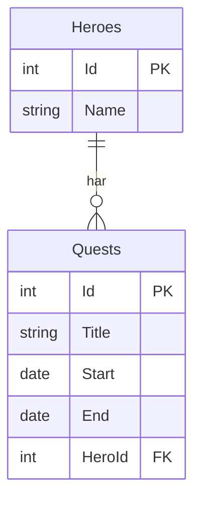
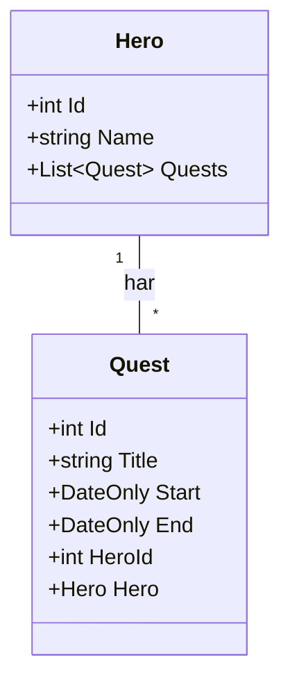
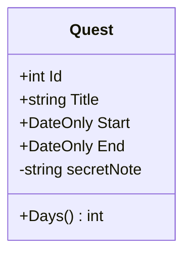
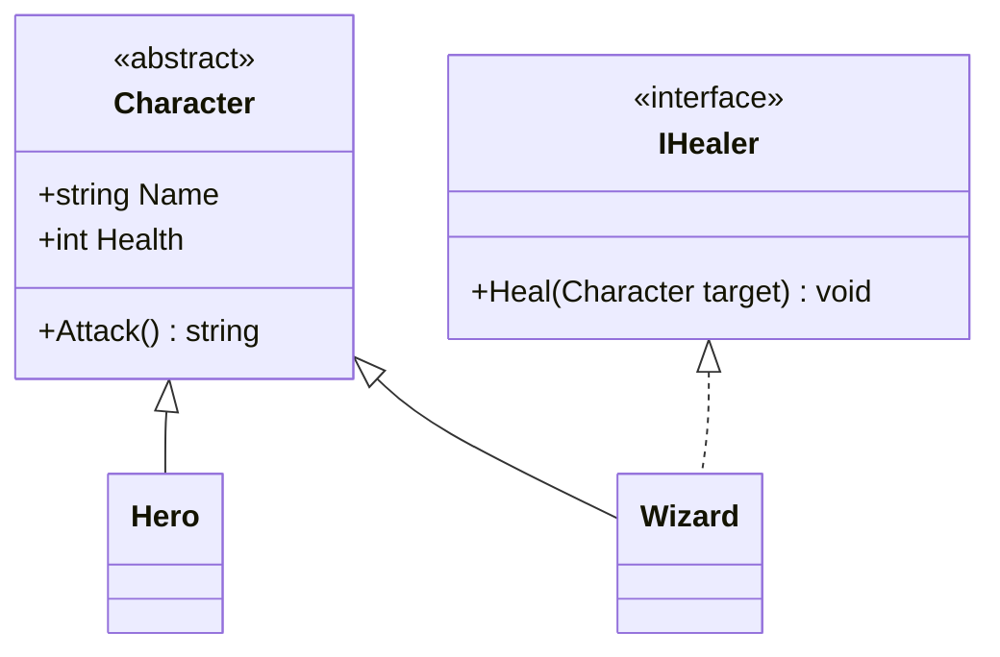
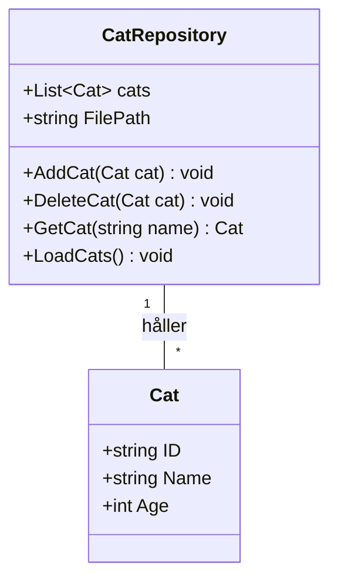
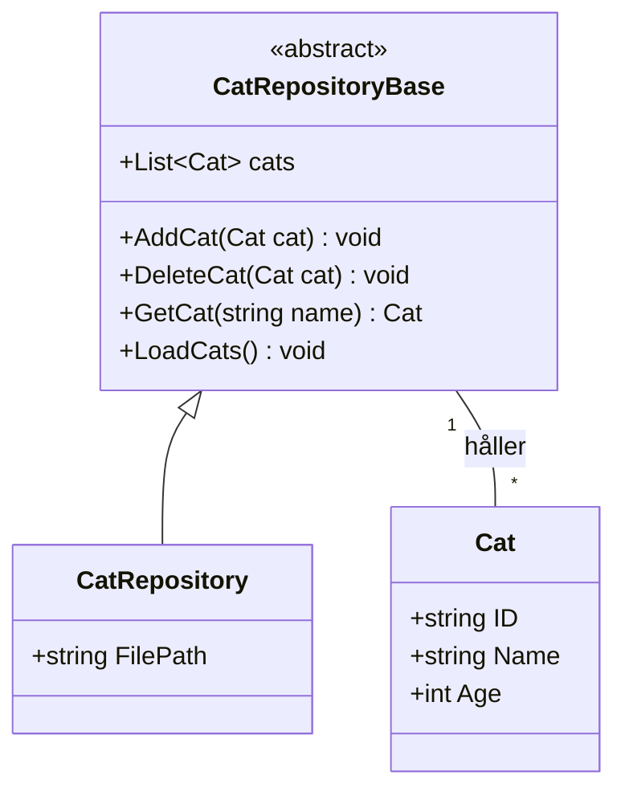

# UML: en ritning av koden

Läsversion av passet om klassdiagram. Bilderna: `lectures/uml_klassdiagram_marp.md`.

**Efter det här kan du:** läsa ett klassdiagram, se hur det skiljer sig från ett ERD och rita ett enkelt klassdiagram själv.

## Ni har redan ritat ett sådant här

I databaskursen ritade ni ER-diagram. Här är Mira och hennes uppdrag från EF-övningen, som ett ERD:



Det här är tabeller. Varje rad i rutan är en kolumn. `PK` är primärnyckeln. `FK` är den främmande nyckeln: `HeroId` säger vilken hjälte uppdraget hör till.

Det här kan ni redan. Allt annat i passet bygger på det.

## Samma sak, ritad som klasser

Så här såg klasserna ut i EF-övningen:

```csharp
class Hero
{
    public int Id { get; set; }
    public string Name { get; set; } = "";
    public List<Quest> Quests { get; set; } = new();
}

class Quest
{
    public int Id { get; set; }
    public string Title { get; set; } = "";
    public DateOnly Start { get; set; }
    public DateOnly End { get; set; }
    public int HeroId { get; set; }
    public Hero Hero { get; set; } = null!;
}
```

Samma klasser som ett **klassdiagram**:



Ett klassdiagram ritar klasserna i C#, inte tabellerna i databasen. Det är en del av **UML**, ett vanligt sätt att rita kod som alla utvecklare känner igen.

Lägg märke till `List~Quest~`. Det är Mermaids sätt att skriva `List<Quest>`.

## Det som är likadant

Båda diagrammen har en ruta per sak: `Hero` och `Quest`. Båda har en linje mellan dem. Och båda säger samma sak: **en** hjälte har **många** uppdrag.

| ERD | Klassdiagram | Betyder |
|-----|--------------|---------|
| `\|\|--o{` | `"1" -- "*"` | en har många |

I klassdiagrammet kallas talen **multiplicitet**. `1` betyder en. `*` betyder många, alltså noll eller fler.

## Det som skiljer

| | ERD | Klassdiagram |
|---|-----|--------------|
| Ritar | tabeller | klasser |
| Hero hittar sina uppdrag via | kolumnen `HeroId` i `Quests` | listan `List<Quest> Quests` |
| Metoder | finns inte | finns |
| `+` och `-` | finns inte | finns |

Två saker är viktiga här.

**1. Relationen sitter på olika ställen.** I databasen finns bara kolumnen `HeroId`. Tabellen `Heroes` vet ingenting om sina uppdrag. I C# har `Hero` en lista med uppdrag. Den kallas **navigeringsegenskap**. EF Core översätter mellan de två åt dig.

**2. En klass har beteende.** En tabell har bara data. En klass har data och metoder. Därför finns metoder bara i klassdiagrammet.

## Att läsa en klassruta

I övningen räknade ni ut antal dagar i `Program.cs`. Tänk om `Quest` själv kunde göra det:

```csharp
class Quest
{
    // ... samma egenskaper som förut ...
    private string secretNote = "";   // bara Quest själv kan se den

    public int Days()
    {
        return End.DayNumber - Start.DayNumber;
    }
}
```

Så här ser det ut i ett klassdiagram:



Läs rutan uppifrån och ned:

1. Överst står klassens namn.
2. Sedan kommer egenskaperna, alltså datan.
3. Sist kommer metoderna. Du känner igen dem på `()`.
4. `+` betyder `public`. `-` betyder `private`.

`Days()` kan aldrig synas i ett ERD. Databasen sparar inga metoder.

## Arv och interface

Minns ni hjältarna från första veckan? `Character` var en abstrakt basklass. `Wizard` ärvde från den och kunde dessutom läka, via interfacet `IHealer`.

```csharp
abstract class Character
{
    public string Name;
    public int Health;
    public abstract string Attack();
}

interface IHealer
{
    void Heal(Character target);
}

class Hero : Character { /* ... */ }
class Wizard : Character, IHealer { /* ... */ }
```

Som klassdiagram:



`<<abstract>>` och `<<interface>>` står överst i rutan. De säger vilken sorts klass det är.

Läs pilarna så här: `Wizard` **är en** `Character`, och `Wizard` **kan** läka.

## Det är allt ni behöver

UML har många symboler. Ni behöver tre:

| Linje | Ser ut som | Betyder | I C# |
|-------|------------|---------|------|
| Association | heldragen linje, med `1` och `*` | har, känner till | en property eller en lista |
| Arv | heldragen linje, tom triangel mot föräldern | är en | `class Hero : Character` |
| Interface | **streckad** linje, tom triangel mot interfacet | lovar att kunna | `class Wizard : Character, IHealer` |

I Mermaid skriver du dem så här:

```text
Hero "1" -- "*" Quest : har
Character <|-- Hero
IHealer <|.. Wizard
```

Triangeln pekar alltid mot den som är "mer allmän": föräldern eller interfacet.

## Från och med nu

- Varje övning har ett klassdiagram. Läs diagrammet först och skriv koden sedan.
- Strategy, Factory och Observer visar vi med klassdiagram.
- **Inlämning 1:** ditt README ska ha ett eget klassdiagram. Mermaid eller en bild går bra.

Ett diagram behöver inte vara perfekt. Det ska visa hur du har tänkt. Rita det gärna innan du skriver koden, och uppdatera det när koden ändras.

## Din tur

**Worked example:** du har redan sett hela vägen från kod till diagram med `Hero` och `Quest` ovan. Gör nu samma sak själv.

Rita klassdiagrammet för katterna från JSON-lektionen förra onsdagen. Där hade vi en `Cat` och en klass som höll en lista med katter.

1. Rita en ruta för `Cat` med dess egenskaper.
2. Rita en ruta för klassen som håller listan med katter. Ta med listan och metoderna.
3. Dra en linje mellan dem och skriv `1` och `*`.

Papper, whiteboard eller Mermaid. Det spelar ingen roll.

<details markdown="1">
<summary>Tips</summary>

Öppna `01_databaskopplingar/notes/livekodning_catjson_repository.md`. `Cat` hade tre egenskaper. Klassen som höll listan hette `CatRepository`. Börja med `Cat`, den är minst.

</details>

<details markdown="1">
<summary>Lösningsförslag</summary>



Ett repository håller många katter. Därför står `1` vid `CatRepository` och `*` vid `Cat`.

Har du fått med fler eller färre metoder? Det gör inget. Det viktiga är rutorna, listan och linjen med `1` och `*`.

**Vill du ha mer?** `CatRepository` ärvde från den abstrakta klassen `CatRepositoryBase`. Då blir det en arvspil också:



</details>

## Sammanfattning

1. Ett ERD ritar tabeller. Ett klassdiagram ritar klasser.
2. Relationen `1` till `*` finns i båda.
3. I databasen sitter relationen i kolumnen `HeroId`. I C# sitter den i listan `List<Quest> Quests`.
4. Metoder och `+`/`-` finns bara i klassdiagrammet.
5. Tre linjer räcker: association, arv och interface (streckad).
