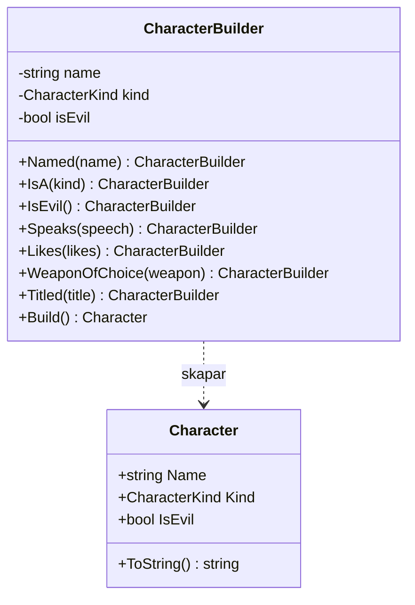
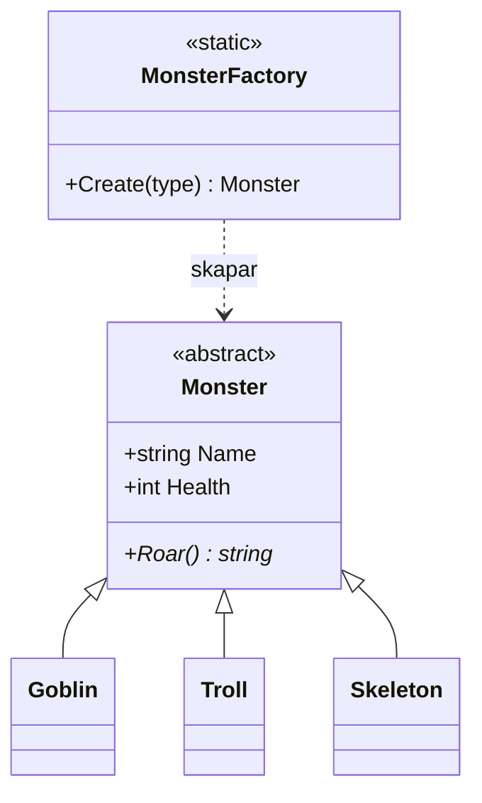
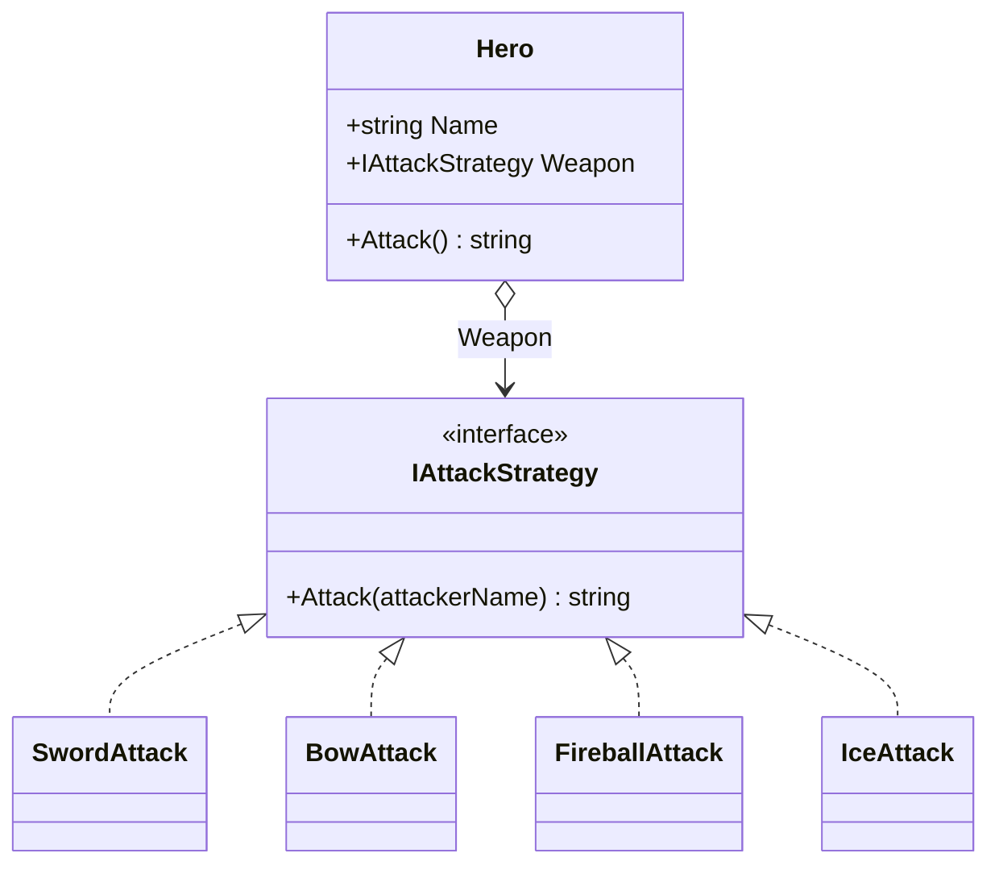
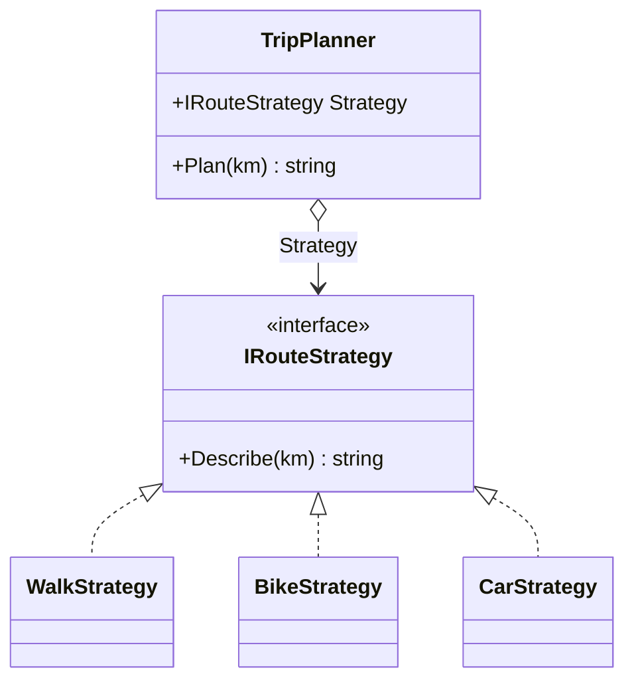
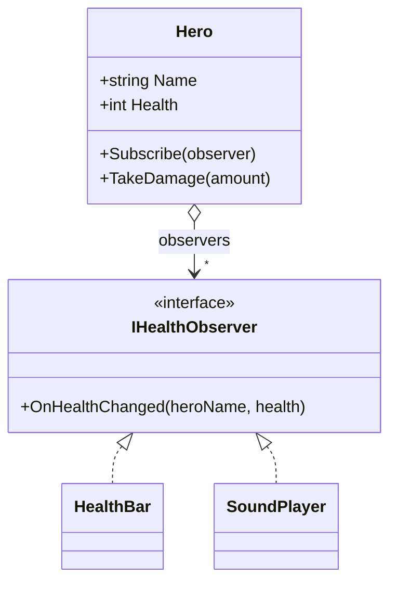
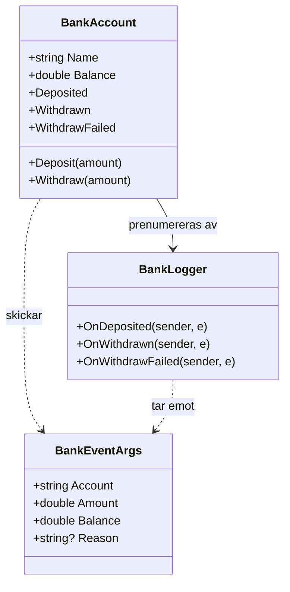
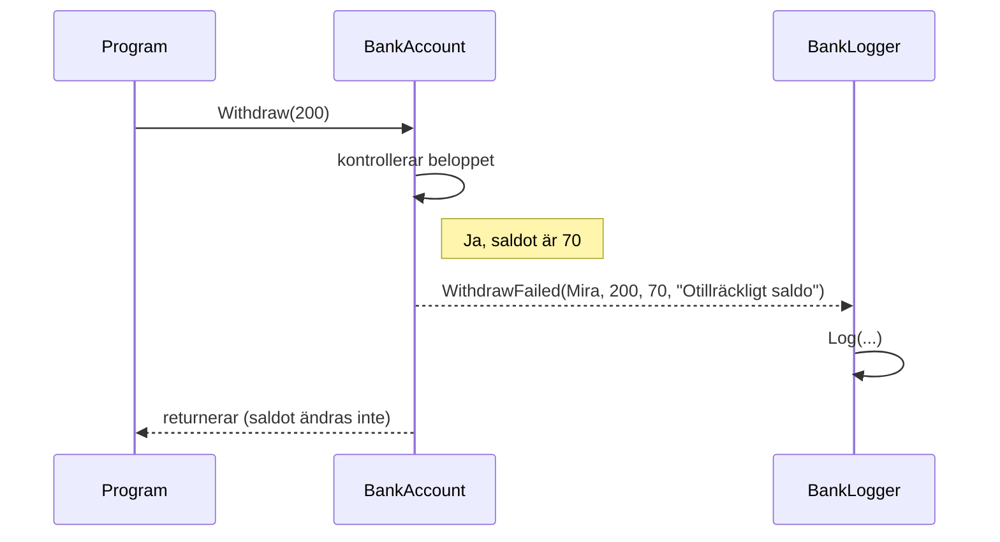

# UML för skojs skull

Alla mönster i ett diagram per mönster, och sist ett sekvensdiagram över bankens event. Diagrammen är bara ritade för att se strukturen. Bra att jämföra med `UML.md`-filerna i varje projekt i `source/repos`.

---

## Builder

---

## Factory

---

## Strategy (vapen)

---

## Strategy (resa)

---

## Observer (Mira)

---

## Observer med event (bankkonto)

---

## Sekvens: ett uttag som misslyckas

Det här är den enda händelsen i kedjan som ändras över tid. Ordningen är viktig.

