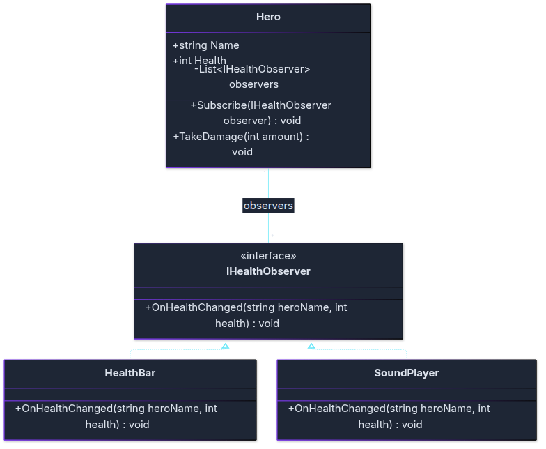

# Övning: Observer

**Efter övningen kan du:** låta flera klasser reagera på samma händelse, och lägga till en ny lyssnare utan att ändra klassen som säger till.

**Hur ni jobbar:** i par. **En skriver, en läser högt.** Byt roller efter varje uppgift.
Nytt konsolprojekt. Klasserna skrivs **efter** koden som körs i `Program.cs`.

## Klassdiagram

Så här hänger klasserna i uppgift 1 ihop:



<!-- mermaid: diagrams/ovning_observer_1.mmd -->

`HealthBar` och `SoundPlayer` lovar att kunna `IHealthObserver`. En `Hero` har många observers i en lista. `-` betyder `private`. Linjen går till interfacet, så `Hero` vet inte vilka klasser som lyssnar.

---

## 🟢 Uppgift 1: hälsostapel och varningsljud

> **Vad:** en observer är någon som vill veta när något händer.
> **När:** när något händer och flera andra ska reagera, utan att den som orsakar det känner till dem.
> **Hur:** ett `interface` för lyssnarna, en lista med lyssnare, och en `foreach` som säger till alla.

1. Skapa `interface IHealthObserver` med `void OnHealthChanged(string heroName, int health);`.
2. Skapa `HealthBar` som skriver en stapel: `[#######   ] Mira: 70` (en `#` per 10 hälsa).
3. Skapa `SoundPlayer` som skriver `♪ Varningsljud: låg hälsa!` när hälsan är under 30.
4. Skapa `Hero` med `Name`, `Health`, en lista med observers, `Subscribe` och `TakeDamage`. Hälsan får aldrig bli under 0.
5. Låt Mira (100 hälsa) få två lyssnare och ta 30 och sedan 50 i skada.

**Förväntad output:**
```
[#######   ] Mira: 70
[##        ] Mira: 20
♪ Varningsljud: låg hälsa!
```

<details markdown="1">
<summary>Tips</summary>

Stapeln: `new string('#', health / 10)` ger rätt antal `#`. `{bar,-10}` i texten fyller ut till 10 tecken.
Hälsan: `Math.Max(0, Health - amount)` ger aldrig under 0.

</details>

<details markdown="1">
<summary>Lösningsförslag</summary>

```csharp
// Hela programmet: övning Observer, uppgift 1
Hero mira = new Hero("Mira", 100);
mira.Subscribe(new HealthBar());
mira.Subscribe(new SoundPlayer());

mira.TakeDamage(30);
mira.TakeDamage(50);

interface IHealthObserver
{
    void OnHealthChanged(string heroName, int health);
}

class HealthBar : IHealthObserver
{
    public void OnHealthChanged(string heroName, int health)
    {
        string bar = new string('#', health / 10);
        Console.WriteLine($"[{bar,-10}] {heroName}: {health}");
    }
}

class SoundPlayer : IHealthObserver
{
    public void OnHealthChanged(string heroName, int health)
    {
        if (health < 30)
        {
            Console.WriteLine("♪ Varningsljud: låg hälsa!");
        }
    }
}

class Hero
{
    public string Name;
    public int Health;
    private List<IHealthObserver> observers = new List<IHealthObserver>();

    public Hero(string name, int health)
    {
        Name = name;
        Health = health;
    }

    public void Subscribe(IHealthObserver observer)
    {
        observers.Add(observer);
    }

    public void TakeDamage(int amount)
    {
        Health = Math.Max(0, Health - amount);

        foreach (IHealthObserver observer in observers)
        {
            observer.OnHealthChanged(Name, Health);
        }
    }
}
```

`Hero` nämner aldrig `HealthBar` eller `SoundPlayer`. Den vet bara att någon vill veta.

</details>

## 🟢 Uppgift 2: en logg

1. Skapa `Logger` som skriver `Logg: Mira har nu 70 hälsa.` (med rätt namn och hälsa).
2. Låt Mira prenumerera med loggen också.
3. Kontrollera: ändrade ni något i `Hero`? Svaret ska vara nej.

**Förväntad output** (bara loggen och stapeln, med Mira som tar 30 i skada):
```
[#######   ] Mira: 70
Logg: Mira har nu 70 hälsa.
```

<details markdown="1">
<summary>Tips</summary>

`Logger` ser ut precis som `HealthBar`: en klass som håller löftet `IHealthObserver`.

</details>

<details markdown="1">
<summary>Lösningsförslag</summary>

```csharp
// Hela programmet: övning Observer, uppgift 2
Hero mira = new Hero("Mira", 100);
mira.Subscribe(new HealthBar());
mira.Subscribe(new Logger());

mira.TakeDamage(30);

interface IHealthObserver
{
    void OnHealthChanged(string heroName, int health);
}

class HealthBar : IHealthObserver
{
    public void OnHealthChanged(string heroName, int health)
    {
        string bar = new string('#', health / 10);
        Console.WriteLine($"[{bar,-10}] {heroName}: {health}");
    }
}

// Den nya lyssnaren. Hero ändrades inte.
class Logger : IHealthObserver
{
    public void OnHealthChanged(string heroName, int health)
    {
        Console.WriteLine($"Logg: {heroName} har nu {health} hälsa.");
    }
}

class Hero
{
    public string Name;
    public int Health;
    private List<IHealthObserver> observers = new List<IHealthObserver>();

    public Hero(string name, int health)
    {
        Name = name;
        Health = health;
    }

    public void Subscribe(IHealthObserver observer)
    {
        observers.Add(observer);
    }

    public void TakeDamage(int amount)
    {
        Health = Math.Max(0, Health - amount);

        foreach (IHealthObserver observer in observers)
        {
            observer.OnHealthChanged(Name, Health);
        }
    }
}
```

</details>

## 🟡 Uppgift 3: samma mönster, en pizzeria

En ny beställning ska synas i köket och ge kunden ett mejl.

1. Skapa `interface IOrderObserver` med `void OnOrderPlaced(string pizza);`.
2. Skapa `KitchenScreen` (`Köket: baka en Margherita!`) och `EmailSender` (`Mejl till kunden: din Margherita är beställd.`).
3. Skapa `OrderSystem` med `Subscribe` och `PlaceOrder(string pizza)`, som först skriver `Ny beställning: Margherita` och sedan säger till alla.
4. Beställ en Margherita och en Vesuvio.

**Förväntad output:**
```
Ny beställning: Margherita
Köket: baka en Margherita!
Mejl till kunden: din Margherita är beställd.
Ny beställning: Vesuvio
Köket: baka en Vesuvio!
Mejl till kunden: din Vesuvio är beställd.
```

<details markdown="1">
<summary>Tips</summary>

`OrderSystem` har samma roll som `Hero`, och `PlaceOrder` samma roll som `TakeDamage`.

</details>

<details markdown="1">
<summary>Lösningsförslag</summary>

```csharp
// Hela programmet: övning Observer, uppgift 3
OrderSystem orders = new OrderSystem();
orders.Subscribe(new KitchenScreen());
orders.Subscribe(new EmailSender());

orders.PlaceOrder("Margherita");
orders.PlaceOrder("Vesuvio");

interface IOrderObserver
{
    void OnOrderPlaced(string pizza);
}

class KitchenScreen : IOrderObserver
{
    public void OnOrderPlaced(string pizza)
    {
        Console.WriteLine($"Köket: baka en {pizza}!");
    }
}

class EmailSender : IOrderObserver
{
    public void OnOrderPlaced(string pizza)
    {
        Console.WriteLine($"Mejl till kunden: din {pizza} är beställd.");
    }
}

class OrderSystem
{
    private List<IOrderObserver> observers = new List<IOrderObserver>();

    public void Subscribe(IOrderObserver observer)
    {
        observers.Add(observer);
    }

    public void PlaceOrder(string pizza)
    {
        Console.WriteLine($"Ny beställning: {pizza}");

        foreach (IOrderObserver observer in observers)
        {
            observer.OnOrderPlaced(pizza);
        }
    }
}
```

</details>

## 🟡 Uppgift 4: termostaten

En termostat berättar när temperaturen ändras. En display och en fläkt lyssnar, och de reagerar olika.

1. Skapa `interface ITemperatureObserver` med metoden `void OnTemperatureChanged(int temperature);`.
2. Skapa `Thermostat` med egenskapen `Temperature`, metoden `Subscribe` och metoden `SetTemperature(int value)`. Den sätter temperaturen och säger till alla lyssnare.
3. Skapa `Display` som skriver ut `Temperatur {temperature} grader`.
4. Skapa `Fan` som skriver ut `Fläkt: på` när temperaturen är över 25, och `Fläkt: av` annars.
5. Sätt temperaturen till 22, 27 och 20. Vad händer med fläkten vid 27?

**Förväntad output:**
```
Temperatur 22 grader
Fläkt: av
Temperatur 27 grader
Fläkt: på
Temperatur 20 grader
Fläkt: av
```

<details markdown="1">
<summary>Tips</summary>

`Thermostat` vet inte vilka som lyssnar, precis som `Hero` i uppgift 1. Den säger bara till.

</details>

<details markdown="1">
<summary>Lösningsförslag</summary>

```csharp
// Hela programmet: övning Observer, uppgift 4
Thermostat termostat = new Thermostat();
termostat.Subscribe(new Display());
termostat.Subscribe(new Fan());

termostat.SetTemperature(22);
termostat.SetTemperature(27);
termostat.SetTemperature(20);

interface ITemperatureObserver
{
    void OnTemperatureChanged(int temperature);
}

class Display : ITemperatureObserver
{
    public void OnTemperatureChanged(int temperature)
    {
        Console.WriteLine($"Temperatur {temperature} grader");
    }
}

class Fan : ITemperatureObserver
{
    public void OnTemperatureChanged(int temperature)
    {
        Console.WriteLine(temperature > 25 ? "Fläkt: på" : "Fläkt: av");
    }
}

class Thermostat
{
    private readonly List<ITemperatureObserver> observers = new();
    public int Temperature { get; private set; }

    public void Subscribe(ITemperatureObserver observer)
    {
        observers.Add(observer);
    }

    public void SetTemperature(int value)
    {
        Temperature = value;

        foreach (ITemperatureObserver observer in observers)
        {
            observer.OnTemperatureChanged(Temperature);
        }
    }
}
```

</details>

---

## 🔴 Uppgift 5: sluta lyssna

Ljudet blir tjatigt. Spelaren stänger av det.

1. Ge `Hero` metoden `Unsubscribe(IHealthObserver observer)` som tar bort lyssnaren ur listan.
2. Spara ljudspelaren i en variabel så att ni kan ta bort just den.
3. Låt Mira ta 75 i skada (varningsljud), stäng av ljudet och låt henne ta 10 till (inget ljud).

**Förväntad output:**
```
[##        ] Mira: 25
♪ Varningsljud: låg hälsa!
Ljudet är avstängt.
[#         ] Mira: 15
```

<details markdown="1">
<summary>Tips</summary>

`List<T>` har metoden `Remove`. För att kunna ta bort rätt objekt behöver ni en variabel som pekar på det.

</details>

<details markdown="1">
<summary>Lösningsförslag</summary>

```csharp
// Hela programmet: övning Observer, uppgift 5
Hero mira = new Hero("Mira", 100);
SoundPlayer sound = new SoundPlayer();   // Sparas så att vi kan ta bort just den sen

mira.Subscribe(new HealthBar());
mira.Subscribe(sound);

mira.TakeDamage(75);

mira.Unsubscribe(sound);
Console.WriteLine("Ljudet är avstängt.");

mira.TakeDamage(10);

interface IHealthObserver
{
    void OnHealthChanged(string heroName, int health);
}

class HealthBar : IHealthObserver
{
    public void OnHealthChanged(string heroName, int health)
    {
        string bar = new string('#', health / 10);
        Console.WriteLine($"[{bar,-10}] {heroName}: {health}");
    }
}

class SoundPlayer : IHealthObserver
{
    public void OnHealthChanged(string heroName, int health)
    {
        if (health < 30)
        {
            Console.WriteLine("♪ Varningsljud: låg hälsa!");
        }
    }
}

class Hero
{
    public string Name;
    public int Health;
    private List<IHealthObserver> observers = new List<IHealthObserver>();

    public Hero(string name, int health)
    {
        Name = name;
        Health = health;
    }

    public void Subscribe(IHealthObserver observer)
    {
        observers.Add(observer);
    }

    public void Unsubscribe(IHealthObserver observer)
    {
        observers.Remove(observer);
    }

    public void TakeDamage(int amount)
    {
        Health = Math.Max(0, Health - amount);

        foreach (IHealthObserver observer in observers)
        {
            observer.OnHealthChanged(Name, Health);
        }
    }
}
```

</details>
