# Flödesscheman: när passar vilket mönster?

Anteckningar till onsdagens pass om **Strategy, Factory, Abstract Factory, Observer, Builder, Facade, Repository, Singleton, Adapter, Decorator och Chain of Responsibility**. CRUD är inget mönster, se sektionen längst ner.

**Efter det här kan du:** läsa en kodsmäll och avgöra vilket mönster som löser den, eller om inget av dem gör det.

Tips: frågorna är korta med avsikt. Ett schema med långa frågor blir för stort för att läsas.

## Innehåll

|   |   |   |   |
|---|---|---|---|
| [Hela vägen i ett schema](#hela-vägen-i-ett-schema) | [Builder](#builder) | [Factory](#factory) | [Abstract Factory](#abstract-factory) |
| [Strategy](#strategy) | [Observer](#observer) | [Facade](#facade) | [Repository](#repository) |
| [Singleton](#singleton) | [Adapter](#adapter) | [Decorator](#decorator) | [Chain of Responsibility](#chain-of-responsibility) |
| [CRUD](#crud) | [Snabbtabell](#snabbtabell) |  |  |

---

## Hela vägen i ett schema

Gå uppifrån och ner. Första "ja" är svaret.

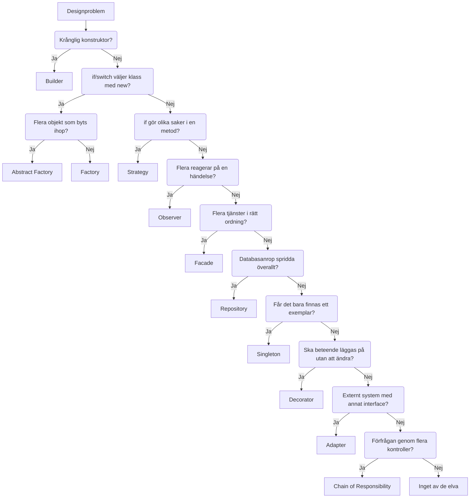

**Obs:** Factory, Abstract Factory och Strategy används ofta tillsammans. Fabriken *skapar* objekten, strategin *utför* uppgiften. Därför frågar schemat om fabrik först: en switch som väljer klass är en fabrik, även om varje klass sedan har sitt eget beteende.

---

## Builder

Passar när skapandet av ett objekt är svårt att läsa, inte när valet av typ är svårt.

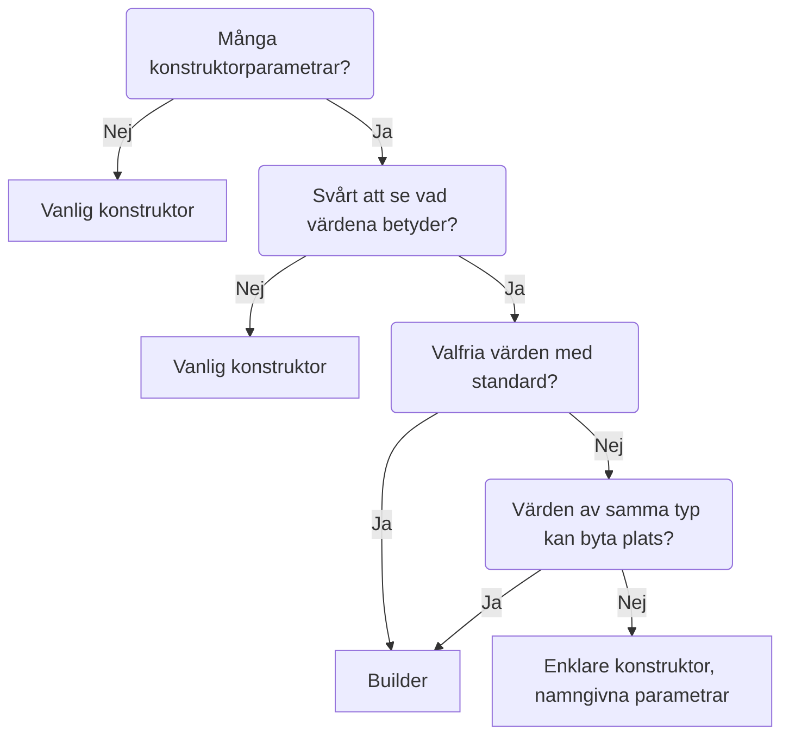

**Varningssignal:** `new Character("Grölf", CharacterKind.Ogre, true, "to mame", "aggghhh", "Club")`. Ingen vet vad `true` betyder.

---

## Factory

Passar när en `if` eller `switch` väljer *vilket* objekt som ska skapas, och samma val upprepas på flera ställen.

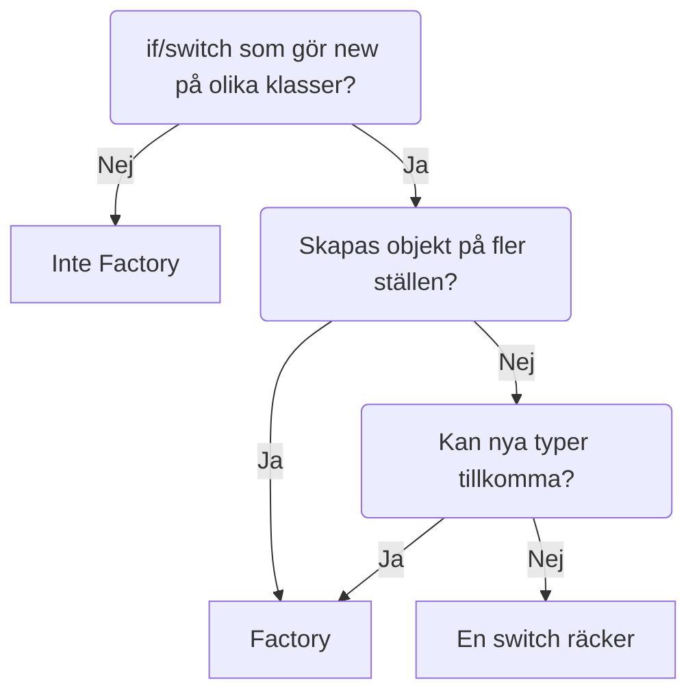

**Varningssignal:** `new Goblin()`, `new Troll()`, `new Dragon()` skrivna på tre olika ställen i programmet. Missar du ett ställe när ett nytt monster läggs till kraschar spelet.

---

## Abstract Factory

Passar när fabriken ska skapa en *familj* av objekt som måste höra ihop. Man byter hela familjen på en gång, inte enskilda objekt.

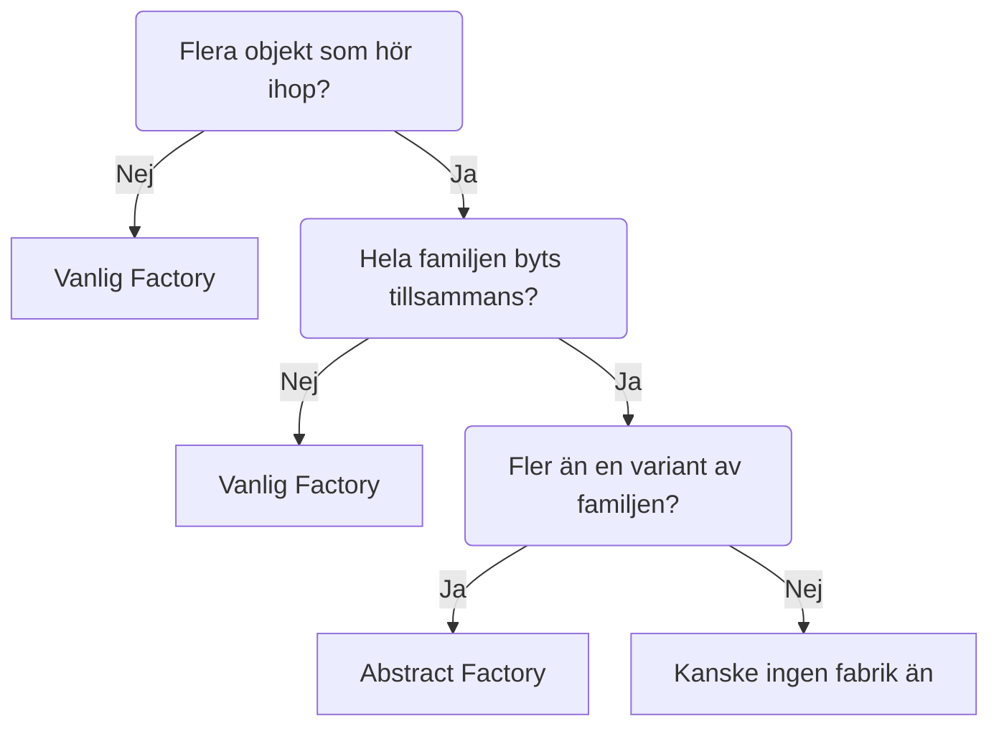

**Varningssignal:** utvecklaren kopierar knappar, formulär och ikoner för mörkt tema, och ingen av klasserna matchar varandra riktigt. Med Abstract Factory byter utvecklaren en rad.

**Skillnad mot Factory:** Factory skapar *ett* objekt av valfri typ. Abstract Factory skapar *flera* objekt som måste passa ihop.

---

## Strategy

Passar när samma uppgift kan göras på flera sätt, och valet ska kunna bytas utan att klassen som använder det ändras.

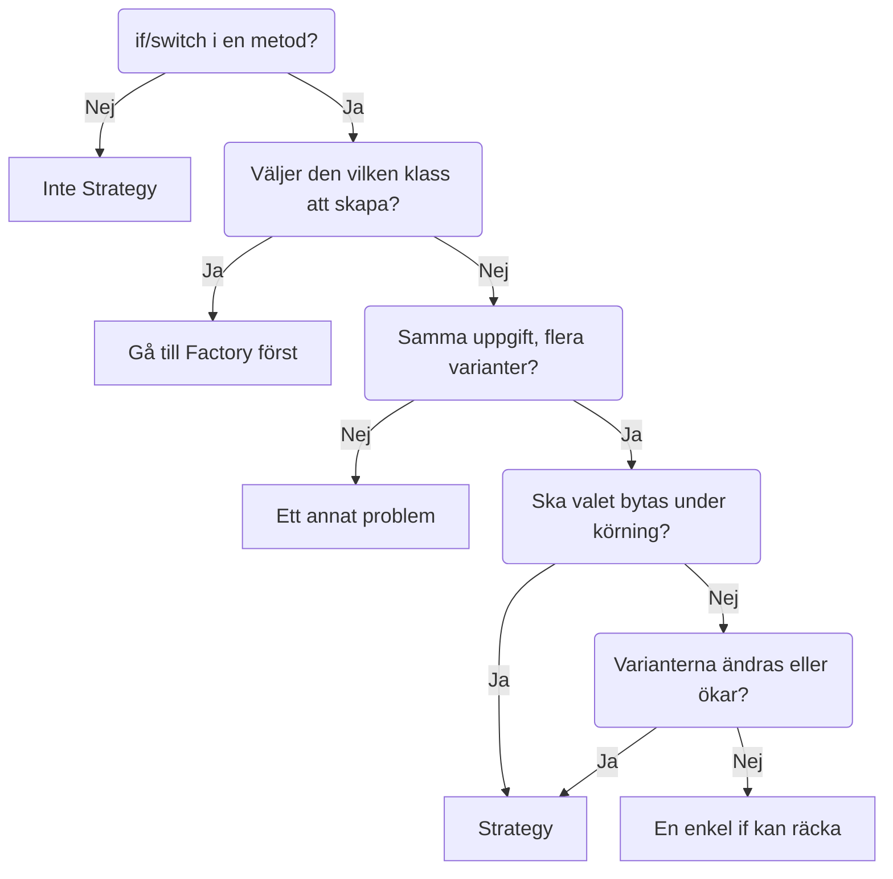

**Varningssignal:** `Attack()` med `if (Weapon == "sword") ... else if (Weapon == "bow") ...`. Varje nytt vapen betyder att `Hero` öppnas igen.

**Vanlig fälla:** att man tittar på hur lika klasserna ser ut. Det avgör inte. Fråga istället: *gör koden ett val, och är valet bytbart?*

---

## Observer

Passar när något händer i ett objekt och flera andra delar ska reagera, utan att objektet känner till dem.

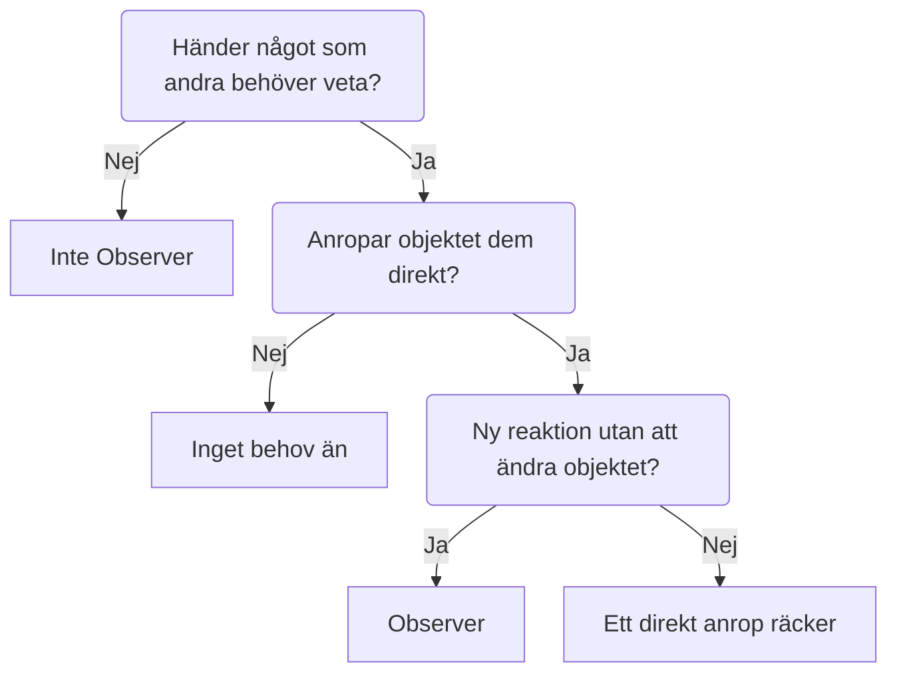

**Varningssignal:** `Hero.TakeDamage()` som anropar `healthBar.Update()`, `soundPlayer.Play()`, `logger.Write()` direkt. Varje ny reaktion kräver att `Hero` ändras.

---

## Facade

Passar när en enda uppgift kräver flera tjänster i rätt ordning, och anroparen inte ska behöva veta det.

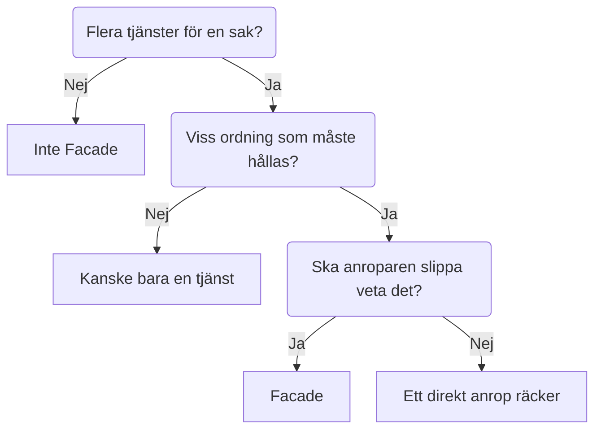

**Varningssignal:** Carlos anropar `LagerService`, sedan `BetalningsService`, sedan `LeveransService`, i rätt ordning. Varje ställe som gör det kan glömma ett steg.

**Skillnad mot Adapter:** Facade *förenklar* ett system. Adapter *översätter* mellan två interface som inte passar ihop.

---

## Repository

Passar när koden pratar direkt med databasen på många ställen, och du vill kunna byta databas eller testa utan den.

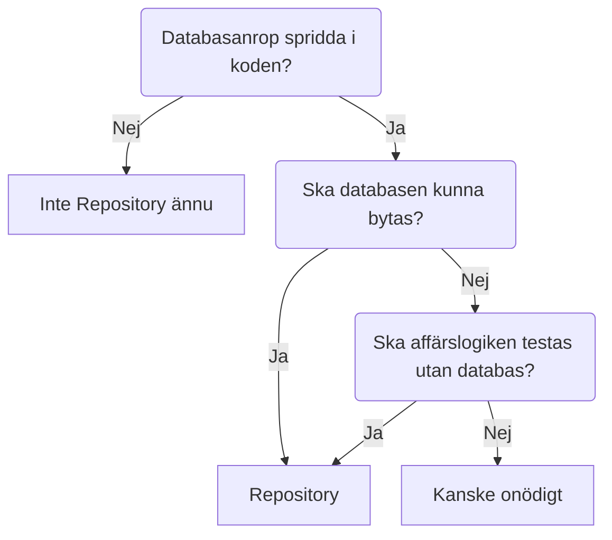

**Varningssignal:** Sofie byter från SQL Server till PostgreSQL och måste ändra i 40 filer, eftersom `DbContext` anropas direkt överallt.

**Repository och CRUD:** ett Repository har oftast metoderna för CRUD (se sektionen nedan).

---

## Singleton

Passar när det ska finnas exakt ett exemplar av något, och alla delar på det.

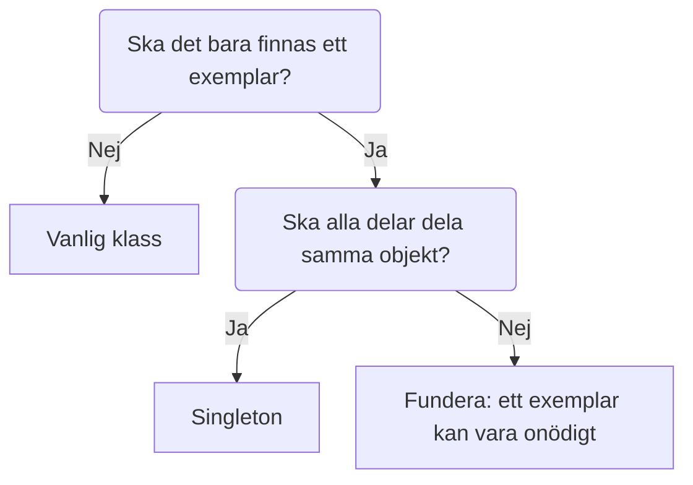

**Varningssignal:** varje order öppnar en ny databasanslutning. Med 500 öppna anslutningar kraschar servern.

**Obs:** Singleton är globalt tillstånd, och det gör koden svårare att testa. I ASP.NET Core registrerar man ofta ett exemplar med `services.AddSingleton<T>()` i stället för att skriva mönstret själv.

---

## Adapter

Passar när din kod och ett externt system pratar olika interface, och du inte kan eller inte ska ändra det externa systemet.

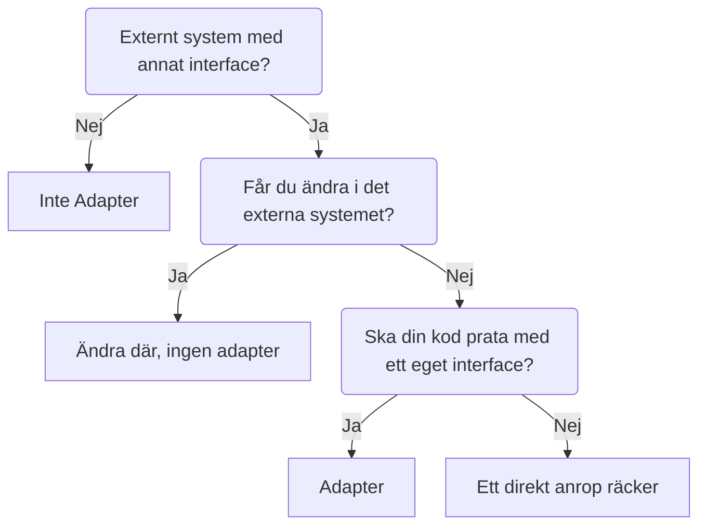

**Varningssignal:** din kod anropar det gamla betalningssystemet med XML och SOAP direkt. Varje gång det byts behöver all kod ändras.

**Skillnad mot Facade:** Adapter *översätter* mellan två interface. Facade *förenklar* ett system.

---

## Decorator

Passar när du vill lägga till beteende till ett objekt utan att ändra dess klass.

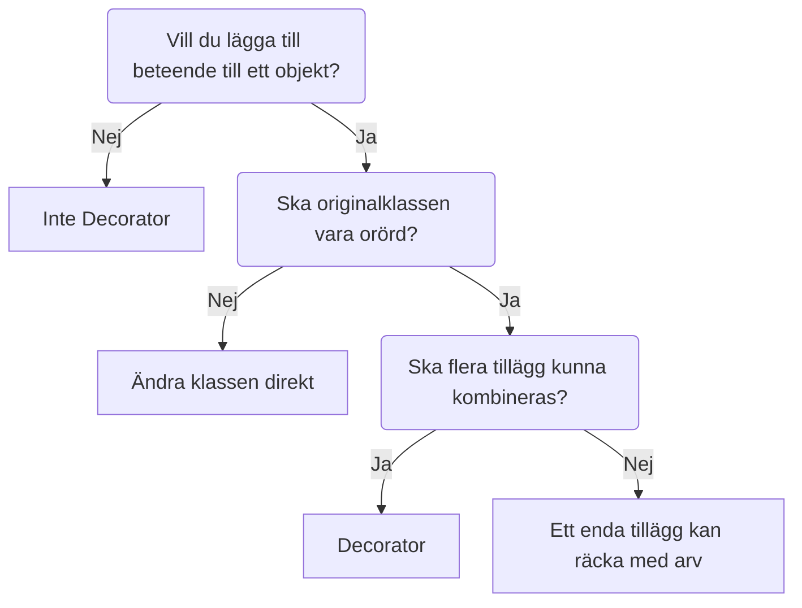

**Varningssignal:** ett `OrderService` som fungerar och har tester, och som nu ska logga varje anrop. Med Decorator omsluter du det i stället för att röra originalet.

**Exempel:** `BufferedStream` i C# omsluter en vanlig `Stream`.

---

## Chain of Responsibility

Passar när en förfrågan ska passera flera kontroller i ordning, och varje steg kan stoppa den eller skicka vidare.

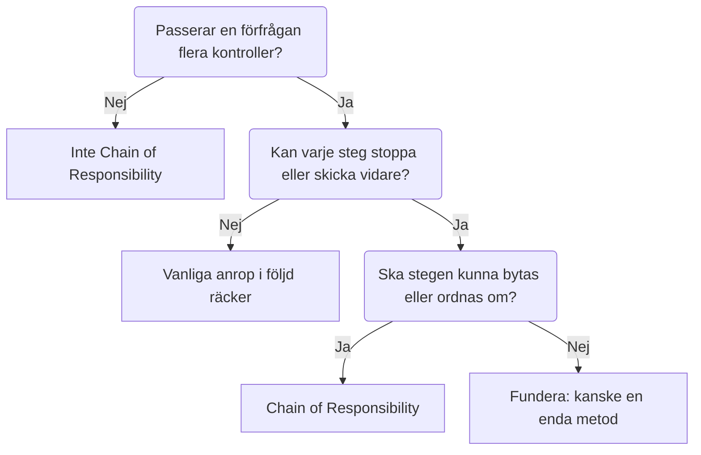

**Varningssignal:** en metod på 200 rader som loggar, kontrollerar inloggning och kontrollerar behörighet, med allt i samma `if`-kedja.

**Exempel:** ASP.NET Core:s middleware-pipeline.

---

## CRUD

**CRUD är inte ett designmönster.** Det är de fyra operationerna man vill kunna göra med data:

| Bokstav | Operation | Typisk metod i ett Repository | SQL |
|---|---|---|---|
| **C** | Create | `Add(entity)` | `INSERT` |
| **R** | Read | `GetById(id)`, `GetAll()` | `SELECT` |
| **U** | Update | `Update(entity)` | `UPDATE` |
| **D** | Delete | `Delete(entity)` | `DELETE` |

Det är en checklista, inte ett val. Frågan du ska ställa är därför inte "är det CRUD?" utan "vilket mönster lägger jag CRUD-metoderna i?". Oftast Repository, om datakällan kan behöva bytas.

---

## Snabbtabell

| Om koden... | Då är det | Fråga |
|---|---|---|
| har en konstruktor med många värden som är svåra att läsa | Builder | Vad betyder det där `false`? |
| har en switch som väljer vilken klass som skapas | Factory | Var skapas objekten? |
| skapar flera objekt som måste bytas tillsammans | Abstract Factory | Hör objekten ihop i en familj? |
| har en metod som gör olika saker beroende på val | Strategy | Kan valet bytas under körning? |
| låter flera delar reagera på en händelse | Observer | Ska nya lyssnare gå att lägga till utan ändring? |
| kräver flera tjänster i rätt ordning för en uppgift | Facade | Ska anroparen slippa veta ordningen? |
| har databasanrop spridda i koden | Repository | Ska databasen kunna bytas? |
| behöver ett objekt som bara får finnas i ett exemplar | Singleton | Ska alla dela samma objekt? |
| har ett externt system med ett annat interface | Adapter | Får du ändra i det externa systemet? |
| vill lägga till beteende utan att ändra klassen | Decorator | Ska originalet vara orört? |
| har en förfrågan som passerar flera kontroller | Chain of Responsibility | Kan varje steg stoppa eller skicka vidare? |
| behöver skapa, läsa, uppdatera och ta bort data | CRUD (inget mönster) | Vilket mönster lägger metoderna i? |
