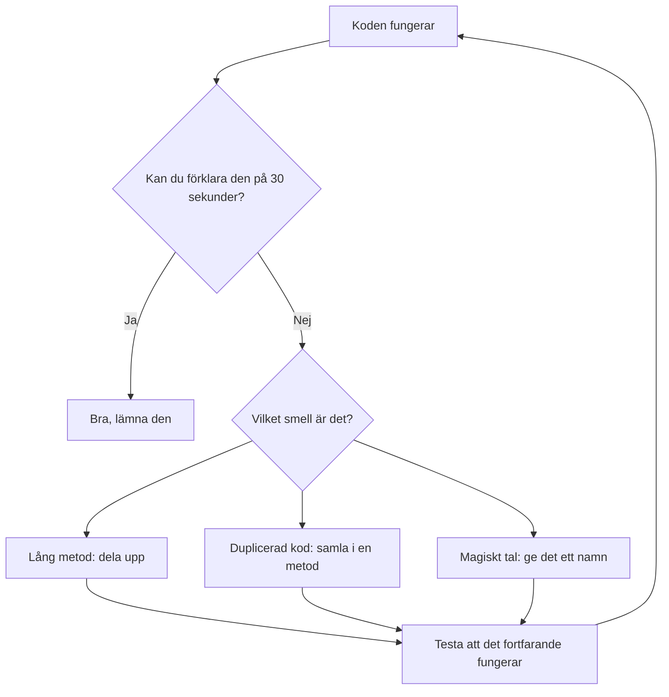

# Code smells

Ett code smell är ett tecken på att koden kan bli bättre. Det betyder inte att koden är trasig. Den fungerar ofta, men den är svår att läsa, ändra och testa.

Tänk på en bil som går bra men låter konstigt. Den kör fortfarande, men något är fel, och ju längre du väntar, desto dyrare blir det.

## Fem vanliga smells

### 1. Lång metod

En metod som gör för mycket. Den blir svår att överblicka och svår att testa.

```csharp
void PrintReceipt(Order order)
{
    decimal sum = 0;
    foreach (var row in order.Rows)
    {
        sum += row.Price * row.Quantity;
    }
    decimal vat = sum * 0.25m;
    Console.WriteLine($"Summa: {sum}");
    Console.WriteLine($"Moms: {vat}");
    Console.WriteLine($"Att betala: {sum + vat}");
}
```

Metoden gör tre saker: räknar summan, räknar momsen och skriver ut. Det är tre jobb i en metod.

### 2. Duplicerad kod

Samma kod på två ställen. När du ändrar det ena glöms det andra.

```csharp
if (customer.Age >= 18 && customer.HasId)
    Console.WriteLine("Välkommen in.");

// ... längre ner i samma program ...
if (customer.Age >= 18 && customer.HasId)
    Console.WriteLine("Välkommen in.");
```

### 3. Magiska tal

Ett tal utan förklaring. Ingen vet vad 0.25 betyder om du inte vet att det är momssatsen.

```csharp
decimal vat = sum * 0.25m;   // Varför 0.25?
```

Ge talet ett namn:

```csharp
const decimal VatRate = 0.25m;
decimal vat = sum * VatRate;
```

### 4. Stor klass

En klass som vet för mycket. Den har många fält och många metoder som inte hör ihop.

### 5. Lång parameterlista

```csharp
void CreateCustomer(string firstName, string lastName, int age, string street, string zipCode, string city, string phone)
```

Sju parametrar är svårt att hålla reda på. Samla det som hör ihop i ett objekt.

## Hur du hittar dem

- **Läs koden högt.** Om du behöver ta en paus för att förstå en metod är det ett tecken.
- **Leta efter kommentarer.** En kommentar som förklarar *vad* koden gör är ofta ett tecken på att koden borde ha ett bättre namn.
- **Leta efter upprepning.** Om du klistrar in samma kod två gånger har du ett smell.

## Så här ser det ut i flöde



## Varför det spelar roll

Koden kommer att ändras. Den som ändrar den är ofta du själv, om sex månader. Ett smell kostar tid varje gång någon läser koden. Det är därför vi städar, även när det fungerar.

## Nästa steg

Nästa lektion lär vi oss två säkra sätt att fixa smells: **Extract Method** och **Rename**. Då blir det konkret.
