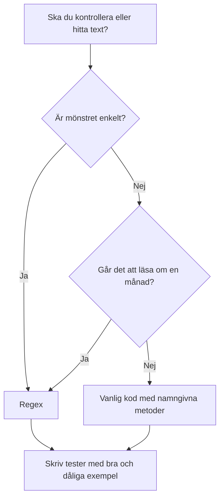

# Regex: mönster i text

Ett regulärt uttryck, regex, är ett kort mönster som beskriver en typ av text. Med ett mönster kan du kontrollera, hitta och ersätta text på ett sätt som annars kräver många rader kod.

Tänk dig att du ska kontrollera om en text ser ut som ett svenskt postnummer: fem siffror, eventuellt med ett mellanslag efter de tre första. Det går att skriva ut i tio rader kod. Med regex blir det en rad.

## Ett första exempel

```csharp
using System.Text.RegularExpressions;

string zip = "413 04";
bool isValid = Regex.IsMatch(zip, @"^\d{3} ?\d{2}$");
Console.WriteLine(isValid);  // True
```

Läs mönstret från vänster till höger:

| Del | Betyder |
|-----|---------|
| `^` | Början av texten |
| `\d{3}` | Exakt tre siffror |
| ` ?` | Ett eventuellt mellanslag |
| `\d{2}` | Exakt två siffror |
| `$` | Slutet av texten |

`@"..."` används för att C# inte ska tolka backslash. Skriv alltid mönstret med `@`.

## De vanligaste delarna

| Mönster | Betyder |
|---------|---------|
| `.` | Vilket tecken som helst (utom radbrytning) |
| `\d` | En siffra |
| `\w` | En bokstav, siffra eller understreck |
| `\s` | Ett mellanslag eller en radbrytning |
| `[abc]` | Ett av tecknen a, b eller c |
| `[a-z]` | En liten bokstav från a till z |
| `*` | Noll eller fler |
| `+` | En eller fler |
| `?` | Noll eller en |
| `{3}` | Exakt tre gånger |
| `{2,4}` | Mellan två och fyra gånger |
| `^` och `$` | Början och slutet av texten |
| `( )` | En grupp, som du kan hämta ut |

## Hitta och hämta ut text

```csharp
string text = "Lektion 2026-11-18, sal B12";
Match match = Regex.Match(text, @"(\d{4})-(\d{2})-(\d{2})");

if (match.Success)
{
    string year = match.Groups[1].Value;   // 2026
    string month = match.Groups[2].Value;  // 11
    string day = match.Groups[3].Value;    // 18
    Console.WriteLine($"År: {year}, månad: {month}, dag: {day}");
}
```

Varje parentes blir en grupp. Grupp 0 är hela träffen.

## Ersätta text

```csharp
string masked = Regex.Replace("Kortnummer 1234-5678", @"\d{4}-", "****-");
// "Kortnummer ****-5678"
```

Ersättning är ofta det som gör regex användbart i praktiken. Till exempel när du vill dölja personnummer i en loggfil.

## Vanliga misstag

- **Glömma `^` och `$`.** Utan dem hittar mönstret en träff *någonstans* i texten, även om resten är skräp. `Regex.IsMatch("abc413 04xyz", @"\d{3} ?\d{2}")` blir `true`.
- **Glömma `@`.** `"\d"` är ogiltigt i C#, och `@"\d"` är rätt.
- **Försöka skriva ett komplett e-postmönster själv.** Det är extremt svårt. Använd `System.Net.Mail.MailAddress` och fånga undantaget i stället, eller acceptera att mönstret är enkelt och ärligt om sina gränser.
- **Använda regex för allt.** Om koden blir svårare att läsa än den vanliga lösningen är det fel verktyg.

## Ett wow-moment: samma sak, två sätt

Ett mönster på några tecken kan ersätta en lång loop med villkor. Titta på två sätt att kontrollera om en text bara innehåller siffror och bindestreck:

```csharp
// Utan regex: en loop med villkor
bool IsValidManual(string text)
{
    if (text.Length == 0) return false;
    foreach (char c in text)
    {
        if (!char.IsDigit(c) && c != '-')
            return false;
    }
    return true;
}

// Med regex: ett mönster
bool IsValidRegex(string text) => Regex.IsMatch(text, @"^[\d-]+$");
```

Båda gör samma sak. Testa dem med samma indata, och se att de ger samma svar. Det är det som räknas: lösningen ska vara lätt att läsa, och den ska fungera.

## Så tänker du när du ska använda regex



## Nästa steg

Gå tillbaka till kodgranskningen. Leta efter `Regex` i koden du granskar, och fråga dig: är mönstret rätt, och förklarar namnet vad det gör?
