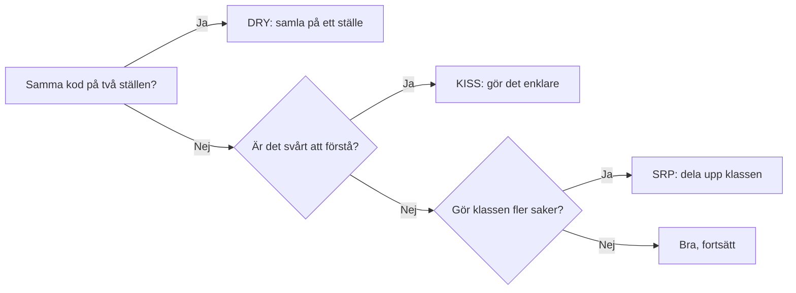
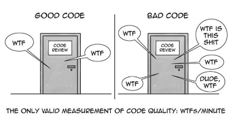

# SOLID, DRY och KISS

Tre principer som hjälper dig skriva kod som är lätt att läsa och ändra. De är inte regler att följa blint. De är verktyg, och ibland går de emot varandra.

## DRY: Don't Repeat Yourself

Varje kunskap ska finnas på ett ställe. Om samma regel finns på två ställen, glöms den ena när den andra ändras.

```csharp
// Dåligt: samma momsregel på två ställen
decimal receiptVat = receiptSum * 0.25m;
decimal invoiceVat = invoiceSum * 0.25m;
```

```csharp
// Bättre: regeln finns på ett ställe
const decimal VatRate = 0.25m;

decimal CalculateVat(decimal sum)
{
    return sum * VatRate;
}
```

Nu ändrar du momssatsen på ett ställe, och både kvitton och fakturor följer med.

## KISS: Keep It Simple, Stupid

Den enklaste lösningen som fungerar är oftast den bästa. Det är lätt att bygga något smart som ingen förstår.

```csharp
// Onödigt komplicerat
bool isAdult = customer.Age >= 18 ? true : false;

// Enklare
bool isAdult = customer.Age >= 18;
```

Frågan att ställa sig är: kan en ny kollega förstå det här på en minut?

## SOLID

Fem principer för objektorienterad design. Här tar vi den som är lättast att se i praktiken: **Single Responsibility Principle (SRP)**.

En klass ska ha ett enda skäl att ändras.

```csharp
// Dåligt: en klass som både räknar och skriver ut
class Receipt
{
    public decimal Sum { get; set; }

    public decimal CalculateVat() => Sum * 0.25m;

    public void Print()
    {
        Console.WriteLine($"Summa: {Sum}");
        Console.WriteLine($"Moms: {CalculateVat()}");
    }

    public void SaveToFile(string path)
    {
        File.WriteAllText(path, $"Summa: {Sum}");
    }
}
```

Klassen ändras av tre olika skäl: om momsen ändras, om utskriften ändras och om filformatet ändras. Dela upp den:

```csharp
class Receipt
{
    public decimal Sum { get; set; }
    public decimal Vat { get; set; }
}

class ReceiptPrinter
{
    public void Print(Receipt receipt)
    {
        Console.WriteLine($"Summa: {receipt.Sum}");
        Console.WriteLine($"Moms: {receipt.Vat}");
    }
}
```

Varje klass har nu ett jobb. Om utskriften ändras, rör du bara `ReceiptPrinter`.

## Så här hänger det ihop



## SoC: Separation of Concerns

SRP handlar om en klass. SoC handlar om hela programmet: att skilja på *ansvarsområden*, till exempel användargränssnitt, affärslogik och datalagring.

```text
Användargränssnitt  →  visar kvitton, tar emot knapptryck
Affärslogik         →  räknar moms och summor
Datalagring         →  sparar kvitton i en fil eller databas
```

Om de tre lagren blandas blir ett ändrat gränssnitt farligt för affärslogiken. Håll dem isär, så kan du byta ut ett lager utan att röra de andra.

## YAGNI: You Aren't Gonna Need It

Bygg inte något för att det *kanske* behövs i framtiden. Du vet inte vad som händer, och oftast blir det inte som du tänkt.

```csharp
// Onödigt: ett system för valutor, när programmet bara använder kronor
interface ICurrencyConverter { decimal Convert(decimal amount, string to); }
```

Om kraven ändras, bygg då. Det är billigare än att underhålla kod som aldrig används.

## MVP: gör inte mer än nödvändigt

MVP står för *Minimum Viable Product*: den minsta version som fungerar och gör nytta. Börja där. Lägg till funktioner när någon faktiskt behöver dem.

Det är samma tanke som YAGNI, men på produktnivå.

## Kill your darlings

Ta bort kod du är stolt över, om den inte behövs. Det är svårt, men det är ofta det bästa du kan göra vid refaktorering. Koden du inte skrev är lättare att ta bort än den du lade ner en halv dag på.

Ta bort det, och titta på resultatet. Fungerar programmet fortfarande? Då var koden onödig.

## KISS, med en förklaring från läraren

Brukar jag skämtsamt säga: **Keep It Simple, Students** 😉. Det är samma princip, bara riktad till er. Lösningen ska vara så enkel att den som läser den efter dig förstår den på en gång, och det gäller även dig om en månad.

## WTF per minut

Ett enkelt test under kodgranskning: hur många gånger per minut tänker du "vad gör den här?" Om svaret är ofta, är koden ett smell.



## Principerna går emot varandra ibland

Ibland blir koden längre när du följer DRY och SRP. Det är okej, om den blir lättare att ändra. Om du delar upp allt i tio klasser för en enkel uppgift har du gått för långt. Det är KISS som säger stopp.

Fråga dig: **vilket problem löser det här?** Om svaret är "inget konkret", ta bort det.
