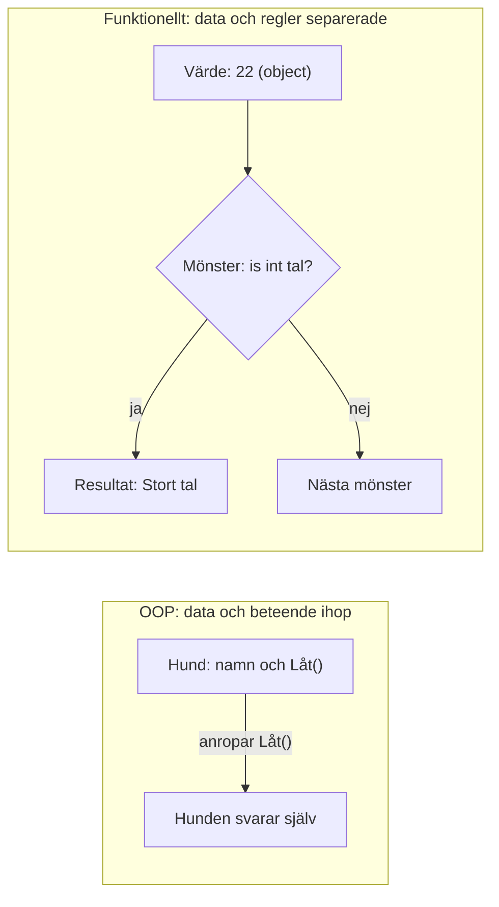

# Pattern matching: från typkontroll till switch-uttryck

I den här kursen har vi jobbat mest med OOP. Pattern matching är ett inslag av funktionellt tänkande i C#, och det tänker lite annorlunda. Här är de två sätten att tänka, så att du ser skillnaden.

**OOP-tänkande:** Data och beteende ligger ihop i ett objekt. Ett `Hund` vet själv hur den låter, och när vi har olika djur anropar vi `Låt()` och varje klass svarar på sitt sätt. Beslutet "vad ska hända" ligger i klassen.

**Funktionellt tänkande:** Data och funktioner är separerade. Vi har ett värde, till exempel ett `object`, och en funktion eller ett uttryck som tittar på värdets form och ger ett svar. Beslutet "vad ska hända" ligger i mönstret, och resultatet är ett värde, inte en serie steg som ändrar något.

I koden nedan ser du båda sidor. Typkontrollerna och `if`-satserna är fortfarande imperativa. Switch-uttrycket i slutet är ett rent funktionellt uttryck: det tar ett värde och ger ett annat värde tillbaka.



## Övningen

Fyll i de tre ställena där det står `/* din kod */`. Programmet får inte krascha, vad användaren än skriver.

```csharp
object value = 22;
/* din kod: om value är en int, skriv ut "value är en int: 22" */

Console.Write("Skriv ett tal: ");
string input = Console.ReadLine() ?? "0";
/* din kod: gör om input till ett tal.
   Går det, skriv "Du skrev talet 42". Går det inte, skriv "Felaktigt värde". */

int age = 19;
string category = /* din kod: under 13 "barn", under 20 "tonåring",
                     under 30 "ung vuxen", annars "vuxen" */;
Console.WriteLine(category);
```

Exempeloutput när användaren skriver `42`:

```text
value är en int: 22
Skriv ett tal: 42
Du skrev talet 42
tonåring
```

Exempeloutput när användaren skriver `abc`:

```text
value är en int: 22
Skriv ett tal: abc
Felaktigt värde
tonåring
```

<details markdown="1">
<summary>Tips 1: kontrollera typen och få värdet i samma steg</summary>

`value is int` svarar bara ja eller nej. Skriv ett namn efter typen, `value is int tal`, så får du värdet i variabeln `tal` inne i `if`-blocket.

</details>

<details markdown="1">
<summary>Tips 2: text till tal utan krasch</summary>

`int.Parse` kraschar om texten inte är ett tal. `int.TryParse(input, out int tal)` returnerar i stället `true` eller `false`, och lägger talet i `tal` när det går.

</details>

<details markdown="1">
<summary>Tips 3: switch-uttrycket</summary>

Skriv `age switch { ... }`. Varje rad är ett mönster, en pil och ett värde, till exempel `< 13 => "barn",`. Raderna prövas uppifrån och ned, och den första som stämmer vinner.

</details>

<details markdown="1">
<summary>Tips 4: allt annat</summary>

Sista raden i switch-uttrycket ska fånga allt som inte har matchat. Det gör `_ => "vuxen"`. Utan den varnar kompilatorn för att alla fall inte är täckta.

</details>

## Genomgång från lektionen

Läs vidare när du har försökt själv. Här är lösningen vi skrev tillsammans.

Vi börjar med ett objekt som innehåller ett tal, men som är deklarerat som `object`. Då måste vi kontrollera typen innan vi använder värdet.

```csharp
object value = 22;

if (value.GetType() == typeof(int)) // the old way
{

}
```

`GetType()` berättar vilken typ det faktiska värdet har. `typeof(int)` ger typen `int`. Jämförelsen med `==` fungerar, men vi har bara kontrollerat typen. Vi har inte fått ut värdet, och blocket är tomt.

Varför använder vi `object` och inte `int` direkt? Eftersom `object` är basen för allt i C# kan variabeln hålla vilket värde som helst. Det är viktigt när data kommer utifrån, från en databas, ett API eller en fil. Där vet vi inte i förväg vilken typ värdet har, så vi måste kontrollera det och omvandla det innan vi använder det.

Nästa steg är `is`. Det kontrollerar typen, och vi måste göra en cast för att få värdet:

```csharp
if (value is int)
{
    int age_ = (int)value;
    Console.WriteLine("Age " + age_);
}
```

Här är det två steg: först kontrollen med `is`, sedan casten `(int)value`. Det går, men det blir lite kod för något som är ett enda tanke.

Med pattern matching kan vi göra både kontrollen och variabeln i samma rad:

```csharp
// Så gör man för att slippe överflödig kod
if (value is int tal) // om value är en int, ska den spara värdet i int tal;
{
    Console.WriteLine($"value är en int: {tal}");
}
```

`value is int tal` säger två saker: "är value en int?" och "om ja, lägg värdet i `tal`". Inne i blocket kan vi använda `tal` direkt, utan cast.

Det korta formatet är en förkortning av det långa:

```csharp
// Lång version: två steg
if (value is int)
{
    int tal = (int)value;
    Console.WriteLine($"value är en int: {tal}");
}

// Kort version: ett steg
if (value is int tal)
{
    Console.WriteLine($"value är en int: {tal}");
}
```

`int tal` i mönstret kallas ett **deklarationsmönster**. Det gör två saker samtidigt: det kontrollerar att typen är `int`, och det deklarerar variabeln `tal` med värdet om kontrollen lyckas. Därför skriver vi typen bara en gång.

Det finns också `as`, som gör en konvertering utan att kasta ett undantag. Om typen inte stämmer blir resultatet `null` i stället:

```csharp
object value = "hej";

string? text = value as string;  // "hej"
int? tal = value as int?;        // null, eftersom value inte är ett int
```

Cast `(int)value` kraschar med `InvalidCastException` om typen inte stämmer. `as` fungerar bara för referenstyper och nullbara värdetyper, som `int?`.

Nu till indata från användaren. Här kan saker gå fel:

```csharp
// Vad kan gå fel?
string input = Console.ReadLine()??"0"; // om man skriver annat än nummer
//int num = int.Parse(input);        // Så kraschar denna

if (!int.TryParse(input, out int inputValue))
{
    Console.WriteLine("Felaktigt värde");
}
Console.WriteLine(inputValue);
```

`int.Parse` kraschar om texten inte är ett tal, och det är därför den är utkommenterad. `int.TryParse` returnerar i stället `false` och skriver ut ett felmeddelande. `??"0"` betyder att om `ReadLine()` returnerar `null`, används `"0"` i stället.

Samma sak kan skrivas med det positiva fallet först. Då behöver vi inte tänka på `!`:

```csharp
if (int.TryParse(input, out int inputValue))
{
    Console.WriteLine(inputValue);
}
else
{
    Console.WriteLine("Felaktigt värde");
}
```

Skillnaden är att `inputValue` bara skrivs ut när omvandlingen lyckas. I koden ovan skrivs `0` ut även när texten är fel, eftersom `out`-variabeln alltid får ett värde.

Sist ett switch-uttryck. Det väljer ett svar utifrån åldern:

```csharp
int age = 19;

string Category = age switch
{
    < 13 => "barn",
    < 20 => "tonåring",
    < 30 => "ung vuxen",
    _ => "vuxen",
};
```

Mönstren läses uppifrån och ned, och den första träffen vinner. Med `age = 19` matchar `< 20`, så resultatet blir `"tonåring"`. `_` fångar allt annat.

## Varför har vi nytta av detta?

Vi får en kontroll och ett värde i samma steg, så koden blir kortare och svårare att göra fel i. Med ett switch-uttryck måste vi också tänka på alla fall, och `_` gör det tydligt vad som händer med allt annat.

## När kan vi använda detta?

Det här används när ett värde kommer utifrån och vi inte vet typen i förväg, och när svaret beror på värdets form, till exempel en ålder i olika intervall. Vill vi ha `null` om värdet inte passar, använder vi `as` i stället för cast.

## Hela koden

```csharp
Console.WriteLine("Hello, World!");

object value = 22;

if (value.GetType() == typeof(int)) // the old way
{

}

if (value is int)
{
    int age_ = (int)value;
    Console.WriteLine("Age " + age_);
}

// Så gör man för att slippe överflödig kod
if (value is int tal) // om value är en int, ska den spara värdet i int tal;
{
    Console.WriteLine($"value är en int: {tal}");
}

// Vad kan gå fel?
string input = Console.ReadLine()??"0"; // om man skriver annat än nummer
//int num = int.Parse(input);        // Så kraschar denna

if (!int.TryParse(input, out int inputValue))
{
    Console.WriteLine("Felaktigt värde");
}
Console.WriteLine(inputValue);

int age = 19;

string Category = age switch
{
    < 13 => "barn",
    < 20 => "tonåring",
    < 30 => "ung vuxen",
    _ => "vuxen",
};
```

# Summan av kardemumman

- **`object`** kan hålla vilket värde som helst. Det används när data kommer utifrån, från en databas, ett API eller en fil.
- **Kontrollera innan du använder.** Typen kan vara fel, och värdet kan vara `null`.
- **`is`** kontrollerar typen. **`is int tal`** kontrollerar och deklarerar variabeln i samma steg.
- **`as`** konverterar utan att kasta ett undantag. Vid fel blir resultatet `null`.
- **Cast** `(int)value` kraschar vid fel, så använd den bara när du är säker på typen.
- **`int.TryParse`** är oftast rätt verktyg för text från användaren, eftersom den inte kraschar.
- **Switch-uttrycket** tar ett värde och ger ett annat tillbaka. Mönstren läses uppifrån och ned, och den första träffen vinner.
- **Tankesättet:** OOP lägger beteendet i objektet. Funktionellt tänkande låter mönstret avgöra, och resultatet är ett värde.

<!-- nion-copyright -->
<sub>© 2025–2026 Nion Education. Alla rättigheter förbehållna. Fritt att läsa, men får inte användas av andra skolor eller utbildningsanordnare utan skriftligt tillstånd från Nion Education. Delar bygger på källor som anges i respektive dokument.</sub>
