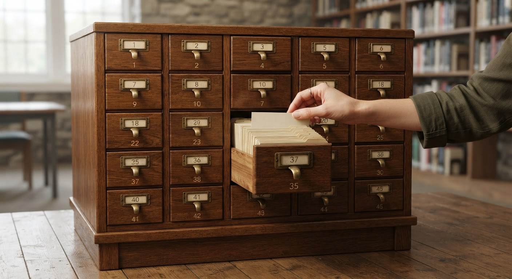

<!-- NOTIS (Marcus): ta upp Dictionary och StringComparer (t.ex. StringComparer.OrdinalIgnoreCase) med klassen. De ska kunna Dictionary. Inte med i det här bildspelet eftersom nivån är arrayer och if. Se todo i NocoDB. -->

<!-- WOW-MOMENT: kontrollen sitter i klassen, inte hos den som anropar -->

# Indexers

**Vecka 48 · Hellweek · Hidden gems**

---

## Anders bokhylla


Anders har en liten bokhylla i kiosken, och en klass `Shelf` med fem platser. Han vill skriva `shelf[0]`, precis som med en array. Men han får skriva `shelf.GetBook(0)`. Varför får arrayer vara coola och inte hans klass?

**Vad behöver klassen kunna för att `shelf[0]` ska fungera?** Fundera lite på det...

---

## Ett kartotek



En indexer är registret till din klass. Du slår upp med en nyckel i `[ ]`, och klassen bestämmer vad som händer bakom lådan.

---

## Använd objektet som en array

```csharp
class Shelf
{
    private readonly string[] books = new string[5];

    public string this[int index]
    {
        get => books[index];
        set => books[index] = value;
    }
}

var shelf = new Shelf();
shelf[0] = "Clean Code";
Console.WriteLine(shelf[0]);
```

---

## Varför?

Koden som använder klassen blir lika kort som om det vore en lista. Men klassen bestämmer själv vad som händer.

---

## Wow: kontrollen i get

```csharp
get
{
    if (index < 0 || index >= books.Length)
        return "Ingen hylla här";
    return books[index];
}
```

`books.Length` är 5. Platserna är 0 till 4. Allt annat stoppas innan det kraschar.

---

## Wow: kontrollen i set

```csharp
set
{
    if (index < 0 || index >= books.Length)
        Console.WriteLine("Ingen plats med det numret");
    else
        books[index] = value;
}
```

Samma kontroll, men när någon försöker lägga in en bok.

---

## Wow: prova att krascha hyllan

```csharp
var shelf = new Shelf();
shelf[0] = "Clean Code";
shelf[7] = "Pragmatic Programmer";   // utanför hyllan

Console.WriteLine(shelf[0]);         // Clean Code
Console.WriteLine(shelf[7]);         // Ingen hylla här
```

Utan `if` hade `shelf[7]` kraschat programmet. Nu sitter kontrollen i klassen, så ingen kan krascha den, oavsett var i programmet de försöker.

---

## Summan av kardemumman

- En indexer är `this[...]` i en klass.
- Den gör ett objekt indexerbart, precis som en array.
- Lägg kontroller i klassen, inte i anroparen.

---

## Proffsens tips: sista platsen är Length - 1

En bokhylla med fem hyllplan. De heter 0, 1, 2, 3 och 4. Det finns inget hyllplan 5, fast hyllan har fem platser.

```csharp
books[books.Length - 1]   // sista platsen
books[books.Length]       // IndexOutOfRangeException
```

`Length` är **antalet** platser, inte numret på den sista. Och kladdkakan igen: fråga först om platsen finns, använd den sen.
