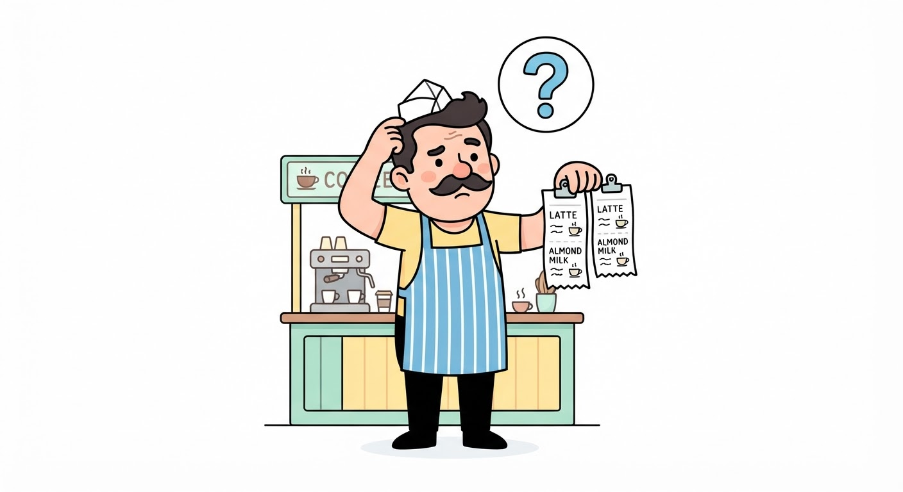

<!-- WOW-MOMENT: samma klass, två sätt att jämföra -->

# Records

**Vecka 48 · Hellweek · Hidden gems**

---

## Samma beställning, två gånger?



Två kunder ropar `Latte, 35 kr`. Anders jämför beställningarna i koden och får `false`, fast de är identiska. Och när han ska ge en av dem rabatt vill han inte ändra originalet.

**Vad behöver Anders kunna göra?** Fundera lite på det...

---

## Två identiska kontrakt


Två dokument med samma innehåll är lika. En `record` tycker likadant: den jämför innehållet, inte vilket exemplar det är.

---

## En rad, en klass

```csharp
public record Customer(string Name, int Age);

var a = new Customer("Ada", 36);
var b = new Customer("Ada", 36);
Console.WriteLine(a == b);          // True
```

Två objekt är lika om deras värden är lika, inte om de är samma objekt i minnet.

---

## Records är skrivskyddade

```csharp
var a = new Customer("Ada", 36);
a.Age = 40;   // går inte
```

```
error CS8852: Init-only property or indexer 'Customer.Age' can only be assigned in an object initializer, ...
```

Värdena sätts när objektet skapas. Sedan är de låsta. Vill du ha en ändrad version gör du en kopia, och det gör `with` på nästa bild.

---

## Oföränderlig kopia med with

```csharp
var older = a with { Age = 37 };
Console.WriteLine(a.Age);           // 36. a är oförändrad.
Console.WriteLine(older.Age);       // ger 37
```

---

## Wow: samma värden, olika svar

```csharp
class OrderClass
{
    public string Name { get; set; } = "";
    public decimal Price { get; set; }
}

record OrderRecord(string Name, decimal Price);
```

Två typer med samma innehåll. Den ena är en `class`, den andra en `record`.

---

## Wow: jämför dem

```csharp
var c1 = new OrderClass { Name = "Latte", Price = 35 };
var c2 = new OrderClass { Name = "Latte", Price = 35 };
Console.WriteLine(c1 == c2);   // False

var r1 = new OrderRecord("Latte", 35);
var r2 = new OrderRecord("Latte", 35);
Console.WriteLine(r1 == r2);   // True
```

En `class` jämför om det är **samma objekt**. En `record` jämför **innehållet**.

---

## Wow: Anders ger rabatt

```csharp
var order = new OrderRecord("Latte", 35);
var rabatt = order with { Price = 30 };

Console.WriteLine(order.Price);    // 35, originalet är oförändrat
Console.WriteLine(rabatt.Price);   // 30
```

`with` gör en kopia där bara det du nämner ändras.

---

## Summan av kardemumman

- En `record` är en klass för data.
- Värdena är skrivskyddade när objektet är skapat.
- Den jämförs på innehåll.
- `with` gör en ändrad kopia.

---

## Proffsens tips: ändra aldrig originalet

Du suddar inte på originalkvittot. Du skriver ut ett nytt. Det är det `with` gör åt dig.

Använd en `record` för data som inte ska ändras: en beställning, ett kvitto, ett svar från ett API. Behöver du en ändrad version, gör en kopia med `with`.
