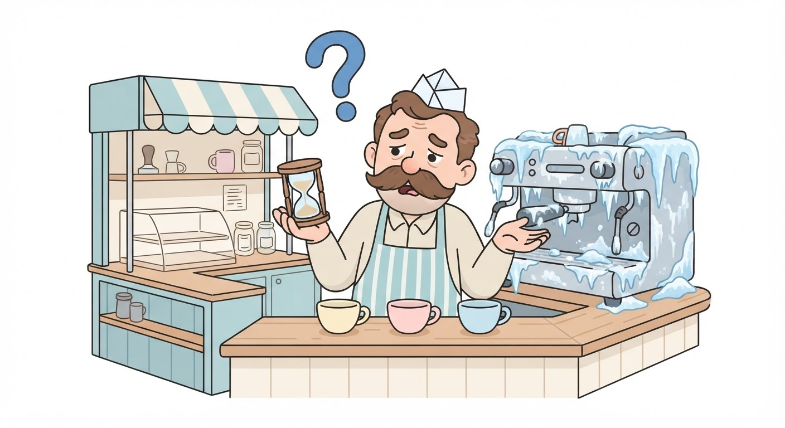

<!-- WOW-MOMENT: tre sekunder blir en -->

# async och await

**Vecka 48 · Hellweek · Hidden gems**

---

## Kön vid kaffemaskinen



Anders hämtar dagens brödleverans, vädret och kassasystemet. Varje anrop tar en sekund. Appen står stilla i tre sekunder och kunderna står i kö.

**Måste han vänta på dem en i taget?** Fundera lite på det...

---

## Många pannor, en kock


Kocken står inte och stirrar på en panna. Han sätter på alla, och tar upp dem när de är klara. Det är `await`.

---

## Vänta utan att blockera

```csharp
async Task<string> FetchGreetingAsync()
{
    await Task.Delay(1000);       // Väntar en sekund utan att frysa tråden
    return "hej";
}

var greeting = await FetchGreetingAsync();
Console.WriteLine(greeting);
```

---

## Vänta med await

```csharp
var greeting = await FetchGreetingAsync();
```

`await` väntar utan att blockera tråden.

---

## Wow: en i taget

```csharp
using System.Diagnostics;

var sw = Stopwatch.StartNew();
await Task.Delay(1000);
await Task.Delay(1000);
await Task.Delay(1000);
Console.WriteLine($"En i taget: {sw.Elapsed.TotalSeconds:F0} s");   // 3 s
```

Tre väntetider efter varandra. `Stopwatch` mäter hur lång tid det tar.

---

## Wow: alla samtidigt

```csharp
sw.Restart();
await Task.WhenAll(Task.Delay(1000), Task.Delay(1000), Task.Delay(1000));
Console.WriteLine($"Alla samtidigt: {sw.Elapsed.TotalSeconds:F0} s");   // 1 s
```

Samma tre väntetider, men de väntar samtidigt. Tre sekunder blir en.

---

## Wow: tre stekpannor

```csharp
sw.Restart();
var pans = new List<(string name, Task task)>
{
    ("Baconet", Task.Delay(3000)),     // tar 3 sekunder
    ("Pannkakan", Task.Delay(1000)),   // tar 1 sekund
    ("Ägget", Task.Delay(2000))        // tar 2 sekunder
};

var done = new List<string>();
```

Tre pannor med olika tider, och de börjar steka direkt. Den som är klar först står sist i listan.

---

## Wow: vem är klar?

```csharp
while (done.Count < pans.Count)
{
    foreach (var (name, task) in pans)
    {
        if (task.IsCompleted && !done.Contains(name))
        {
            done.Add(name);
            Console.WriteLine($"Klart: {name} ({sw.Elapsed.TotalSeconds:F0} s)");
        }
    }
    // Här kan programmet göra något annat medan pannorna steker
    await Task.Delay(100);
}
```

```
Klart: Pannkakan (1 s)    Klart: Ägget (2 s)    Klart: Baconet (3 s)
```

Programmet stirrar inte på en panna. Totalt 3 sekunder, inte 6.

---

## Summan av kardemumman

- `async` och `await` väntar utan att blockera.
- Använd `await` när du väntar på en `Task`.
- `Task.WhenAll` väntar på flera samtidigt.
- Medan du väntar kan programmet göra något annat.

---

## Proffsens tips: starta först, vänta sen

Sätt på alla plattor först. Vänta sedan på att maten blir klar.

```csharp
var bread = FetchAsync("bröd");       // starta, vänta inte än
var weather = FetchAsync("väder");
var till = FetchAsync("kassa");

await Task.WhenAll(bread, weather, till);   // nu väntar vi, alla samtidigt
```

Skriver du `await` på varje rad direkt blir det en i taget igen.
